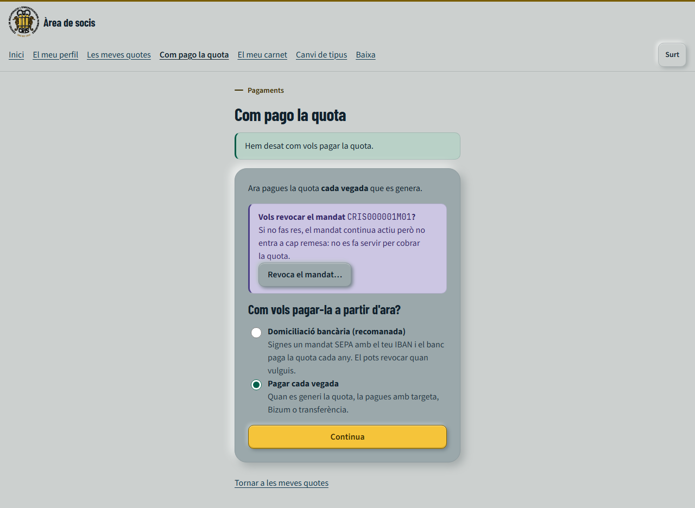
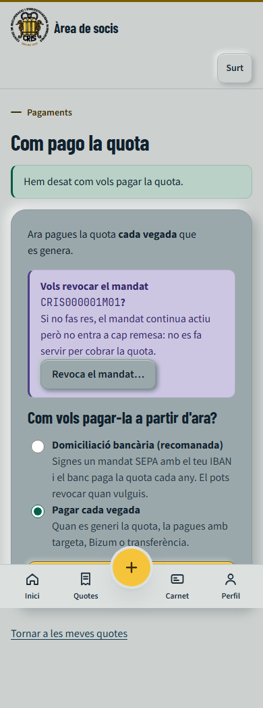

# P-134 · «Pagar cada vegada» amb un mandat actiu: es pregunta si es revoca

| Data i hora (Europa/Madrid) | Commit | Proves | CI |
|---|---|---|---|
| 17/11/2026 | 12ba0e0b | 1 funció canviada (2 casos), e2e actualitzada | [A comprovar] |

**En tres línies:** quan un soci que té un mandat actiu tria pagar la quota cada vegada, la pantalla li pregunta si vol revocar el mandat i li dona el botó per fer-ho. Si no fa res, el mandat continua actiu però no entra a cap remesa, perquè la remesa segueix la preferència. Abans només l'avisava, amb la marca «A validar: P-134».

## Què s'ha fet
- `templates/payments/fee_method.html`: l'avís passa a pregunta («Vols revocar el mandat …?») amb el botó «Revoca el mandat…» cap a la confirmació que ja existia (amb la contrasenya si la sessió no és recent). El botó surt sempre, també amb la signatura apagada (P-127).
- `apps/payments/preference_views.py`: fora `mandate_url` del context, que ja no es feia servir.
- Resposta C de la P-134 a la [095](../decisions/095-respostes-del-propietari-a-les-preguntes-irreversibles-de-la-fase-1.md); el pas 3 de [P-M05a-A](../planning.md#M05a-5-processos) es canvia a la PR del pla.

## Decisions i perquè
- **Cap canvi a les dades:** la remesa ja exclou qui no ha triat la domiciliació amb el motiu «No ha triat la domiciliació» (`test_motius_d_exclusio`), i el model ja ho deia: amb la C només canvia el flux de la pantalla.
- **La pregunta no obliga:** revocar és un enllaç a la confirmació de sempre, no un pas nou. Si el soci no hi respon, no passa res.

## Com se sap que funciona
- `test_p_134_amb_mandat_actiu_i_pagar_cada_vegada_pregunta_si_el_revoca` (signatura encesa i apagada): la pregunta, el «si no fas res», l'enllaç a revocar, cap «A validar», cap IBAN, i el mandat continua actiu.
- `test_member_chooses_how_to_pay_the_fee` (e2e): la pregunta i el botó, al navegador.
- Sortida de proves · executada el 17/11/2026 en local (PostgreSQL 16):
  ```
  $ pytest -q apps/payments/tests/test_fee_method.py
  20 passed
  $ pytest -q -m e2e apps/core/tests/e2e/test_metode_quota.py
  1 passed
  ```
- Captures mirades: 1280 px i 390 px.



