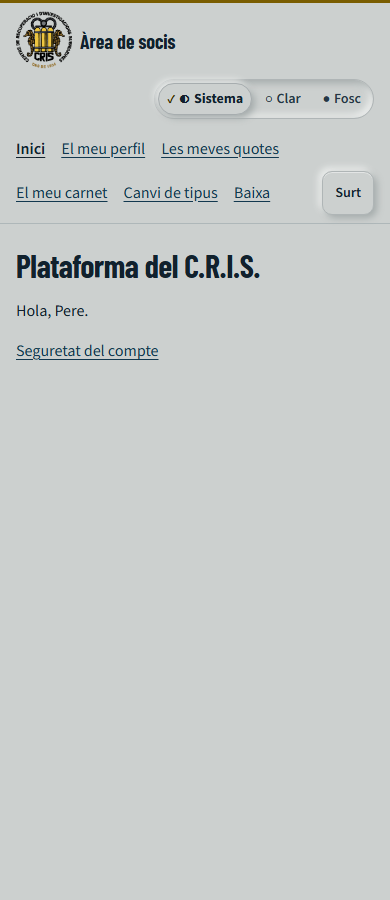

# T-DX-01 · Tokens de moviment i radis concèntrics; logotips més grans

| Data i hora (Europa/Madrid) | Commit | Proves | CI |
|---|---|---|---|
| 16/11/2026 11:27 | f569996 | 3 noves | [A comprovar] (PR #47) |

**En tres línies:** és la primera tasca del carril de disseny dels recursos externs. Les durades i les corbes de les animacions ja són valors amb nom, que segueixen les regles B i C del sistema de disseny, i cap no frena l'usuari més de 400 ms. El logotip del club és més gran a totes les capçaleres.

## Què s'ha fet
- `tokens.css`: tokens de moviment nous (`--m-panell`, `--m-preparacio`, `--m-escalonat`, `--m-llindar`, `--m-oleaje`, `--m-corba-molla` i `--escala-premut`). L'entrada de la portada passa a 300 ms i el gir del carnet a 400 ms, perquè la regla B9 demana panells de 200 a 300 ms. Detall: [design-system §15.4](../design-system.md#154-tokens-que-concreten-les-regles).
- Tots passen a 0 amb `prefers-reduced-motion`, i l'escala de premut passa a 1.
- La classe `radi-concentric` calcula el radi interior: radi exterior menys farciment (regles C1 i D8).
- Logotips: capçalera 56 px, barra lateral 64, peu 160, web pública 96 i web pública al mòbil 64, per decisió del propietari.
- Cua: [`estat/DX.md`](../estat/DX.md).

## Decisions i perquè
- **Es mantenen els noms que ja existien** (`--m-rapid`, `--m-corba`, `--m-corba-sortida`, `--m-corba-entra-surt`). La 1.7 del sistema de disseny en proposava de nous per a la mateixa feina, i canviar-los el nom hauria tocat tots els components.
- **`--r-interior` va en una classe i no a `:root`**: una propietat personalitzada es resol on es declara, així que a `:root` no veuria el radi ni el farciment de cada contenidor.
- **`--m-corba-molla` té alternativa**: sense suport de `linear()`, fa servir la corba d'entrada.
- **Del canvi local de `tokens.css` del propietari només entren els logotips.** El selector de tema no canvia: es manté la T-M01-45 fins que Eclipse i Duermevela el substitueixin (resposta del propietari del 16/11/2026).

## Problemes trobats
- Els valors de la taula de §4.1 del sistema de disseny ja no coincidien amb `tokens.css`: deia 150 ms per a `--m-rapid` (n'hi ha 180) i 600 ms per al gir (n'hi havia 650). S'ha corregit amb els valors reals.
- Amb el logotip de 56 px, la capçalera dels comptes passa de 64 a 72 px d'alt. `--capcalera-alcada` és un mínim, així que la capçalera creix i no talla res.

## Com se sap que funciona
- `apps/core/tests/test_tokens_moviment.py` comprova tres coses: que cada durada passa a 0 amb moviment reduït, que cap durada que bloqueja no supera 400 ms i que l'escala de premut és del 4 al 6 %.
- La bateria sencera al navegador passa: 49 proves i 1 xfail que ja hi era. Aquesta bateria inclou la revisió de pantalles a 320 px en clar i en fosc, que falla si alguna cosa desborda.
- Captures de l'àrea personal i de l'administració a 1280, 390 i 320 px, mirades.

## Evidències
- Captura: `captures/2026-11-16_1127_T-DX-01_area-personal-390.png`

  

  *16/11/2026 11:27 (Europa/Madrid) · local, dades inventades de la prova e2e · commit f569996*
- Sortida de proves · commit f569996 · executada el 16/11/2026 en local (PostgreSQL 16):
  ```
  $ pytest apps/core/tests/test_tokens_moviment.py apps/accounts/tests/test_pages.py -q
  99 passed
  $ pytest -m e2e apps/core/tests/e2e -q
  49 passed, 1 xfailed
  ```

## Termes nous
- **Radi concèntric:** el radi d'un element de dins és el de fora menys el farciment, perquè les dues corbes vagin paral·leles.
- **Llindar de Doherty:** 400 ms; si una resposta triga més, l'usuari ha de veure que alguna cosa passa (esquelet o progrés).
