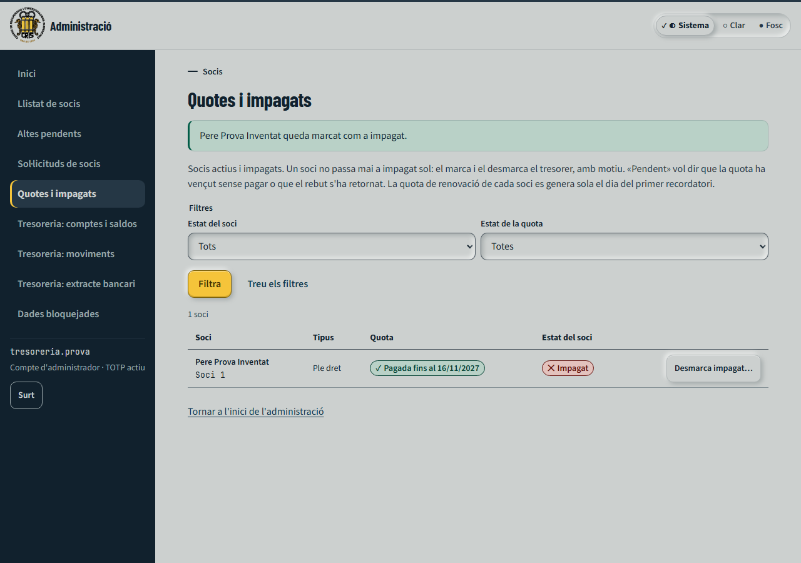

# T-DX-02 · Paleta d'estats en OKLCH, vores amb transparència i superfície flotant

| Data i hora (Europa/Madrid) | Commit | Proves | CI |
|---|---|---|---|
| 16/11/2026 12:10 | ff09b38 | 6 noves | [A comprovar] (PR #50) |

**En tres línies:** els colors que diuen l'estat d'una quota o d'un soci (pagat, pendent, retornat, impagat…) ara tenen tots la mateixa lluminositat, així cap no crida més que un altre i tots es llegeixen igual de bé, en clar i en fosc. Les vores fan servir el color del text amb transparència i es veuen sobre qualsevol fons. Hi ha un color nou per als menús i els diàlegs que floten.

## Què s'ha fet
- `tokens.css`: els colors d'estat (`ok`, `avis`, `error`, `info` i `sistema`) en `oklch()` dins de `@supports`, amb un hexadecimal de reserva que és el mateix color. Detall: [design-system §15.4](../design-system.md#154-tokens-que-concreten-les-regles).
- Mateixa lluminositat per rol: al clar, decoratiu 0,42, text 0,33 i fons tenyit 0,84; al fosc, 0,80, 0,80 i 0,31. El to de cada estat és el mateix als dos temes.
- `--c-linia` i `--c-linia-forta` amb `color-mix(in oklch, …)` sobre el color del text.
- `--c-superficie-flotant`, més clara que el contenidor al fosc (C6).
- Prova nova: `apps/core/tests/test_tokens_color.py`.

## Decisions i perquè
- **Només els estats i la superfície flotant passen a `oklch()`.** Els primitius de marca i la resta de tokens queden en hexadecimal: són exactes i no tenen res a igualar. Convertir-los hauria duplicat línies sense cap canvi visible.
- **El fons de l'avís al clar continua sent el daurat de marca** (`--llauto`), perquè ja té L 0,84.
- **Els degradats que ja hi havia no es canvien:** són gairebé neutres i ja barregen en `oklab`. Els nous es faran en `oklch` (Oleaje, capçaleres, Vistazo).
- **Percentatges de les vores:** 14 % (clar) i 20 % (fosc) per a la decorativa, que fa 1,3:1 com abans; 68 % i 48 % per a la forta, que dona 3:1 o més sobre el fons, el contenidor i el pou.
- **La prova va a `apps/core/tests/`** perquè pytest només busca a `apps/`. És un fitxer nou que només llegeix `tokens.css`, sense tocar el codi del nucli (el pilot hi té la PR #48 oberta).

## Problemes trobats
- La 1.7 del sistema de disseny posava el pou (`--c-superficie-2`) per sobre del contenidor en l'ordre d'elevació. Al fosc és al revés (L 0,28 i 0,33). S'ha corregit.
- Els navegadors que entenen `oklch()` però no `color-mix()` (Safari 15.4 a 16.1) haurien pintat les vores del color del text. Per això les vores van en un `@supports` propi.

## Com se sap que funciona
- `test_tokens_color.py`, en clar i en fosc: mateixa L per rol; el text fa 4,5:1 o més i el decoratiu 3:1 o més sobre el fons, el contenidor, el pou i el seu fons tenyit (mínims reals: 4,82 i 3,32); i cada hexadecimal de reserva és el mateix color que el seu `oklch()`. Si es canvia una L, fallen tres proves.
- La bateria al navegador passa sencera (49 proves i 1 xfail que ja hi era), amb la revisió d'accessibilitat i de pantalles a 320 px en clar i en fosc.

## Evidències
- Quotes i impagats a 1280 px (clar): `captures/2026-11-16_1210_T-DX-02_quotes-i-impagats-1280.png`

  

  *16/11/2026 12:10 (Europa/Madrid) · local, dades inventades de la prova e2e · commit ff09b38*
- La mateixa pantalla a 320 px (fosc): `captures/2026-11-16_1210_T-DX-02_quotes-i-impagats-320-fosc.png`

  *16/11/2026 12:10 (Europa/Madrid) · local, dades inventades de la prova e2e · commit ff09b38*
- Sortida de proves · commit ff09b38 · executada el 16/11/2026 en local (PostgreSQL 16):
  ```
  $ pytest apps/core/tests/test_tokens_color.py apps/core/tests/test_tokens_moviment.py -q
  9 passed
  $ pytest -m e2e apps/core/tests/e2e -q
  49 passed, 1 xfailed
  ```

## Termes nous
- **OKLCH:** una manera d'escriure els colors amb lluminositat (L), intensitat (C) i to (H). Dos colors amb la mateixa L es veuen igual de clars.
- **Color de reserva:** el valor que fa servir un navegador que no entén el format nou.
