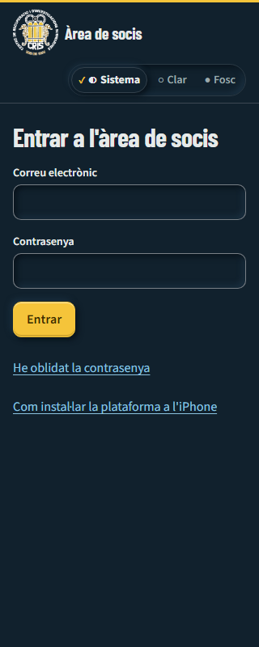

# T-DX-04 · Duermevela, motor de tema

| Data i hora (Europa/Madrid) | Commit | Proves | CI |
|---|---|---|---|
| 16/11/2026 12:27 | ff90744 | 3 noves al navegador | [A comprovar] (PR #51) |

**En tres línies:** si algú canvia el tema clar o fosc en una pestanya, les altres pestanyes obertes de la plataforma canvien soles, sense recarregar. La barra del navegador del mòbil pren el color del tema. El canvi es veu com una cortina rodona que surt del botó triat, i és directe per a qui demana menys moviment.

## Què s'ha fet
- `static/js/tema.js` porta el motor del recurs Duermevela adaptat. Es manté el nom del fitxer, la clau `cris-tema` i els valors `light` i `dark`.
- Sincronització entre pestanyes amb l'esdeveniment `storage`.
- `<meta name="theme-color">` amb el `--c-fons` del tema actiu. La crea el mateix guió, així que no cal cap color escrit a la plantilla; segueix el sistema quan la tria és «Sistema».
- Una cortina circular amb `document.startViewTransition`, de `--m-panell` (250 ms) i amb `--m-corba-entra-surt`. `tokens.css` treu el fos per defecte de les View Transitions.
- Detall: [design-system §7](../design-system.md#7-temes-clar-i-fosc).

## Decisions i perquè
- **Es manté el nom `tema.js`.** Canviar-lo a `duermevela.js` obligava a tocar una prova existent d'`apps/core` mentre el pilot hi té una PR oberta. El recurs queda identificat a la capçalera del fitxer.
- **Sense guió en línia al `<head>`**, al contrari del recurs: el fitxer es carrega sense `defer` abans dels estils, com abans (decisió 066).
- **La cortina dura 250 ms i no 820 ms com al recurs:** la regla B9 demana panells de 200 a 300 ms i que res no bloquegi més de 400 ms.
- **Sense cortina quan el color no canvia,** per exemple si es tria «Sistema» quan el sistema ja demana el tema que hi havia.
- **Fora del recurs:** la il·lustració de l'habitació, el mesurador de destells i el botó «Simular».

## Problemes trobats
- Per fer la cortina, el navegador necessita la imatge del tema anterior. El guió aplica el tema nou per saber si el color canvia, torna a posar l'anterior i després fa la transició.

## Com se sap que funciona
- `apps/core/tests/e2e/test_duermevela.py` és una prova nova, en un fitxer nou. Comprova tres coses:
  - En triar «Fosc» en una pestanya, l'altra passa a fosc i marca l'opció, i la barra pren el color de fons.
  - En tornar a «Sistema», l'altra pestanya treu el tema i la clau desapareix.
  - Amb moviment reduït, el tema ja hi és en tornar del clic. I «Sistema» sense canvi de color deixa la pàgina com era.
- La bateria al navegador passa sencera (53 proves i 1 xfail que ja hi era), també la que comprova que el tema es conserva en sortir.

## Evidències
- Entrada a 320 px en fosc, sense cap canvi visual al selector: `captures/2026-11-16_1227_T-DX-04_entrada-320-fosc.png`

  

  *16/11/2026 12:27 (Europa/Madrid) · local, prova e2e · commit ff90744*
- Sortida de proves · commit ff90744 · executada el 16/11/2026 en local (PostgreSQL 16):
  ```
  $ pytest -m e2e apps/core/tests/e2e/test_duermevela.py -q
  3 passed
  $ pytest -m e2e apps/core/tests/e2e -q
  53 passed, 1 xfailed
  ```

## Termes nous
- **View Transitions:** una funció del navegador que fa una foto de la pàgina abans d'un canvi i permet animar el pas a la pàgina nova.
- **theme-color:** l'etiqueta que diu al navegador del mòbil de quin color ha de pintar la seva barra.
