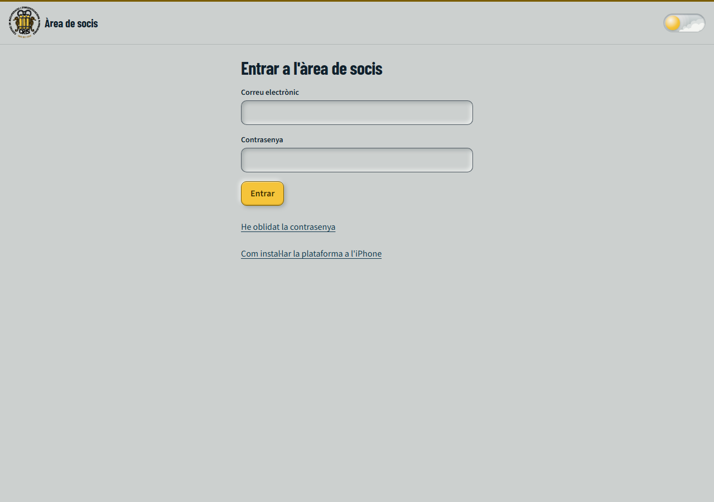

# T-DX-05 · Eclipse: interruptor de dia i nit a la part pública

| Data i hora (Europa/Madrid) | Commit | Proves | CI |
|---|---|---|---|
| 16/11/2026 13:26 | 6e3026a | 5 al navegador (3 noves) i 1 adaptada | [A comprovar] (PR #54) |

**En tres línies:** a les pàgines que es veuen sense entrar (l'entrada, «Fer-se soci»…), la capçalera porta un interruptor de dia i nit. Quan el prems, el sol creua el carril i la lluna el tapa. En obrir la pàgina, mostra el tema que té l'ordinador o el telèfon; si el canvies, queda fixat i surt «Com el sistema» per tornar-hi.

## Què s'ha fet
- Peça nova: `templates/_eclipse.html`, `static/css/eclipse.css` i `static/js/eclipse.js`. Detall: [design-system §7](../design-system.md#7-temes-clar-i-fosc).
- `tema.js` obre `window.CrisTema` (triar i saber quin tema es veu) i avisa amb l'esdeveniment `cris:tema`. Així l'interruptor segueix els canvis que arriben d'una altra pestanya o del sistema.
- `base.html`: sense sessió, Eclipse; amb sessió, el selector de tres opcions fins a la T-DX-05b.
- Cua: la fila de la T-DX-05 canvia d'abast i s'afegeix la T-DX-05b ([`estat/DX.md`](../estat/DX.md)).

## Decisions i perquè
- **Decisió del propietari del 16/11/2026:** el seguiment del sistema va a la configuració i per defecte es fa servir el tema del sistema. A la part pública, l'interruptor de dia i nit es veu i, per defecte, mostra el tema del sistema. A socis i administració, el tema passarà a la configuració del compte (T-DX-05b).
- **«Com el sistema» només surt quan la tria és manual.** L'interruptor és de dos estats i el recurs no té manera de tornar a seguir el sistema.
- **Sense animacions infinites (D20):** al recurs, les estrelles titil·len i la corona gira sense parar; aquí es queden quietes un cop apareixen.
- **Sense l'onda de canvi de tema del recurs:** ja la fa la cortina de Duermevela, que surt de l'interruptor.
- **Colors de marca:** el sol és el daurat (`--llauto`), la nit l'`--abisme` i les núvols el `--paper`. Cap color nou.
- **Cap estil escrit a mà:** les molles calculen la posició i el JavaScript l'escriu en variables de CSS (`--eclipse-x`, `--eclipse-lluna`…).

## Problemes trobats
- La prova del punt 2 de la T-M01-45 comprovava el selector a la pàgina d'entrada, que ara és pública i porta Eclipse. Ara la comprova amb sessió, on el selector continua.
- Una prova de pagaments (`test_processing.py`, xarxa de seguretat) ha fallat 2 vegades de 4 en local, també sobre `master`. És del carril del pilot i se li ha comunicat.

## Com se sap que funciona
- `apps/core/tests/e2e/test_duermevela.py`, ara amb l'interruptor:
  - En obrir, amb el sistema en clar i en fosc, l'interruptor mostra el tema del sistema i «Com el sistema» no es veu.
  - En prémer, el tema queda fixat i passa a l'altra pestanya; la barra del navegador pren el color.
  - «Com el sistema» torna a seguir el sistema a totes dues pestanyes.
  - Amb moviment reduït, el canvi és directe.
  - L'àrea tàctil fa 44 × 44 px.
- La bateria sencera al navegador passa (57 proves i 1 xfail que ja hi era). Proves unitàries: 4.741 passades i la inestable de pagaments.

## Evidències
- Entrada de dia a 1280 px: `captures/2026-11-16_1326_T-DX-05_entrada-dia-1280.png`

  

  *16/11/2026 13:26 (Europa/Madrid) · local, prova e2e · commit 6e3026a*
- De nit, amb «Com el sistema», a 1280 i 390 px: `captures/2026-11-16_1326_T-DX-05_entrada-nit-1280.png`, `captures/2026-11-16_1326_T-DX-05_entrada-nit-390.png`

  *16/11/2026 13:26 (Europa/Madrid) · local, prova e2e · commit 6e3026a*
- Sortida de proves · commit 6e3026a · executada el 16/11/2026 en local (PostgreSQL 16):
  ```
  $ pytest -m e2e apps/core/tests/e2e -q
  57 passed, 1 xfailed
  ```

## Termes nous
- **Interruptor (switch):** un botó de dos estats que el lector de pantalla anuncia com «activat» o «desactivat».
