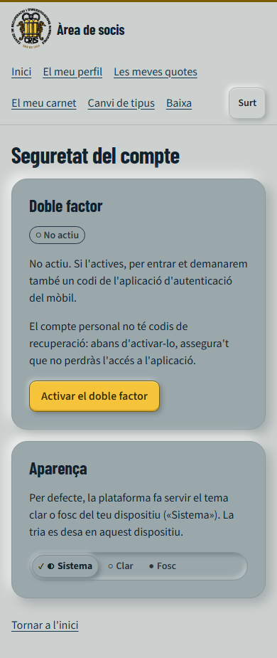

# T-DX-05b · El tema a la configuració del compte

| Data i hora (Europa/Madrid) | Commit | Proves | CI |
|---|---|---|---|
| 16/11/2026 14:03 | d27ce8f | 2 noves i 3 adaptades | [A comprovar] (PR #55) |

**En tres línies:** quan has entrat, la capçalera ja no té el selector de tema. Ara és a la configuració del compte: els socis el troben a «Seguretat del compte», dins del bloc «Aparença», i l'administració a l'inici. Per defecte, la plataforma fa servir el tema del dispositiu («Sistema»).

## Què s'ha fet
- `templates/_selector_tema.html`: el selector de tres opcions com a peça (classe `selector-tema-ajust`, amb el text a totes les mides).
- «Seguretat del compte» (`compte/seguretat/`) i l'inici de l'administració porten el bloc «Aparença».
- `base.html`: amb sessió, cap control de tema a la capçalera; sense sessió, l'interruptor Eclipse (T-DX-05).
- `comptes.css`: fora les regles del selector a la capçalera, que ja no s'apliquen.
- Detall: [design-system §7](../design-system.md#7-temes-clar-i-fosc). Fila a [`estat/DX.md`](../estat/DX.md).

## Decisions i perquè
- **Decisió del propietari del 16/11/2026:** el tema va a la configuració i per defecte es fa servir el del sistema. A la part pública, l'interruptor es veu (T-DX-05).
- **Substitueix la T-M01-45** (punts 2 i 6: el selector a la capçalera i el seu ordre al tabulador).
- **A l'administració, a l'inici:** no hi ha cap altra pàgina de configuració del compte d'administrador. Una pàgina pròpia demanaria una vista nova a `apps/accounts`.
- **La tria continua sent del dispositiu** (`cris-tema`), com abans, i passa a les altres pestanyes amb Duermevela.

## Problemes trobats
- La prova del carnet sense connexió fa clic per coordenades. A la pàgina de configuració, el selector queda sota la línia de pantalla; ara s'hi desplaça abans de fer el clic.
- Una altra prova de pagaments de la família `TestSafetyNet` ha fallat una vegada. La causa és el rellotge (la notificació i el límit cauen en el mateix tic a Windows). El pilot l'arregla a la #56.

## Com se sap que funciona
- `apps/members/tests/test_revisio_pantalles_045.py`: l'inici del soci no porta cap control de tema i «Seguretat del compte» porta el selector i «Aparença»; l'inici de l'administració porta el selector dins del contingut.
- E2E adaptades:
  - Punt 2: els tres textos es llegeixen a 320 px, ara a la configuració.
  - Punt 6: després del logotip, el Tab va al menú.
  - Carnet sense connexió: el tema triat a la configuració es conserva en sortir.
- Bateria sencera al navegador: 57 passades i 1 xfail que ja hi era. Proves unitàries: 4.743 passades i la inestable de pagaments.

## Evidències
- «Seguretat del compte» a 390 px, amb «Aparença»: `captures/2026-11-16_1403_T-DX-05b_seguretat-aparenca-390.png`

  

  *16/11/2026 14:03 (Europa/Madrid) · local, prova e2e, soci inventat · commit d27ce8f*
- La mateixa pantalla a 320 px en fosc: `captures/2026-11-16_1403_T-DX-05b_seguretat-aparenca-320-fosc.png`

  *16/11/2026 14:03 (Europa/Madrid) · local, prova e2e, soci inventat · commit d27ce8f*
- Sortida de proves · commit d27ce8f · executada el 16/11/2026 en local (PostgreSQL 16):
  ```
  $ pytest -m e2e apps/core/tests/e2e -q
  57 passed, 1 xfailed
  ```
