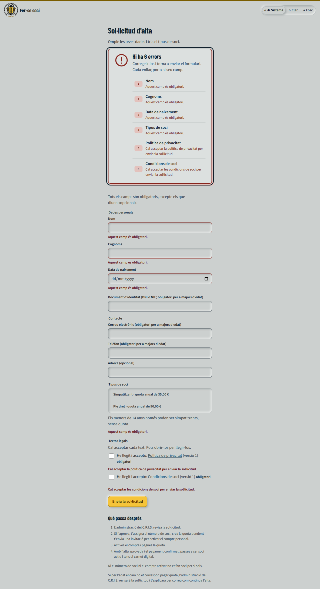

# T-DX-06 · Errata: resum d'errors al formulari «Fer-se soci»

| Data i hora (Europa/Madrid) | Commit | Proves | CI |
|---|---|---|---|
| 16/11/2026 12:40 | e6012ea | 2 noves al navegador | [A comprovar] (PR #52) |

**En tres línies:** quan algú envia el formulari per fer-se soci i hi falta alguna cosa, a dalt de tot surt «Hi ha 6 errors» amb una llista. Cada element de la llista porta al camp que s'ha de corregir. El lector de pantalla ho anuncia en carregar la pàgina, i els missatges al costat de cada camp continuen on eren.

## Què s'ha fet
- Peça nova del sistema de disseny: `templates/_errata.html`, `static/css/errata.css` i `static/js/errata.js`, carregats a la plantilla base. Detall: [design-system §6.10](../design-system.md#610-errata-resum-derrors-dun-formulari-t-dx-06).
- El formulari d'alta (web i presencial) la fa servir en lloc de l'avís d'error general.
- Les dues caselles obligatòries (política de privacitat i condicions de soci) tenen etiqueta en català, que surt al resum.
- Fila a [`estat/DX.md`](../estat/DX.md).

## Decisions i perquè
- **El nombre d'errors surt de `form.errors|length` i la numeració la fa un comptador de CSS.** Així no cal cap etiqueta de plantilla nova a `apps/core`.
- **Els errors d'un camp ocult surten com a «Formulari», sense enllaç:** la persona no els pot omplir.
- **Del recurs queden per a més endavant** la validació en sortir de cada camp, l'índex de seccions i el «Tot correcte». Obligarien a repetir al navegador les regles del servidor.
- **Sense animació:** el resum surt en carregar la pàgina i el canvi d'estat és el focus. La regla D20 diu que cada animació ha de respondre a una acció.

## Problemes trobats
- A la primera captura, dues caselles sortien com «Accept privacy» i «Accept membership terms». Django fa l'etiqueta a partir del nom del camp quan no en té cap. S'hi han posat les etiquetes en català.

## Com se sap que funciona
- `apps/core/tests/e2e/test_errata.py`:
  - En enviar el formulari buit, surt el resum, rep el focus i diu «Hi ha N errors», amb N igual al nombre d'elements.
  - El primer enllaç porta al seu camp, que queda amb el focus i amb `aria-invalid`.
  - Sense errors, no hi ha cap resum.
- Revisió a 320 px en clar i en fosc, sense desplaçament lateral.
- Proves del mòdul 01: 2.368 passades. Bateria sencera al navegador: 52 passades i 1 xfail que ja hi era.

## Evidències
- A 1280 px, en clar: `captures/2026-11-16_1240_T-DX-06_fer-se-soci-errors-1280.png`

  

  *16/11/2026 12:40 (Europa/Madrid) · local, prova e2e, formulari buit · commit e6012ea*
- A 320 px, en fosc: `captures/2026-11-16_1240_T-DX-06_fer-se-soci-errors-320-fosc.png`

  *16/11/2026 12:40 (Europa/Madrid) · local, prova e2e, formulari buit · commit e6012ea*
- Sortida de proves · commit e6012ea · executada el 16/11/2026 en local (PostgreSQL 16):
  ```
  $ pytest apps/members -q
  2368 passed
  $ pytest -m e2e apps/core/tests/e2e -q
  52 passed, 1 xfailed
  ```

## Termes nous
- **Resum d'errors:** la llista a dalt d'un formulari amb tots els camps que cal corregir, cadascun amb un enllaç al camp.
