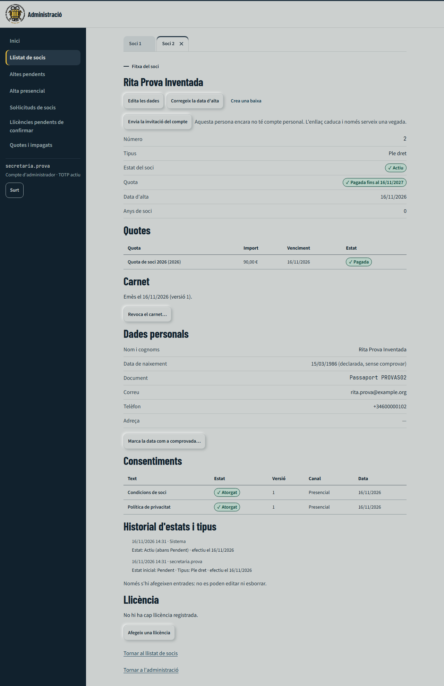

# T-DX-07 · Solapas: pestanyes de les fitxes obertes a l'administració

| Data i hora (Europa/Madrid) | Commit | Proves | CI |
|---|---|---|---|
| 16/11/2026 14:29 | 2de4c7c, 9ff485d | 3 noves al navegador | [A comprovar] (PR #57) |

**En tres línies:** a l'administració, cada fitxa de soci o de sol·licitud que obres queda en una pestanya a dalt del contingut («Soci 12», «Baixa 34»). Així pots anar d'una a l'altra sense tornar a buscar-les. Les pestanyes es poden tancar i reordenar, i les que no hi caben passen a un menú «+N».

## Què s'ha fet
- Peça nova: `static/js/solapas.js` i `static/css/solapas.css`. La tira és a `base.html` amb una sessió d'administració. Detall: [design-system §6.11](../design-system.md#611-solapas-pestanyes-de-les-fitxes-obertes-t-dx-07).
- La fitxa del soci i la de les sol·licituds hi posen la seva etiqueta (bloc `solapa`), amb el número i sense el nom.
- Fila a [`estat/DX.md`](../estat/DX.md).

## Decisions i perquè
- **P-96, opció B (resposta del propietari):** la llista (adreça i etiqueta, sense noms) va a `sessionStorage`, que només viu en aquesta pestanya del navegador. El contingut no es desa enlloc, i «Surt» la buida.
- **Cada pestanya és un enllaç, no una pestanya amb el contingut a dins:** en obrir-la, el servidor torna a comprovar el permís. Una pestanya no salta cap control.
- **En tancar l'activa:** s'obre la de la dreta o, si era l'última, la de l'esquerra; sense cap pestanya, l'inici de l'administració. És el comportament del recurs.
- **El menú «+N» el crea el guió:** sense JavaScript no faria res, i el servidor no posa cap botó dins de `<main>`.
- **Del recurs no s'hi fa** el panell lateral de registres (ja hi ha la barra lateral) ni els esborranys en tancar una pestanya (P-96).

## Problemes trobats
- L'arrossegament s'aturava al primer moviment: el navegador començava l'arrossegament natiu de l'enllaç. Ara l'enllaç porta `draggable="false"`.
- Quatre proves de navegació i de Cluber comproven l'HTML exacte: el formulari de «Surt» i que a `<main>` no hi hagi cap botó sense classe. S'ha adaptat la peça perquè continuï complint-ho, sense canviar les proves.

## Com se sap que funciona
- `apps/core/tests/e2e/test_solapas.py`:
  - Dues fitxes surten com «Soci 1» i «Soci 2», sense cap nom a `sessionStorage`.
  - Una pestanya porta a la seva fitxa, i Alt+→ la mou amb el focus.
  - Tancar l'activa obre l'altra, i «Surt» buida la llista.
  - Arrossegar canvia l'ordre, sense obrir cap fitxa.
  - Escriure en un formulari posa el punt, i en tancar-la es pregunta.
- Bateria sencera al navegador: 60 passades i 1 xfail que ja hi era. Proves unitàries: 4.742 passades i les 4 que s'han arreglat a `9ff485d`, que ara passen.

## Evidències
- Dues fitxes obertes, a 1280 px: `captures/2026-11-16_1429_T-DX-07_dues-fitxes-1280.png`

  

  *16/11/2026 14:29 (Europa/Madrid) · local, prova e2e, socis inventats · commit 2de4c7c*
- A 320 px, en fosc: `captures/2026-11-16_1429_T-DX-07_dues-fitxes-320-fosc.png`

  *16/11/2026 14:29 (Europa/Madrid) · local, prova e2e, socis inventats · commit 2de4c7c*
- Sortida de proves · commit 9ff485d · executada el 16/11/2026 en local (PostgreSQL 16):
  ```
  $ pytest apps/accounts/tests/test_navigation.py apps/members/tests/test_cluber_views.py -q
  53 passed
  $ pytest -m e2e apps/core/tests/e2e -q        (a 2de4c7c)
  60 passed, 1 xfailed
  ```
