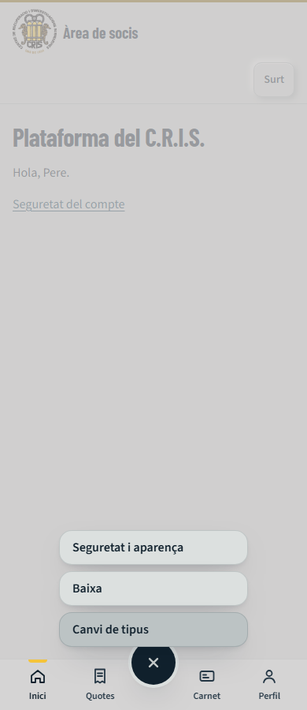

# T-DX-08 · Ramillete: navegació de l'àrea del soci al mòbil

| Data i hora (Europa/Madrid) | Commit | Proves | CI |
|---|---|---|---|
| 16/11/2026 15:17 | d2c88f8, 721f8bc | 2 noves al navegador i 3 adaptades | [A comprovar] (PR #58) |

**En tres línies:** al mòbil, l'àrea del soci té una barra a baix amb «Inici», «Quotes», «Carnet» i «Perfil», com les aplicacions de telèfon. Al mig hi ha un botó rodó «Més», que s'obre en ventall amb les opcions que es fan servir poc: «Canvi de tipus», «Baixa» i «Seguretat i aparença». «Surt» es queda dalt, a la capçalera.

## Què s'ha fet
- Peça nova: `templates/members/_ramillete.html` (a `base.html`, després del contingut, per als comptes personals), `static/css/ramillete.css` i `static/js/ramillete.js`. Detall: [design-system §6.12](../design-system.md#612-ramillete-navegació-de-làrea-del-soci-al-mòbil-t-dx-08).
- Per sota de 600 px i amb JavaScript, la barra es veu i la capçalera només deixa «Surt». A partir de 600 px, o sense JavaScript, la navegació de la capçalera de sempre.
- Fila a [`estat/DX.md`](../estat/DX.md).

## Decisions i perquè
- **Un sol «Surt» per pantalla (T-M01-46):** a la primera versió, el ventall també portava «Surt», i la prova de la navegació ho va aturar. «Surt» es queda a la capçalera, també al mòbil.
- **Només amb JavaScript:** sense el guió, el botó «Més» no faria res i «Baixa» quedaria inaccessible al mòbil. Per això la barra i l'amagatall dels enllaços de la capçalera depenen de `.ramillete-actiu`.
- **La barra va després del contingut:** és l'ordre natural del tabulador i no posa cap icona abans del QR del carnet.
- **Del recurs no s'hi fa** la barra lateral a partir de 760 px (a l'escriptori ja hi ha la capçalera) ni les fulles de cada acció.
- **Moviment amb els tokens:** el ventall surt amb `--m-panell`, `--m-corba-molla` i `--m-escalonat`, no amb els 700 ms del recurs (B9).

## Problemes trobats
- Tres proves comprovaven la navegació antiga: sortir amb el teclat al mòbil, l'ordre del Tab a 320 px i el dibuix del QR, que agafava el primer `<path>` de la pàgina. S'han adaptat a la barra; la del QR ara només mira dins del QR.
- Una e2e de Bizum ha fallat una vegada dins la bateria i ha passat dues vegades sola: és inestable i és del carril del pilot.

## Com se sap que funciona
- `apps/core/tests/e2e/test_ramillete.py`, a 390 px:
  - La barra es veu, «Inici» està marcat i la capçalera només deixa «Surt».
  - «Més» obre el ventall amb el focus a la primera opció; Esc el tanca i torna al botó, i tocar fora també el tanca.
  - «Quotes» porta a les quotes, i la barra no tapa el final de la pàgina.
  - A l'escriptori, la barra no es veu i hi ha la navegació de la capçalera.
- Proves unitàries: 4.766 passades. Bateria al navegador: 61 passades, 1 xfail que ja hi era i la inestable de Bizum.

## Evidències
- El ventall obert, a 390 px: `captures/2026-11-16_1517_T-DX-08_ventall-obert-390.png`

  

  *16/11/2026 15:17 (Europa/Madrid) · local, prova e2e, soci inventat · commit 721f8bc*
- A 320 px, en fosc: `captures/2026-11-16_1517_T-DX-08_ventall-obert-320-fosc.png`

  *16/11/2026 15:17 (Europa/Madrid) · local, prova e2e, soci inventat · commit 721f8bc*
- Sortida de proves · commit 721f8bc · executada el 16/11/2026 en local (PostgreSQL 16):
  ```
  $ pytest -q
  4766 passed
  $ pytest -m e2e apps/core/tests/e2e -q
  61 passed, 1 xfailed (i la inestable de Bizum, que passa sola)
  ```
