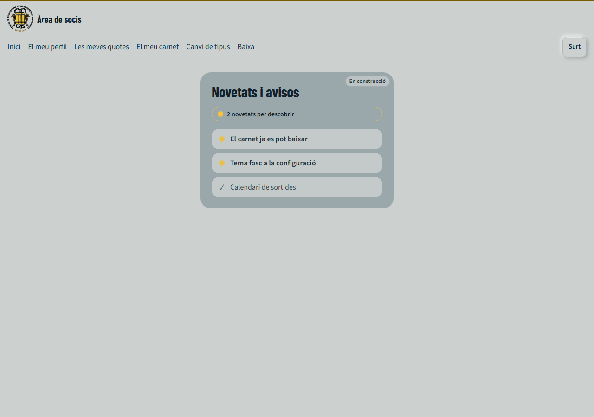

# T-DX-09 · Baliza i el patró de les pantalles «En construcció»

| Data i hora (Europa/Madrid) | Commit | Proves | CI |
|---|---|---|---|
| 16/11/2026 19:50 | b717d12 | 2 noves (parametritzades) | [A comprovar] (PR #77) |

**En tres línies:** hi ha la primera pantalla «En construcció», «Novetats i avisos», amb la baliza al costat del que és nou, la nota que s'obre i el comptador. Sobretot, queda fixat com es fan totes les altres: cada pantalla és un fitxer i una plantilla nous, i les rutes, l'índex i les proves la troben sola. Així se'n poden fer diverses alhora sense trepitjar-se.

## Què s'ha fet
- App `apps/previews`: `screens/` (una pantalla per fitxer, amb `TITLE` i `CONTEXT` d'exemple), `views.py` (amb el decorador `under_construction` de la T-DX-03), `urls.py` (rutes `/en-construccio/<nom>/` i l'índex `/en-construccio/`), afegida a `INSTALLED_APPS` i a `config/urls.py`.
- Bloc `estils` a `templates/base.html`, perquè cada pantalla enllaci el seu CSS sense tocar la base.
- `templates/previews/novetats.html` i `static/css/baliza.css`. Detall: [design-system §16](../design-system.md#16-pantalles-en-construcció).
- Fila a [`estat/DX.md`](../estat/DX.md), amb la regla del carril actualitzada: diverses tasques alhora si no comparteixen codi (propietari, 16/11/2026; decisió 094).

## Decisions i perquè
- **Una pantalla, fitxers nous i res més:** la decisió 094 només deixa treballar alhora si no es comparteix cap fitxer de codi. Les rutes es construeixen a partir dels fitxers de `screens/`, i les proves (unitària i e2e) es parametritzen sobre les mateixes pantalles, així que cap pantalla nova toca `urls.py`, cap prova ni el mapa del hook.
- **Una sola batuda en aparèixer:** el recurs fa bategar les balizes sense parar, i això xoca amb la D20.
- **Al menú, encara no:** l'enllaç a l'índex aniria al menú de l'administració, que és codi del nucli. L'índex es pot obrir per l'adreça.

## Problemes trobats
- La píndola del comptador s'estirava a tota l'amplada; ara s'ajusta al text.

## Com se sap que funciona
- `apps/previews/tests/test_screens.py`, per a cada pantalla: té títol i plantilla, porta l'etiqueta amb `aria-describedby`, no té cap `style=`, un POST torna 405, sense accés respon 404 (també l'índex), i l'índex l'enllaça.
- `apps/core/tests/e2e/test_previews.py`, per a cada pantalla: l'etiqueta i el títol visibles i les captures a 1280, 390 i 320 px, en clar i en fosc, sense desplaçament lateral.
- La prova comuna de només lectura (`test_under_construction.py`) i la del mapa del hook continuen passant.
- Bateria unitària sencera: 4.873 proves. L'e2e sencera la passa el CI.

## Evidències
- «Novetats i avisos» a 1280 px: `captures/2026-11-16_1950_T-DX-09_novetats-1280.png`

  

  *16/11/2026 19:50 (Europa/Madrid) · local, prova e2e, contingut d'exemple · commit b717d12*
- A 320 px, en fosc: `captures/2026-11-16_1950_T-DX-09_novetats-320-fosc.png`

  *16/11/2026 19:50 (Europa/Madrid) · local, prova e2e · commit b717d12*
- Sortida de proves · executada el 16/11/2026 en local (PostgreSQL 16):
  ```
  $ pytest apps/previews apps/core/tests/test_under_construction.py apps/core/tests/test_verificacio_t_m00_07.py -q
  41 passed
  $ pytest -m e2e apps/core/tests/e2e/test_previews.py -q
  1 passed
  ```
