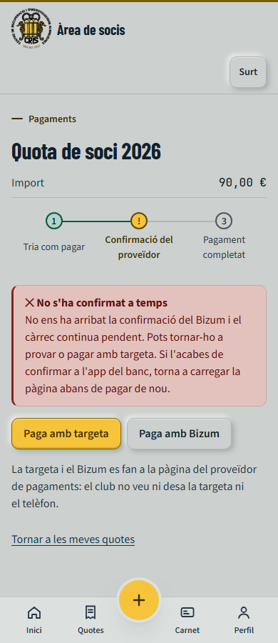

# T-DX-10 · Tramite: els passos d'un pagament

| Data i hora (Europa/Madrid) | Commit | Proves | CI |
|---|---|---|---|
| 16/11/2026 15:45 | af0919e | 6 noves | [A comprovar] (PR #60) |

**En tres línies:** a la pantalla de pagament, el soci veu en quin pas és: «Tria com pagar», «Confirmació del proveïdor» i «Pagament completat». Si el proveïdor no completa el pagament, el pas de la confirmació surt en groc; quan el servidor el confirma, els tres passos queden fets. La pàgina s'actualitza sola mentre s'espera, com ja feia.

## Què s'ha fet
- Peça nova: `templates/payments/_tramite.html`, dins de `_status.html`, i `static/css/tramite.css`. Detall: [design-system §6.13](../design-system.md#613-tramite-els-passos-dun-pagament-t-dx-10).
- Els passos surten de l'estat del servidor (`payments.payment_status`). HTMX els torna a demanar cada 3 s mentre el pagament és en curs, sense canviar la consulta que ja hi havia.
- Fila a [`estat/DX.md`](../estat/DX.md).

## Decisions i perquè
- **Sense temps simulat:** el recurs omple la línia amb la durada de cada pas, però aquí no la sabem. El pas es marca quan el servidor diu que ha canviat.
- **Sense animació contínua (D20)** mentre s'espera: el «◷» i el text ja diuen que s'està esperant.
- **El segell de «Pagament completat» només surt quan el servidor l'ha confirmat (B10):** l'estat no és mai el de la tornada del navegador (RN-M05b-05).
- **El pas 3 no es diu «Pagat»:** una prova comprova que aquesta paraula no surti si no és pagat, i té raó. Un pas futur no pot fer servir el text de l'estat.

## Problemes trobats
- La primera versió deia «Pagat» al pas 3 i la prova de la pantalla de pagament ho va detectar. Ara és «Pagament completat».
- Una vegada, en tancar el lot de proves de pagament, va sortir un error 401 a la consulta d'estat (la sessió ja s'havia tancat). Després va passar dues vegades de dues. Se n'ha passat la línia al pilot.

## Com se sap que funciona
- `apps/payments/tests/test_tramite.py`: per a cada estat (pendent, en curs, fallat, fora de temps, pagat), les classes dels tres passos i un sol `aria-current="step"`; cap «Pagat» als passos; un càrrec que no es pot pagar no en porta.
- Les e2e de targeta, Bizum, rebut i el flux del primer euro passen amb els passos a la pantalla. La bateria sencera fa 62 passades i 1 xfail que ja hi era. Proves unitàries: 4.774 passades.

## Evidències
- Bizum «No s'ha confirmat a temps», a 390 px: `captures/2026-11-16_1545_T-DX-10_no-confirmat-390.png`

  

  *16/11/2026 15:45 (Europa/Madrid) · local, prova e2e, proveïdor fals, soci inventat · commit af0919e*
- Pagat, a 1280 px: `captures/2026-11-16_1545_T-DX-10_pagat-1280.png`

  *16/11/2026 15:45 (Europa/Madrid) · local, prova e2e, proveïdor fals · commit af0919e*
- Sortida de proves · commit af0919e · executada el 16/11/2026 en local (PostgreSQL 16):
  ```
  $ pytest -q
  4774 passed
  $ pytest -m e2e apps/core/tests/e2e -q
  62 passed, 1 xfailed
  ```
