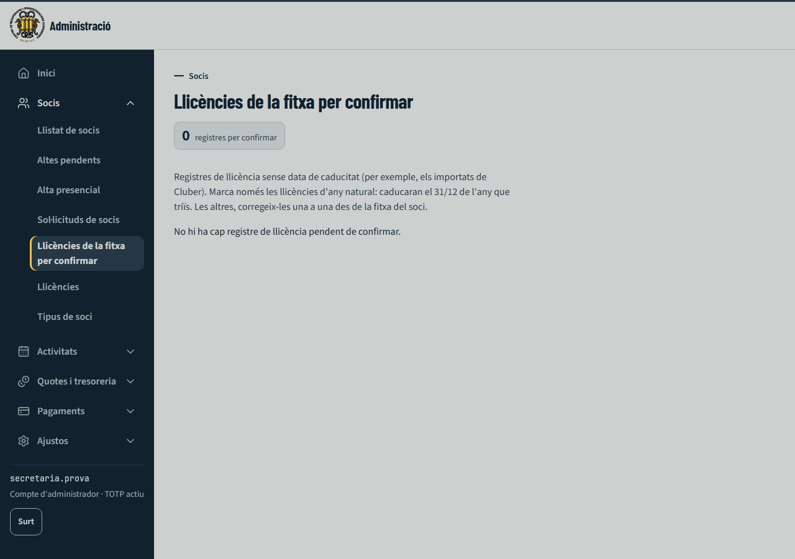

# T-DX-100 · «Llicències de la fitxa per confirmar»: nom propi per a la confirmació en bloc del 01

| Data i hora (Europa/Madrid) | Commit | Proves | CI |
|---|---|---|---|
| 24/11/2026 05:26 | 2e55fa6e | 1 nova; 25 de navegació; 1 e2e d'accessibilitat | [A comprovar] |

**En tres línies:** a la revisió de la #530 he vist que la secretaria té dues entrades amb gairebé el mateix nom. La del 01 era «Llicències pendents de confirmar», per als registres de la fitxa del soci. La del 06 és «Llicències per confirmar», filla de «Llicències». El pilot ha respost B: totes dues són vigents fins que es faci a producció el pas únic de les llicències de la fitxa al 06 (T-M06-14), i la del 01 es reanomena. Ara es diu «Llicències de la fitxa per confirmar».

## Què s'ha fet
- `apps/accounts/navigation.py`: el nou nom de l'entrada.
- `templates/members/licence_bulk_confirm.html`: el títol i l'`h1`.
- `docs/guies/guia-secretaria.md` i `guia-secretaria-llicencies.md`: el nom de la pantalla.
- `docs/design-system.md` (llista d'entrades del menú) i `docs/estat/DX.md`.
- `apps/members/tests/test_screens_dx100.py`: prova nova.

## Decisions i perquè
- **«de la fitxa»:** és el que la distingeix de la del 06. Primer havia proposat «Registres de llicència de la fitxa per confirmar», però al menú ocupava tres línies. Amb aquest nom n'ocupa dues, com «Tresoreria: comptes i saldos».
- **No es toquen** les entrades antigues del diari ni `docs/planning.md`: el pla és congelat (D1), i el nom de la pantalla és un text, no una regla.
- **Quan el pas únic sigui a producció**, la pantalla del 01 quedarà buida i es podrà treure del menú (resposta A del pilot).
- **Seguretat i privacitat:** només són textos. El permís P4/LC i la comprovació de la vista no canvien.

## Problemes trobats
- Al CI, `apps/licences/tests/test_confirm_06.py::test_secretary_screens` va fallar. Comprovava que «per confirmar» no sortís a la pàgina de llicències, i mirava la pàgina sencera, menú inclòs. El nom nou de l'entrada del 01 conté aquestes paraules. Ara la prova mira el contingut de la pàgina (`main_of`), que és el que volia comprovar.

## Com se sap que funciona
- La prova nova fallava amb el nom vell i ara passa. També passen les 25 proves de navegació i l'auditoria d'accessibilitat de les pantalles d'administració (`test_accessibilitat_028.py::test_admin_screens`).

## Comprovació §15.5
- **Captura mirada** a 1280 px: el menú «Socis» amb l'entrada marcada i la pàgina. És només un canvi de text i no canvia res a cap altra amplada.

## Evidències
- «Llicències de la fitxa per confirmar» a 1280 px. `captures/2026-11-24_0526_T-DX-100_llicencies-fitxa-1280.png`

  

  *24/11/2026 05:26 (Europa/Madrid) · local, prova e2e temporal, dades inventades · commit 2e55fa6e*
