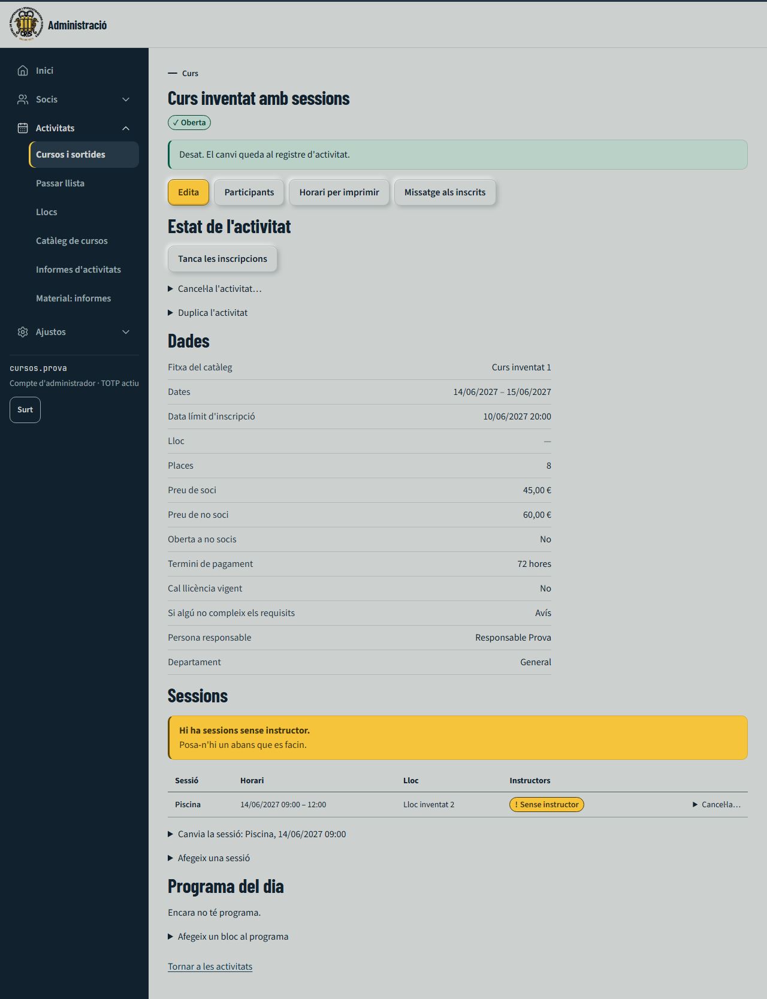

# T-DX-101 · Sessions de la fitxa: «Cancel·la…» plegat, amb l'etiqueta del motiu visible

| Data i hora (Europa/Madrid) | Commit | Proves | CI |
|---|---|---|---|
| 24/11/2026 07:09 | b0ae37b0 | 1 nova; 11 de la fitxa; 2 e2e | [A comprovar] |

**En tres línies:** he revisat la pantalla de la #536, que permet canviar una sessió des de la fitxa d'una activitat. Està bé, amb un sol punt. A la taula de sessions, cada fila portava el formulari per cancel·lar la sessió sempre obert: el camp del motiu, amb l'etiqueta amagada i només un text d'exemple, i el botó. Ara va plegat a la cel·la d'accions («Cancel·la…»), amb l'etiqueta visible, com «Cancel·la l'activitat…» (T-DX-99).

## Què s'ha fet
- `templates/activities/activity_detail.html`:
  - la cel·la d'accions de cada sessió porta un `details` amb el formulari (`formulari`);
  - l'etiqueta del motiu és visible;
  - el botó diu «Cancel·la la sessió».
- `apps/activities/tests/test_screens_dx101.py`: prova nova.
- `docs/estat/DX.md`.

## Decisions i perquè
- **Plegat:** cancel·lar una sessió es fa poc i no es desfà. Obert a cada fila, feia la taula alta i, a 1024 px, el botó queia sota el camp.
- **Etiqueta visible:** la regla de formularis la demana sempre visible. El text d'exemple no substitueix l'etiqueta.
- **El `summary` diu quina sessió és**, però només per al lector de pantalla (`visualment-amagat`). Així, amb diverses sessions, cada «Cancel·la…» es distingeix.
- **Seguretat i privacitat:** només és la plantilla. El servidor continua demanant el motiu i comprovant AC7.

## Com se sap que funciona
- La prova nova fallava sense el canvi i ara passa. També passen les de la fitxa (`test_admin_schedule.py` i la de la T-DX-99), 11 en total, i les e2e de sessions i d'estats.

## Comprovació §15.5
- **Captures mirades** a 1280, 1024, 390 i 320 px, en clar i en fosc: la fitxa amb una sessió canviada.

## Evidències
- Sessions de la fitxa a 1280 px. `captures/2026-11-24_0709_T-DX-101_sessions-1280.png`

  

  *24/11/2026 07:09 (Europa/Madrid) · local, prova e2e, dades inventades · commit b0ae37b0*
