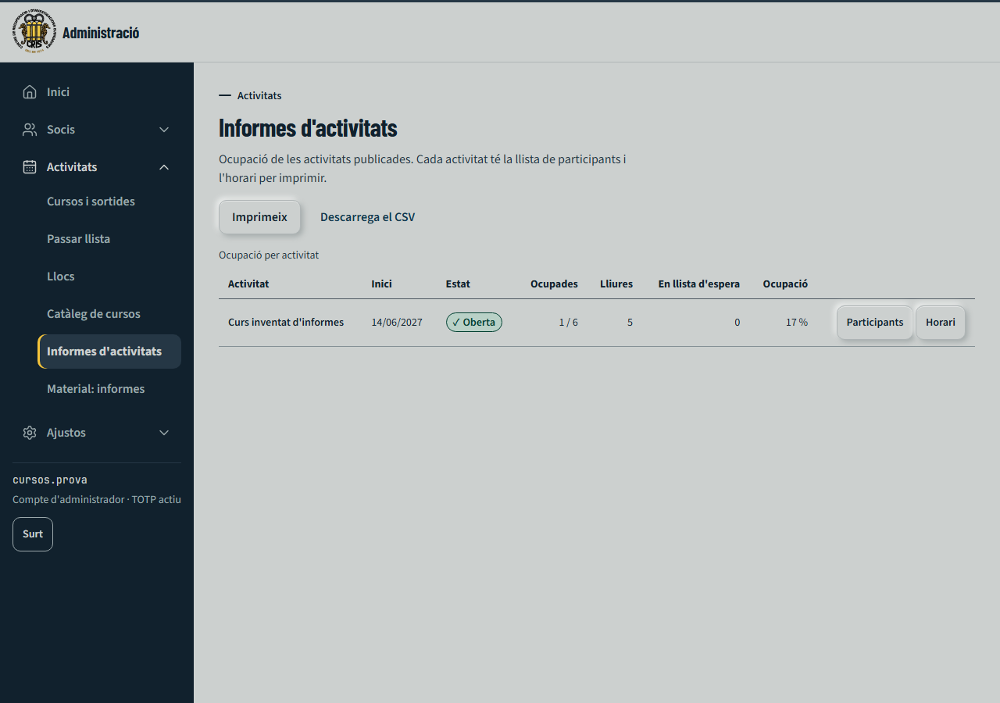
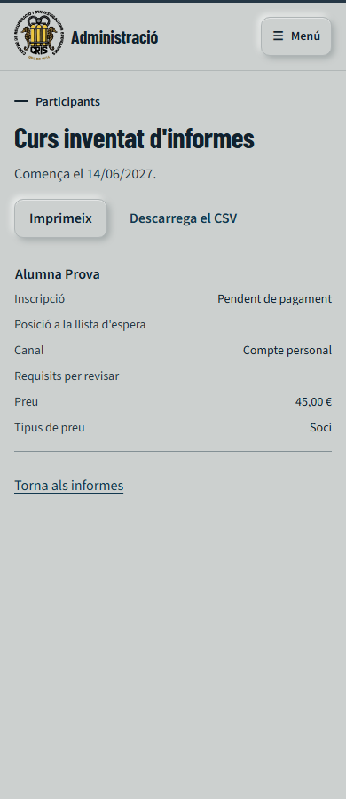
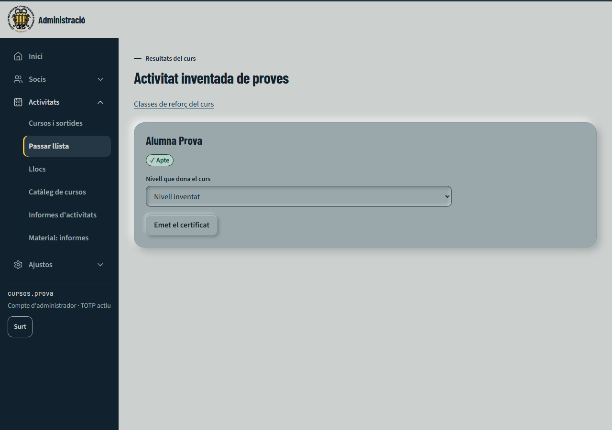

# T-DX-102 · Revisió del 02 (informes, resultats, reforç, certificat) i del 03 i el calendari d'ajuts

| Data i hora (Europa/Madrid) | Commit | Proves | CI |
|---|---|---|---|
| 24/11/2026 10:27 | 74b45d07 | 3 noves, 1 adaptada; les del 02; 4 e2e | [A comprovar] |

**En tres línies:** he revisat amb les regles B, C i D les pantalles del 02 de la #531 i la #535 (informes, resultats del curs, reforç, missatge, resultats ambientals, projecte, certificat) i les del 03 i del calendari d'ajuts, que encara no havia mirat. Hi havia quatre detalls. L'estat de l'activitat sortia en text pla, els botons repetits a cada targeta eren principals, la pantalla dels participants mostrava el preu en cèntims («4500») i el número del certificat no anava en monoespai. Ara tot segueix el sistema de disseny.

## Què s'ha fet
- `templates/activities/reports.html` i `project_detail.html`: l'estat de cada activitat amb `activities/_activity_status.html`, com a «Cursos i sortides».
- `templates/activities/course_outcomes.html` i `reinforcement_list.html`: «Emet el certificat» i «Confirma el reforç» passen a `boto`.
- `apps/activities/views/reports.py`: als participants, la columna «Preu (cèntims)» surt com a «Preu» en euros, amb `euros()` del nucli. El servei i el CSV no canvien.
- `templates/activities/my_activities.html`: el número del certificat, amb `codi`.
- `apps/activities/tests/test_screens_dx102.py`: prova nova. `test_admin_reports.py`: la prova de les columnes ara espera el preu en euros.
- `docs/estat/DX.md`.

## Decisions i perquè
- **Botons repetits (D19):** a «Resultats del curs» i a «Classes de reforç» hi ha una targeta per alumne o per proposta. Amb el botó principal a cada una, la pantalla en tenia tants com alumnes. És el mateix criteri que «Confirma…» de les llicències per confirmar (T-DX-98).
- **Preu en euros només a la pantalla (B18):** la sortida es mostra en format català. El CSV es queda en cèntims perquè qui el baixa hi fa càlculs, i les proves del servei el fixen així.
- **No tocat:** la fitxa del projecte marca «Catàleg de cursos» al menú, perquè s'hi arriba des del catàleg (criteri de la T-DX-49). A les captures de «Cost d'ús del material» amb el formulari, la capçalera de la taula surt al mig: és la capçalera fixa en una captura de pàgina sencera feta amb la pàgina desplaçada. Sense desplaçar, surt bé.
- **«En construcció»:** cap de les pantalles que queden (factures, àmbits, avaries, calendari…) té encara versió real. No se n'ha retirat cap.
- **Seguretat i privacitat:** només plantilles i el format d'una cel·la. Els permisos (AC12, AC13, AC11, AC19 i AC20) i les columnes que veu cada rol els continua decidint el servidor.

## Com se sap que funciona
- Les tres proves noves fallaven sense el canvi a les plantilles. Ara passen les tres i totes les del 02.
- E2e en verd: informes, «Les meves activitats», passar llista (resultats, reforç, certificat) i medi ambient. També el material, el cost de material i el calendari d'ajuts.

## Comprovació §15.5
- **Captures mirades** a 1280, 1024, 390 i 320 px, en clar i en fosc: informes (ocupació, participants, horari), resultats del curs, reforç (llista i proposta), missatge als inscrits, resultats ambientals, projecte, certificat (administració i alumna), «Les meves activitats», informes de material, cost d'ús, cost de material d'una activitat i calendari d'ajuts.

## Evidències
- Informes d'activitats a 1280 px. `captures/2026-11-24_1027_T-DX-102_informes-ocupacio-1280.png`

  

  *24/11/2026 10:27 (Europa/Madrid) · local, prova e2e, dades inventades · commit 74b45d07*

- Participants a 390 px. `captures/2026-11-24_1027_T-DX-102_participants-390.png`

  

  *24/11/2026 10:27 (Europa/Madrid) · local, prova e2e, dades inventades · commit 74b45d07*

- Resultats del curs a 1280 px. `captures/2026-11-24_1027_T-DX-102_resultats-curs-1280.png`

  

  *24/11/2026 10:27 (Europa/Madrid) · local, prova e2e, dades inventades · commit 74b45d07*
