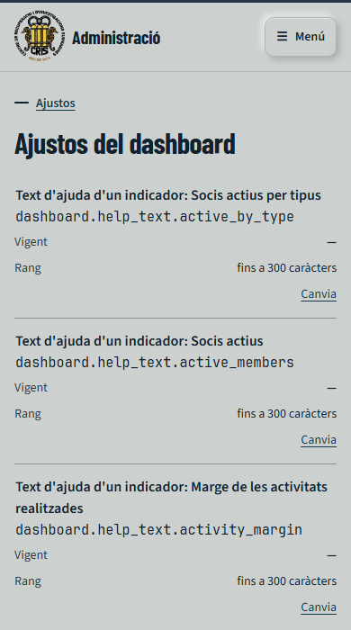

# T-DX-103 · Ajustos a 390 px: sense les cel·les buides i amb «Canvia» curt

| Data i hora (Europa/Madrid) | Commit | Proves | CI |
|---|---|---|---|
| 24/11/2026 15:33 | 8cb2c6b4 | 1 e2e nova, 1 adaptada; 12 e2e dels ajustos | [A comprovar] |

**En tres línies:** el pilot va avisar que, a 390 px, l'apartat d'ajustos «Dashboard» era una pàgina molt llarga: hi ha 25 textos d'ajuda buits i cadascun era una targeta de vuit línies. Moltes d'aquelles línies no deien res («Programat: —», «Inicial:» en blanc), i l'enllaç repetia el nom sencer. Ara les cel·les sense valor no surten a la taula apilada, l'enllaç diu «Canvia» i cada targeta té cinc línies.

## Què s'ha fet
- `templates/core/settings_section.html`:
  - «Programat» sense res programat i «Inicial» buida porten `cel-buida`;
  - «Vigent» buit diu «—»;
  - l'enllaç mostra «Canvia» o «Historial» (`aria-hidden`), i el nom sencer («Canvia: …») és en un `visualment-amagat`.
- `static/css/comptes.css`: `td.cel-buida` no surt a la taula apilada. A partir de 600 px, sí.
- `docs/design-system.md`: la cel·la sense valor i l'enllaç que es repeteix.
- Proves: e2e nova a `test_ajustos.py` (apartat del dashboard a 390 i a 1280 px). `test_business_settings_views.py` adaptada al marcatge nou.

## Decisions i perquè
- **Regla D3, «Drop redundant labels»:** «Programat: —» a cada targeta no informa. A la taula d'escriptori, «—» sí que es queda, perquè la columna ho demana.
- **Nom accessible exacte:** el primer intent posava només «: nom» en amagat, i Chromium calculava «Canvia : nom», amb un espai. El nom sencer en amagat i el verb visible amb `aria-hidden` donen «Canvia: nom», com abans, i les proves que el busquen no canvien.
- **Seguretat i privacitat:** cap canvi. «Canvia» només surt a qui pot editar, i el servidor ho torna a comprovar.

## Com se sap que funciona
- Passen les 12 e2e dels ajustos, la nova inclosa, i 478 proves de les pantalles d'ajustos de tots els mòduls.

## Comprovació §15.5
- **Captures mirades** a 1280, 1024, 390 i 320 px, en clar i en fosc: l'apartat del dashboard, el de pagaments, el de la web i el text d'ajuda del dashboard.

## Evidències
- Ajustos del dashboard a 390 px, a dalt. `captures/2026-11-24_1533_T-DX-103_dashboard-390-detall.png`

  

  *24/11/2026 15:33 (Europa/Madrid) · local, prova e2e, dades inventades · commit 8cb2c6b4*
