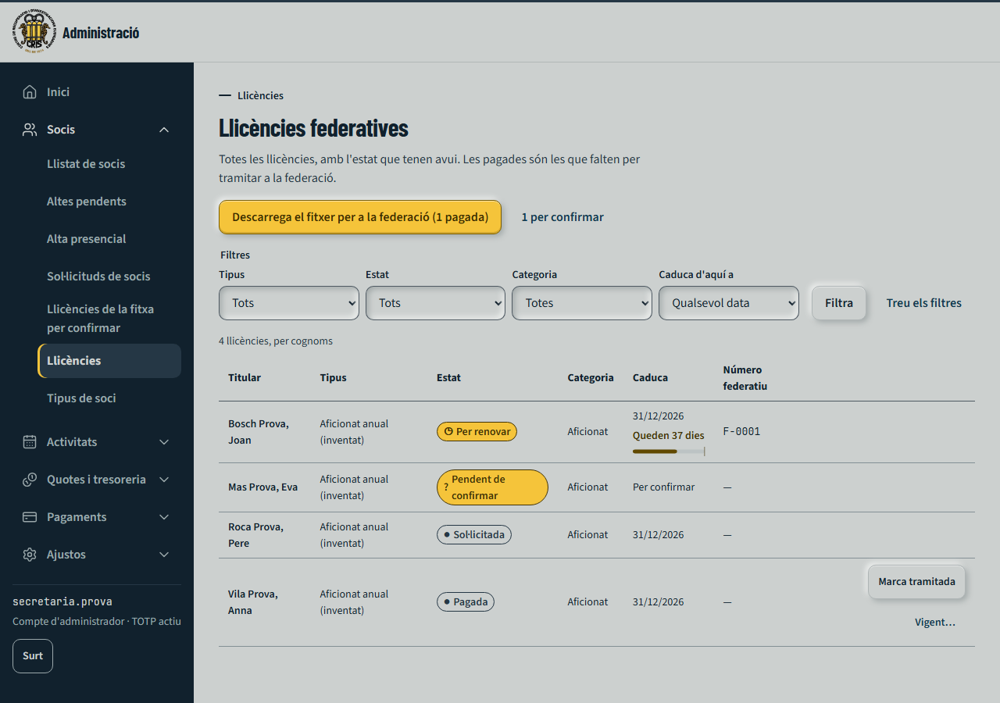
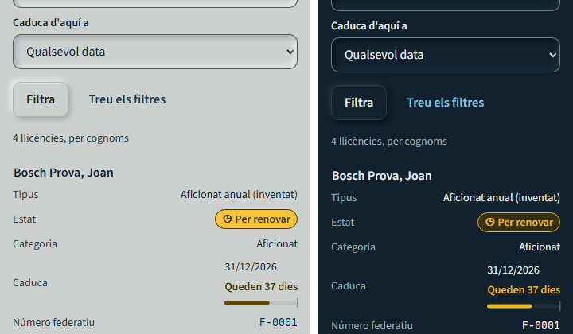

# T-DX-105 · Vigencia al llistat de llicències de l'administració (06)

| Data i hora (Europa/Madrid) | Commit | Proves | CI |
|---|---|---|---|
| 24/11/2026 15:45 | 7d26d6ef | 1 nova, 1 adaptada; les del 06 i del 01; 2 e2e | [A comprovar] |

**En tres línies:** primera tasca de l'[inventari dels recursos](../plans/recursos-disseny-extern.md#9-inventari-dús) (llesca 06). Al llistat «Llicències» de l'administració, una llicència «Per renovar» ara porta els dies que queden sota la data de caducitat, amb la regla de Vigencia. El dia d'avís de la llicència passa a ser l'ajust «Per renovar» (VC-41). Així la barra es posa en avís el mateix dia que l'estat diu «Per renovar», també a «La meva llicència» i a la fitxa del soci.

## Què s'ha fet
- `templates/licences/list.html`: `` a la cel·la «Caduca» de les files «Per renovar». La data i la peça van dins d'un sol element, perquè a la taula apilada no es reparteixin en dues columnes (com la V16).
- `templates/members/_licence_records.html`: el mateix element a la cel·la de la fitxa.
- `apps/members/templatetags/vigencia.py`: `licence_warning_days()` llegeix `licences.to_renew_days` amb el servei d'ajustos.
- `static/css/vigencia.css`: dins d'una taula, la peça va sota la data, sense el marge de bloc, i «Queden N dies» no es parteix.
- `docs/design-system.md` §6.15: els dies d'avís de la llicència i on surt la peça.
- Proves: `apps/licences/tests/test_screens_dx105.py`, nova. `test_vigencia.py` diu ara que la llicència avisa amb l'ajust.

## Decisions i perquè
- **Reutilitzar abans que fer de nou:** la peça ja existia (T-DX-13). Només canvia on surt i d'on treu el dia d'avís.
- **Només a les «Per renovar»:** és on els dies que queden canvien què ha de fer la secretaria. A les vigents, amb la data n'hi ha prou, i 30 barres farien soroll (regla D3).
- **Dia d'avís = VC-41:** abans la llicència no en tenia cap. Ara n'hi ha un d'editable a «Ajustos» (T-M06-20) i no s'afegeix cap valor nou al codi.
- **Seguretat i privacitat:** els dies surten de la data de caducitat, i aquesta només es veu amb el camp C6 (CA-M06-33). El compte el fa el servidor, mai el rellotge del navegador.

## Com se sap que funciona
- Les dues proves (la nova i l'adaptada) fallaven sense el canvi. Ara passen, i també 3.203 del 06 i del 01 i les e2e de llicències i de la fitxa.

## Comprovació §15.5
- **Captures mirades** a 1280, 1024, 390 i 320 px, en clar i en fosc: el llistat de llicències amb una «Per renovar».

## Evidències
- Llistat de llicències a 1280 px. `captures/2026-11-24_1545_T-DX-105_llistat-1280.png`

  

  *24/11/2026 15:45 (Europa/Madrid) · local, prova e2e, dades inventades · commit 7d26d6ef*

- La mateixa fila a 390 px (clar) i a 320 px (fosc). `captures/2026-11-24_1545_T-DX-105_llistat-390-320.png`

  

  *24/11/2026 15:45 (Europa/Madrid) · local, prova e2e, dades inventades · commit 7d26d6ef*
