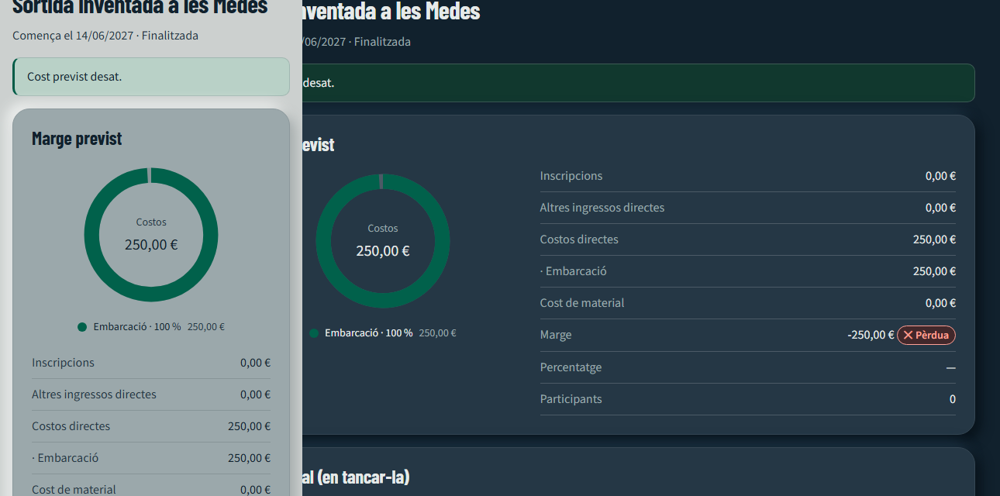

# T-DX-106 · Gastos al marge d'una activitat (09)

| Data i hora (Europa/Madrid) | Commit | Proves | CI |
|---|---|---|---|
| 24/11/2026 15:42 | f877d4cd | 2 noves; les del 09; 1 e2e | [A comprovar] |

**En tres línies:** llesca 09 de l'[inventari dels recursos](../plans/recursos-disseny-extern.md#9-inventari-dús). Fins ara, la peça Gastos només sortia a la pantalla en construcció «Finances per àmbit». Ara és un component, i el marge d'una activitat el fa servir: un anell amb on van els costos (cada categoria i el cost de material), amb el total al mig i la llegenda «nom · N %» i l'import.

## Què s'ha fet
- `apps/margins/templatetags/gastos.py`: ``.
  - Rep parelles (nom, cèntims) i les ordena.
  - Si n'hi ha més de cinc, ajunta les menors a «Altres».
  - Calcula els percentatges i els segments sobre `pathLength="100"`.
- `templates/_gastos_anell.html`: el parcial de l'anell. SVG amb atributs, sense `style=`.
- `apps/margins/views.py`: `_lines` hi afegeix `segments`, en cèntims: els costos per categoria i el cost de material.
- `templates/margins/activity.html`: l'anell al costat de les xifres del marge previst i del real (`gastos-cols`).
- `static/css/gastos.css`: cinquè color («Altres», `--c-text-2`), i dins d'una targeta l'anell fa 192 px.
- `docs/design-system.md` §6.23: la peça.
- Proves: `apps/margins/tests/test_screens_dx106.py` (l'etiqueta i la pantalla).

## Decisions i perquè
- **Reutilitzar:** es fa servir el dibuix i el CSS de la T-DX-33, i el càlcul passa del contingut d'exemple a una etiqueta. La T-DX-107 (despeses) i, quan tingui pantalla, l'informe per departament (T-M09-14) la poden fer servir.
- **L'etiqueta és a `apps/margins`, no a `apps/core`:** el pilot té feina oberta al nucli. Les biblioteques d'etiquetes són de tot el projecte, i una altra app la pot carregar amb ``.
- **Cinc colors i «Altres» (B16):** un grup de més de cinc colors ja no es llegeix.
- **Mida (D13):** la xifra principal és el marge. A 390 px, l'anell a mida completa empenyia el marge fora de la pantalla, i per això fa 192 px.
- **Seguretat i privacitat:** només imports i categories, sense cap persona. Els permisos de la pantalla (MG5 a MG7) no canvien.

## Com se sap que funciona
- La prova de l'etiqueta fallava abans de crear-la. Ara passen les dues i les 102 del 09, i també l'e2e del marge i la de la pantalla en construcció de finances.

## Comprovació §15.5
- **Captures mirades** a 1280, 1024, 390 i 320 px, en clar i en fosc: el marge previst (amb un cost previst) i el congelat (sense anell).

## Evidències
- Marge previst a 390 px (clar) i a 1280 px (fosc). `captures/2026-11-24_1542_T-DX-106_marge-390-1280.png`

  

  *24/11/2026 15:42 (Europa/Madrid) · local, prova e2e, dades inventades · commit f877d4cd*
