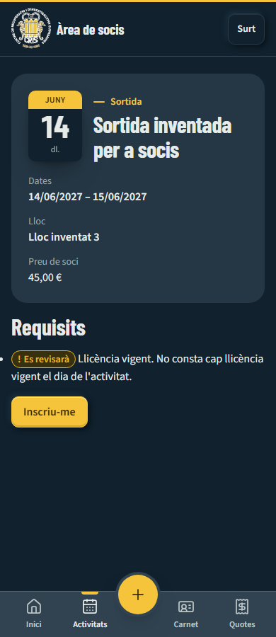

# T-DX-109 · Convite a la fitxa pública i a les inscripcions d'una activitat (02)

| Data i hora (Europa/Madrid) | Commit | Proves | CI |
|---|---|---|---|
| 24/11/2026 16:33 | 754fda85 | 1 nova; les 865 del 02; 3 e2e | [A comprovar] |

**En tres línies:** llesca 02 de l'[inventari dels recursos](../plans/recursos-disseny-extern.md#9-inventari-dús). La peça Convite (P-99 A) s'havia quedat sense pantalla quan es va retirar la fitxa en construcció (T-DX-95). Ara és la capçalera de la fitxa pública d'una activitat i de les dues inscripcions, la del soci i la del convidat, amb el full de calendari, el títol i les dades clau.

## Què s'ha fet
- `templates/activities/_convite_cap.html`: el parcial comú, amb el full de calendari (`aria-hidden`), l'avantítol, l'`h1` i `convite-dades` (dates, lloc amb el punt de trobada, i el preu que toca a qui mira).
- `templates/activities/public_detail.html`: la capçalera amb la descripció i la inscripció (`boto-principal boto-gran`). La resta va a «Detalls», sense repetir dates, lloc ni preus.
- `templates/activities/member_enrol.html` i `guest_enrol.html`: la mateixa capçalera, amb el preu del soci o del convidat.
- `static/css/convite.css`: l'`h1` dins la capçalera, i el botó principal centrat quan es parteix a 320 px.
- `docs/design-system.md` §6.24 i la nota de la T-DX-38.
- `docs/estat/DX.md`: la T-DX-109 feta i la T-DX-108 ajornada.
- Prova: `apps/activities/tests/test_screens_dx109.py`.

## Decisions i perquè
- **Reutilitzar:** la peça i el CSS ja existien (T-DX-38). Un sol parcial fa que les tres pantalles del recorregut d'apuntar-se comencin igual.
- **Sense barra de places:** el pla vol les places lliures al detall (HU-M02-06), però `public.py` encara no les compta (T-M02-12). Calcular-les és codi del 02. S'ha demanat al pilot que n'exposi el número, i la barra hi anirà quan el doni.
- **Sense «Afegeix al calendari» ni recordatori:** el calendari és només de qui ja està inscrit (RN-M02-25), i ja és a «Les meves activitats».
- **T-DX-108 ajornada:** «Les meves factures» és una llista que ja segueix el sistema. Emisor és el full d'una factura i el formulari d'emetre-la, i tots dos depenen de la factura en PDF (T-M09-04b, bloquejada). Vestir la llista de paper no aportaria res (D6).
- **Seguretat i privacitat:** cap dada nova. Les dades són les de `public.py`, que mai no hi posa cap nom de participant ni cap nota del lloc. Inscriure's continua passant pel servidor.

## Com se sap que funciona
- La prova nova fallava sense el canvi. Ara passen la nova i les 865 del 02, i també les e2e de les pàgines públiques i de les dues inscripcions.
- **Incident:** a les 16:15 la màquina es va quedar sense memòria i el PostgreSQL local va caure («out of memory»). Es va recuperar sol a les 16:21. Les proves es van tornar a passar després.

## Comprovació §15.5
- **Captures mirades** a 1280, 1024, 390 i 320 px, en clar i en fosc: la fitxa pública, la inscripció del soci (amb un requisit en avís i amb el pagament) i la del convidat (amb Errata i en presencial).

## Evidències
- Fitxa pública a 1280 px. `captures/2026-11-24_1633_T-DX-109_fitxa-publica-1280.png`

  

  *24/11/2026 16:33 (Europa/Madrid) · local, prova e2e, dades inventades · commit 754fda85*

- Inscripció del soci a 390 px, en fosc. `captures/2026-11-24_1633_T-DX-109_inscripcio-soci-390-fosc.png`

  

  *24/11/2026 16:33 (Europa/Madrid) · local, prova e2e, dades inventades · commit 754fda85*
