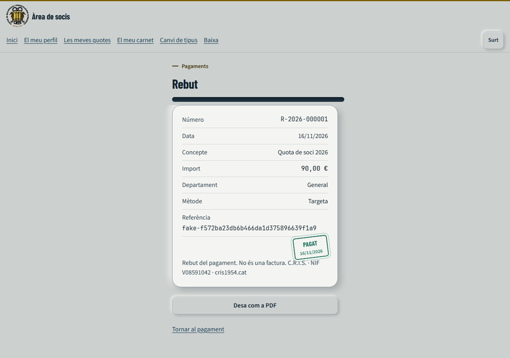

# T-DX-11 · El rebut: la ranura i el segell

| Data i hora (Europa/Madrid) | Commit | Proves | CI |
|---|---|---|---|
| 16/11/2026 16:11 | 7a5d9d4, ab93d95 | e2e del rebut i captures | [A comprovar] (PR #62) |

**En tres línies:** en obrir el rebut d'un pagament, el document surt d'una ranura com d'una impressora de tiquets, i després hi cau el segell «Pagat» amb la data. Si es desa com a PDF o s'imprimeix, surt en blanc i negre, sense la ranura.

## Què s'ha fet
- `templates/payments/receipt.html`: la ranura, el paper i el segell. `static/css/ranura.css`, només amb tokens. Detall: [design-system §6.14](../design-system.md#614-el-rebut-la-ranura-i-el-segell-t-dx-11).
- La *fixture* `capture` de les e2e espera que acabin les animacions finites abans de fer la foto. Abans, la captura del rebut sortia a mig moviment.
- Fila a [`estat/DX.md`](../estat/DX.md).

## Decisions i perquè
- **El segell no depèn del navegador:** la pàgina del rebut només existeix quan el servidor ha confirmat el pagament (RN-M05b-19), així que el segell no pot sortir abans d'hora (B10).
- **P-93, opció C (resposta del propietari):** d'Emisor només se n'agafa l'estètica, el segell. La factura és de la 09.
- **El segell va dins del flux, sota les dades i a la dreta:** a la primera versió, a dalt a la dreta, tapava el número del rebut.
- **El paper és `--paper`, clar als dos temes,** com el justificant de la impressora del wireframe.

## Problemes trobats
- Una prova comprova que la paraula «rebut» no surti a les pantalles de quotes, on no s'ofereix cap rebut. El primer nom del full d'estil, `rebut.css`, enllaçat a la plantilla base, la contenia. Ara es diu `ranura.css`.
- El segell quedava a l'esquerra: la targeta col·loca els fills en una graella. Ho ha resolt `justify-self: end`.

## Com se sap que funciona
- L'e2e del rebut (`test_rebut.py`): el número, el concepte, el departament, el mètode, «No és una factura» i «Desa com a PDF» continuen a la pàgina amb la ranura i el segell.
- Proves de l'àrea personal i de pagaments: 393 passades. Bateria sencera: 4.776 proves unitàries (més la del nom, ja arreglada) i 62 e2e amb 1 xfail que ja hi era.

## Evidències
- El rebut a 1280 px: `captures/2026-11-16_1611_T-DX-11_rebut-1280.png`

  

  *16/11/2026 16:11 (Europa/Madrid) · local, prova e2e, proveïdor fals, soci inventat · commit 7a5d9d4*
- A 390 px: `captures/2026-11-16_1611_T-DX-11_rebut-390.png`

  *16/11/2026 16:11 (Europa/Madrid) · local, prova e2e · commit 7a5d9d4*
- Sortida de proves · commit ab93d95 · executada el 16/11/2026 en local (PostgreSQL 16):
  ```
  $ pytest apps/members/tests/test_personal_area.py apps/payments -q
  393 passed
  $ pytest -m e2e apps/core/tests/e2e/test_rebut.py -q
  1 passed
  ```
