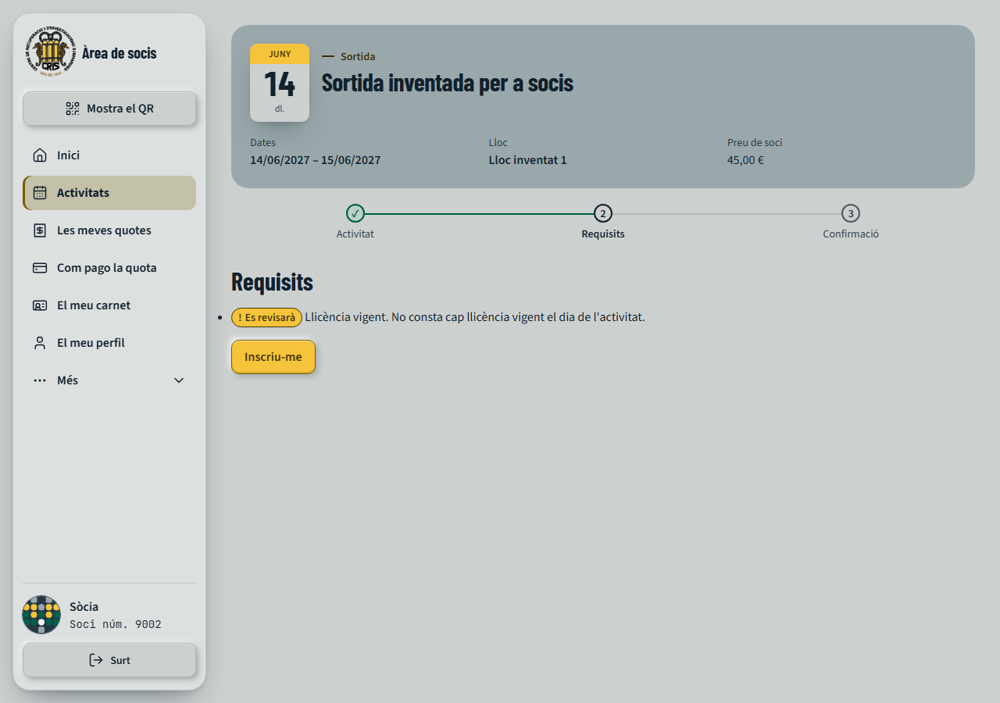
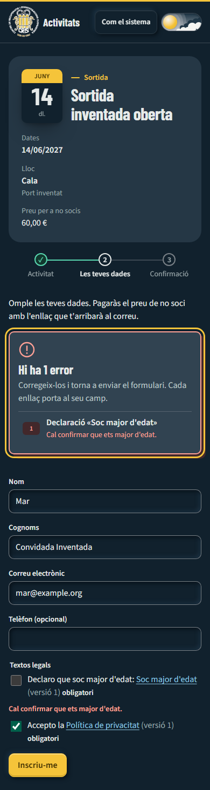

# T-DX-110 · Camilla: els passos d'apuntar-se a una activitat (02)

| Data i hora (Europa/Madrid) | Commit | Proves | CI |
|---|---|---|---|
| 24/11/2026 17:33 | b31b7914 | 1 nova; les 866 del 02; 2 e2e | [A comprovar] |

**En tres línies:** llesca 02 de l'[inventari dels recursos](../plans/recursos-disseny-extern.md#9-inventari-dús). Camilla (P-94 A) és el flux d'inscripció per passos. Ara la inscripció del soci i la del convidat diuen on és la persona: «Activitat», «Requisits» o «Les teves dades», i «Confirmació». Es fa amb la línia de passos de Tramite, sense cap peça nova.

## Què s'ha fet
- `templates/activities/_passos_inscripcio.html`: els tres passos amb `tramite`. El pas actual porta `aria-current="step"`, i els fets, «fet» per al lector de pantalla.
- `templates/activities/member_enrol.html`:
  - pas 2 abans d'inscriure's;
  - pas 3 amb una inscripció pendent;
  - tots fets si és confirmada.
- `templates/activities/guest_enrol.html`: pas 2 omplint les dades, i pas 3 un cop enviat el correu.
- `docs/design-system.md` §6.26.
- `docs/estat/DX.md`: la T-DX-110 feta i la T-DX-111 (Asueto) «no cal».
- Prova: `apps/activities/tests/test_screens_dx110.py`.

## Decisions i perquè
- **Reutilitzar (indicació del propietari):** Camilla ja demanava la línia de Tramite (§6.13), que té tres passos per defecte. No calia el CSS de quatre passos de `camilla.css`.
- **«Confirmació» i no «Pagament»:** una activitat gratuïta es confirma sense pagar. Amb preu, la confirmació arriba en pagar.
- **Asueto, no cal:** el que té de propi (l'horari del local, el dia tancat, «Mou-la») no és al pla. El programa del dia ja es llegeix bé com a taula, i l'agenda d'Horario (§6.25) el podria mostrar si calgués.
- **Seguretat i privacitat:** cap dada nova. Els passos depenen de l'estat de la inscripció de la mateixa persona, que la vista ja dona. Cap camp de salut.

## Com se sap que funciona
- La prova nova fallava sense el canvi. Ara passen la nova i les 866 del 02, i també les e2e de les dues inscripcions.

## Comprovació §15.5
- **Captures mirades** a 1280, 1024, 390 i 320 px, en clar i en fosc: la inscripció del soci (requisits i pagament) i la del convidat (amb Errata i en presencial).

## Evidències
- Inscripció del soci a 1280 px. `captures/2026-11-24_1733_T-DX-110_inscripcio-soci-1280.png`

  

  *24/11/2026 17:33 (Europa/Madrid) · local, prova e2e, dades inventades · commit b31b7914*

- Inscripció d'un convidat a 390 px, en fosc. `captures/2026-11-24_1733_T-DX-110_convidat-390-fosc.png`

  

  *24/11/2026 17:33 (Europa/Madrid) · local, prova e2e, dades inventades · commit b31b7914*
