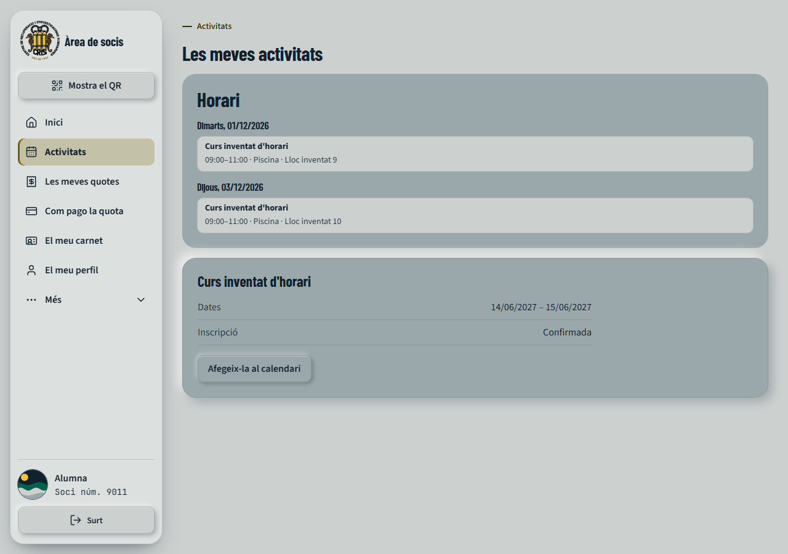
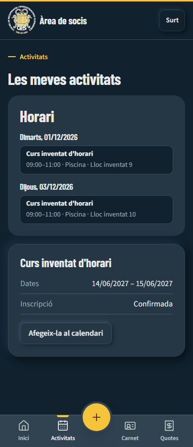

# T-DX-112 · Horario a «Les meves activitats» (02) i el calendari d'una inscripció sense reforços d'altres

| Data i hora (Europa/Madrid) | Commit | Proves | CI |
|---|---|---|---|
| 24/11/2026 16:49 | 91a4c1c0 | 1 nova, 1 e2e nova; les del 02 i de les pantalles en construcció | [A comprovar] |

**En tres línies:** llesca 02 de l'[inventari dels recursos](../plans/recursos-disseny-extern.md#9-inventari-dús). El pla diu que «Les meves activitats» ha de portar l'horari (C16), i fins ara no el portava. Ara hi ha una agenda per dies amb la peça Horario, amb les properes sessions on la persona té plaça. Fent-la, he trobat un error que ja hi era: el calendari `.ics` d'una inscripció també portava les sessions de reforç d'altres alumnes.

## Què s'ha fet
- `apps/activities/views/my_activities.py`:
  - `_own_sessions(enrolment)`: les sessions del grup i els reforços d'aquell alumne. Ara el `.ics` la fa servir.
  - `_agenda(person)`: les sessions no cancel·lades que no han acabat, de les inscripcions amb plaça, agrupades per la data local.
- `templates/activities/my_activities.html`: la secció «Horari», amb `horario-dies`, `horario-dia` i `horario-acte`.
- `static/css/horario.css`: les regles de la graella setmanal només s'apliquen dins de `.horario-graella`, perquè l'agenda no es converteixi en set columnes a 1024 px. El títol del dia admet `h3`.
- `docs/design-system.md` §6.25 i `docs/estat/DX.md`.
- Proves: `apps/activities/tests/test_screens_dx112.py`, i l'e2e nova `test_a_student_sees_her_schedule`.

## Decisions i perquè
- **Agenda i no graella:** la graella setmanal és la del calendari general, que el pla no té i que es queda en construcció. A «Les meves activitats», l'agenda llista el que toca i es llegeix bé a totes les mides.
- **Només amb plaça:** qui és a la llista d'espera no té cap sessió assegurada, i per això no surt a l'horari. Al `.ics`, en canvi, continua sortint (és el comportament que ja hi era, `LIVE`).
- **L'error del `.ics` (RN-M02-25):** la vista passava `activity.sessions`, i el fitxer d'un alumne portava també les classes de reforç d'un company. No hi surten noms, però sí quan i on fa classe un altre alumne. Primer la prova que ho reprodueix, que fallava, i després l'arreglo, en un sol lloc per al `.ics` i l'agenda. És codi del 02 i el pilot no hi era (la sessió va caure a les 16:15): queda dit aquí i a la PR.
- **Data:** «Dimarts, 01/12/2026», amb el format de data de l'aplicació (B18). El format llarg en català no posa el «de» del mes.
- **Seguretat i privacitat:** només les inscripcions de la persona del compte, com la resta de la pàgina. Cap nom d'altres participants.

## Com se sap que funciona
- La prova nova fallava amb l'error del `.ics`. Ara passa, i també les 938 del 02 i de les pantalles en construcció, i les tres e2e de «Les meves activitats», la nova inclosa.

## Comprovació §15.5
- **Captures mirades** a 1280, 1024, 390 i 320 px, en clar i en fosc: «Les meves activitats» amb l'horari, i el calendari en construcció, on la graella setmanal no ha canviat.

## Evidències
- «Les meves activitats» amb l'horari, a 1280 px. `captures/2026-11-24_1649_T-DX-112_horari-1280.png`

  

  *24/11/2026 16:49 (Europa/Madrid) · local, prova e2e, dades inventades · commit 91a4c1c0*

- El mateix a 390 px, en fosc. `captures/2026-11-24_1649_T-DX-112_horari-390-fosc.png`

  

  *24/11/2026 16:49 (Europa/Madrid) · local, prova e2e, dades inventades · commit 91a4c1c0*
