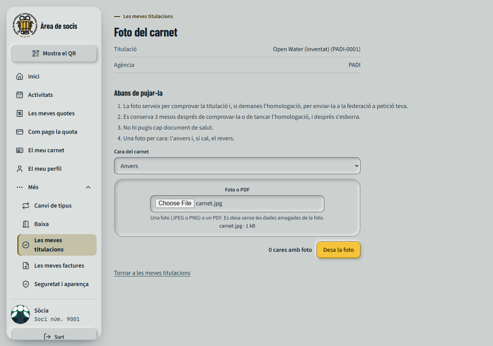

# T-DX-117 · Expositor a la foto del carnet: la zona per arrossegar-hi la foto, i «Foto del carnet» al menú del soci

| Data i hora (Europa/Madrid) | Commit | Proves | CI |
|---|---|---|---|
| 24/11/2026 18:00 | 2c4a74cd | 1 de navegació, 1 e2e ampliada | [A comprovar] |

**En tres línies:** és una petició del pilot (T-M02-42b): la foto del carnet d'una titulació ja feia servir Expositor, però sense la zona per arrossegar-hi la foto. La peça `zona-magnetica` ja era al CSS, i el seu JavaScript només existia als wireframes. Ara és una millora progressiva comuna (`static/js/zona-magnetica.js`). A més, «Foto del carnet» marca «Les meves titulacions» al menú del soci.

## Què s'ha fet
- `static/js/zona-magnetica.js`, per a cada `.zona-magnetica[data-zona-magnetica]` que té un camp de fitxer a dins:
  - es pot deixar-hi el fitxer arrossegant-lo (`a-sobre`);
  - diu el nom i la mida (`te-fitxer`);
  - si no compleix l'`accept`, buida el camp i ho diu en text (`te-error`, amb el missatge de `data-error-tipus`).
- `templates/activities/_card_photo.html`: el camp de la foto dins de la zona. `my_card_photo.html` i `admin_card_photo.html` carreguen el JS.
- `templates/members/_ramillete.html` i `_personal_nav.html`: `activities:my_certification_photo` com a subpàgina de «Les meves titulacions» (T-DX-76).
- `docs/design-system.md`, a la fila «Zona per pujar fitxers», i `docs/estat/DX.md`.
- Proves:
  - la parella nova a `apps/core/tests/test_personal_nav_subpages.py`;
  - a `test_fotos_titulacions.py`, un fitxer de text dona error i buida el camp, i la foto en diu el nom.

## Decisions i perquè
- **Reutilitzar (indicació del propietari):** la peça ja era al sistema i només li faltava el comportament. Abans de fer-ne una de nova es va mirar si n'hi havia cap. La T-DX-116 (documents de les despeses) farà servir la mateixa.
- **Millora progressiva:** sense JavaScript, el camp de sempre continua dins de la zona, amb la seva etiqueta. Amb JavaScript no s'amaga res: el camp continua sent el control i el teclat funciona igual.
- **Sense l'imant ni la llum dels wireframes:** no informen (D6) i demanaven animació.
- **Seguretat i privacitat:** el navegador no puja res ni mostra la foto. Només llegeix el nom, la mida i el tipus del fitxer triat. El servidor torna a comprovar el tipus pel contingut, la mida, el titular o AC25 i VC-56.

## Com se sap que funciona
- Passen les 37 proves de navegació i de la foto del carnet, i l'e2e de la foto amb la zona.

## Comprovació §15.5
- **Captures mirades** a 1280, 1024, 390 i 320 px, en clar i en fosc: la foto del carnet (soci, abans i amb la foto triada) i la de la secretaria. A 390 px, la barra del soci surt al mig de la captura perquè la captura és de pàgina sencera i la pàgina estava desplaçada. No és cap error.

## Evidències
- La foto triada a 1280 px. `captures/2026-11-24_1800_T-DX-117_foto-triada-1280.png`

  

  *24/11/2026 18:00 (Europa/Madrid) · local, prova e2e, dades inventades · commit 2c4a74cd*
