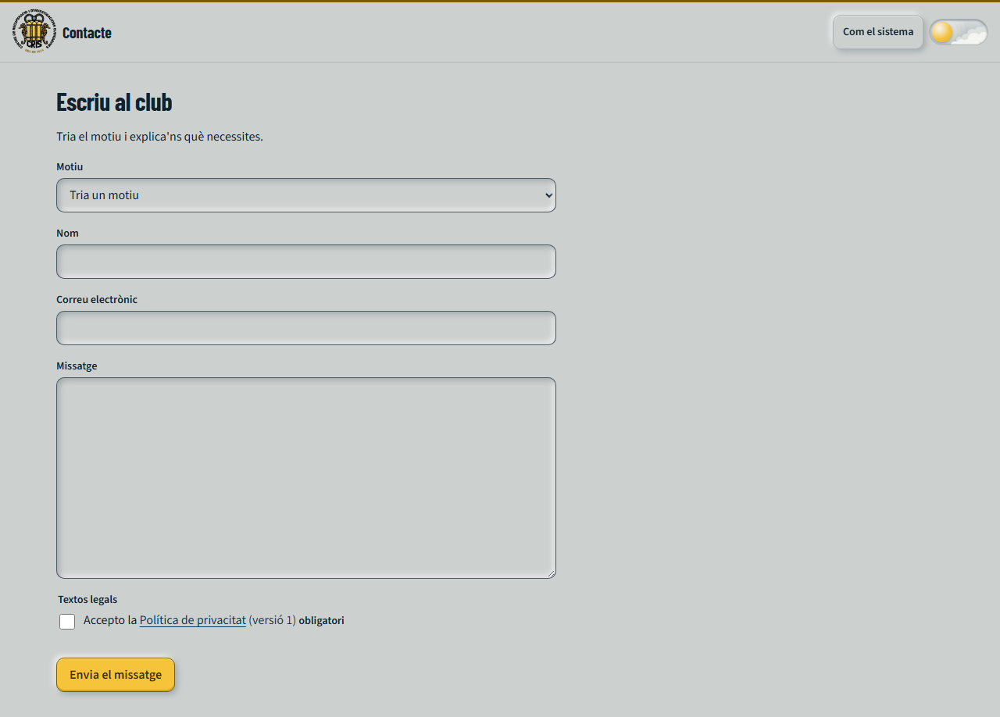

# T-DX-119 · Contacte (07): sense recurs de moment

| Data i hora (Europa/Madrid) | Commit | Proves | CI |
|---|---|---|---|
| 24/11/2026 23:33 | a447c953 | cap (només documentació); e2e del contacte mirada | [A comprovar] |

**En tres línies:** és una petició del pilot (carril A, T-M07-11). La pantalla pública `/contacte/` no tenia cap recurs assignat al mapa. Revisada amb les regles B, C i D, segueix el sistema: formulari, Errata i textos legals, com «Demana la llicència». La decisió per defecte, que és reversible, és no posar-hi cap recurs ara. Quan l'ajuda pública del 07 tingui preguntes, Recoveco anirà al costat del formulari.

## Què s'ha fet
- `docs/plans/recursos-disseny-extern.md` §6.5: la fila «Contacte» amb l'estat i la decisió.
- `docs/estat/DX.md`: la T-DX-119, feta.

## Decisions i perquè
- **Recoveco, més endavant:** hi encaixa (qui escriu al club troba abans la resposta), però avui l'ajuda pública és en construcció i no té preguntes. Posar-hi el recurs sense contingut seria una caixa buida.
- **Cap canvi a la plantilla:** és del carril del pilot (07). Hi ha un suggeriment per a ell: després de «Missatge enviat» no hi ha cap enllaç per tornar a la portada.

## Com se sap que funciona
- No hi ha codi. L'e2e del contacte (`test_web_contacte.py`) passa, i les captures s'han mirat.

## Comprovació §15.5
- **Captures mirades** a 1280, 1024, 390 i 320 px, en clar i en fosc: el formulari i «Missatge enviat».

## Evidències
- El formulari de contacte a 1280 px. `captures/2026-11-24_2333_T-DX-119_contacte-1280.png`

  

  *24/11/2026 23:33 (Europa/Madrid) · local, prova e2e, dades inventades · commit a447c953*
