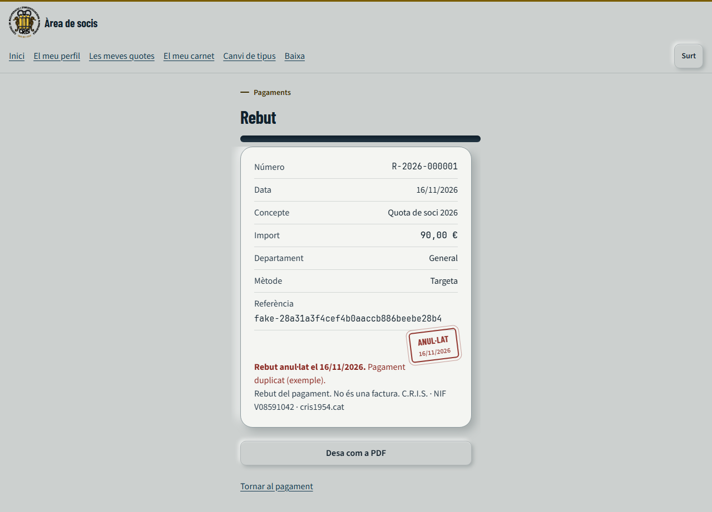

# T-DX-11b · Ranura: el rebut anul·lat

| Data i hora (Europa/Madrid) | Commit | Proves | CI |
|---|---|---|---|
| 16/11/2026 22:06 | 4fa6e45 | 2 noves, 1 ampliada | [A comprovar] (PR #110) |

**En tres línies:** quan la tresoreria anul·la un rebut (la #105 hi afegeix l'anul·lació amb una nota, sense esborrar-lo), el rebut ja no porta el segell «Pagat». Ara hi diu «Anul·lat», amb la data, en grana i sense animació, i a sota, la nota de l'anul·lació. De pas, el rebut ja no sobresurt de la pantalla a 320 px.

## Què s'ha fet
- `templates/payments/receipt.html`: amb `receipt.cancellation`, el segell «Anul·lat» i la nota; sense, el segell «Pagat» de sempre.
- `static/css/ranura.css` (`.rebut-segell.es-anullat`, `.rebut-nota-anullacio`) i el primitiu `--grana` a `static/css/tokens.css`. Detall: [design-system §6.14](../design-system.md#614-el-rebut-la-ranura-i-el-segell-t-dx-11).
- Fila nova a [`estat/DX.md`](../estat/DX.md): la tasca la va demanar el pilot, perquè el rebut és una peça del carril de disseny (T-DX-11).

## Decisions i perquè
- **Un primitiu nou, `--grana`:** el paper del rebut és clar als dos temes, i el color d'error del tema fosc és clar. Sobre el paper no arribava al contrast mínim. `--grana` és el mateix vermell que l'error del tema clar, fix, amb 8,3:1 sobre `--paper`.
- **Sense animació:** el segell que cau celebra un pagament (B10). Un rebut anul·lat no celebra res.
- **La nota es veu:** la nota és la que escriu la tresoreria en anul·lar (045), i el rebut només el veu la persona del pagament.

## Problemes trobats
- La prova nova a 320 px va trobar que el rebut sobresortia 8 px. Era de la T-DX-11: el marge negatiu de `.rebut-sortida` (`--e-5`) era més gran que el farciment de la pàgina (`--e-4`). Fins ara el rebut no s'havia comprovat a 320 px.

## Com se sap que funciona
- `apps/payments/tests/test_rebut_anullat.py`: un rebut anul·lat porta «Anul·lat» i la nota, i el segell no diu «Pagat». Un rebut sense anul·lació no canvia.
- `apps/core/tests/e2e/test_rebut.py`, ampliada: després de pagar, la tresoreria anul·la el rebut, i la pàgina diu «Anul·lat» i la nota, amb captures a 1280, 390 i 320 px, en clar i en fosc, sense desplaçament lateral.
- Les proves del rebut que ja hi havia i les dels tokens passen (25).

## Evidències
- Rebut anul·lat a 1280 px: `captures/2026-11-16_2206_T-DX-11b_rebut-anullat-1280.png`

  

  *16/11/2026 22:06 (Europa/Madrid) · local, prova e2e, soci inventat · commit 4fa6e45*
- A 320 px, en fosc: `captures/2026-11-16_2206_T-DX-11b_rebut-anullat-320-fosc.png`

  *16/11/2026 22:06 (Europa/Madrid) · local, prova e2e · commit 4fa6e45*
- Sortida de proves · executada el 16/11/2026 en local (PostgreSQL 16):
  ```
  $ pytest apps/payments/tests/test_rebut_anullat.py apps/payments/tests/test_receipts.py apps/core/tests/test_tokens_color.py apps/core/tests/test_tokens_moviment.py -q
  25 passed
  $ pytest -m e2e apps/core/tests/e2e/test_rebut.py -q
  1 passed
  ```
