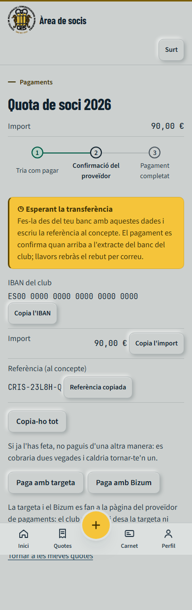

# T-DX-12 · Deposito: «Copia-ho tot» a la transferència i el comprovant

| Data i hora (Europa/Madrid) | Commit | Proves | CI |
|---|---|---|---|
| 16/11/2026 22:48 | 734376c | 1 nova (més les comunes de pantalles) | [A comprovar] (PR #114) |

**En tres línies:** a la pantalla de pagament per transferència, a més de copiar cada dada per separat, ara hi ha «Copia-ho tot»: l'IBAN del club, l'import i la referència d'un cop, una per línia. El comprovant de la transferència (pujar-lo i seguir-ne l'estat) és una proposta que el pla no té, i per això surt com a pantalla «En construcció».

## Què s'ha fet
- `templates/payments/_status.html`: el botó «Copia-ho tot», amb el mateix `copia.js` de la T-M05b-06 (sense codi nou).
- `apps/previews/screens/comprovant_transferencia.py` i `templates/previews/comprovant_transferencia.html`: `/en-construccio/comprovant-transferencia/`, amb els passos de Tramite i el formulari desactivat.
- Subsecció a [design-system §16](../design-system.md#t-dx-12-deposito-pagar-per-transferència-i-el-comprovant) i fila a [`estat/DX.md`](../estat/DX.md): deixa d'estar bloquejada, perquè la T-M05b-06 (#85) ja és a `master`.

## Decisions i perquè
- **El comprovant, en construcció:** el pla no en té cap regla (D1), i un bloc «En construcció» dins de la pantalla real el veurien els socis a producció (P-90 ho impedeix). Com a pantalla a part, només el veu qui té el permís de previsualitzar.
- **Cap promesa de regla:** la primera versió de l'ajuda deia què es faria amb un IBAN que sortís al comprovant. Ho he tret: no és cap regla del pla.
- **El pagament no canvia:** només es confirma amb l'extracte del banc del club (B10). El comprovant, quan funcioni, només ajudarà la tresoreria.

## Problemes trobats
- Cap.

## Com se sap que funciona
- `apps/payments/tests/test_transfer_copia.py`: «Copia-ho tot» porta les tres dades, una per línia, i el missatge de copiat. Les 15 proves de transferència que ja hi havia passen.
- Les proves comunes de pantalles (`apps/previews`, 15) i les e2e de la transferència i del comprovant (2) passen, amb captures a 1280, 390 i 320 px.

## Evidències
- La transferència en espera amb «Copia-ho tot», a 390 px: `captures/2026-11-16_2248_T-DX-12_copia-ho-tot-390.png`

  

  *16/11/2026 22:48 (Europa/Madrid) · local, prova e2e, soci inventat · commit 734376c*
- El comprovant en construcció, a 320 px en fosc: `captures/2026-11-16_2248_T-DX-12_comprovant-320-fosc.png`

  *16/11/2026 22:48 (Europa/Madrid) · local, prova e2e, contingut d'exemple · commit 734376c*
- Sortida de proves · executada el 16/11/2026 en local (PostgreSQL 16):
  ```
  $ pytest apps/payments/tests/test_transfer_copia.py apps/payments/tests/test_transfer.py -q
  16 passed
  $ pytest -m e2e apps/core/tests/e2e/test_previews.py apps/core/tests/e2e/test_pagament_transferencia.py -k "comprovant or transfer" -q
  2 passed
  ```
