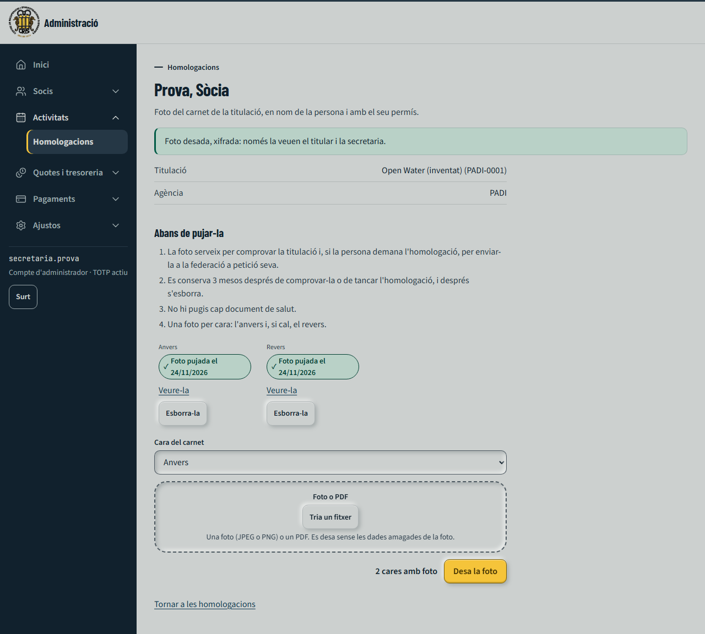

# T-DX-120 · Revisió de la T-M02-49: fotos del carnet, homologació i primera estrella

| Data i hora (Europa/Madrid) | Commit | Proves | CI |
|---|---|---|---|
| 24/11/2026 23:05 | 14af7085 | e2e de fotos ampliada; e2e de despeses, homologacions i primera estrella | [A comprovar] |

**En tres línies:** el pilot va trobar set retocs menors en revisar les captures de la T-M02-49. Se n'han fet sis. El setè, el contrast de les targetes en clar, ja compleix l'AA i no s'ha tocat. El més visible és «Tria un fitxer»: el botó natiu del camp de fitxer sortia en la llengua del navegador («Choose File»), i ara la zona hi posa un botó del sistema en català.

## Què s'ha fet
- **«Tria un fitxer»** (`static/js/zona-magnetica.js` i `static/css/tokens.css`, `zm-tria-fitxer`): amb `data-tria`, un `boto boto-petit` al lloc del botó natiu. El camp continua a sobre, transparent, i rep el clic, el teclat i el nom accessible. El focus es veu al botó. Es fa servir a la foto del carnet i als documents d'una despesa.
- **Espai sota la barra del soci** (`static/css/ramillete.css`): al mòbil, el cos deixa també l'espai del botó central, que sobresurt `--e-5`. Abans, el darrer element de qualsevol pantalla del soci hi podia quedar tapat.
- **«Abans de pujar-la»** (`static/css/expositor.css`): la llista fa `--amplada-formulari`, com el formulari.
- **«Esborra-la»** (`templates/activities/_card_photo.html`): `boto boto-petit`. Abans era un `boto-text` que semblava text negre al costat de l'enllaç «Veure-la».
- **Pantalla de la secretaria:** la primera regla, en tercera persona («si la persona demana l'homologació… a petició seva»), amb `secretaria=True` des d'`admin_card_photo.html`.
- **Càrrega de titulacions** (`person_certifications.html`): l'etiqueta de la secció diu «Socis», com el menú.
- `docs/design-system.md` (fila «Zona per pujar fitxers») i `docs/estat/DX.md`.
- Prova: a `test_fotos_titulacions.py`, el botó diu «Tria un fitxer» i, amb el focus al camp, el contorn és al botó.

## Decisions i perquè
- **Al producte i no a la prova:** posar el Chromium de les proves en català (`--lang=ca`) no canvia el botó, perquè el Chromium sense finestra només porta l'anglès. A més, un soci amb el navegador en castellà o en anglès també el veuria en aquella llengua. El botó del sistema el veu tothom en català.
- **El camp natiu, transparent a sobre del botó**, i no amagat: el clic i el teclat són els del navegador i el nom accessible continua sent l'etiqueta del camp. El botó és `aria-hidden`. Sense JavaScript, queda el camp de sempre.
- **Contrast de les targetes en clar:** el text secundari i els enllaços sobre `--c-superficie` fan 5,0:1 (AA, 4,5:1). No es toca: canviar el gris de les targetes afectaria totes les pantalles.

## Com se sap que funciona
- Passen les sis e2e de fotos, despeses, homologacions i primera estrella.

## Comprovació §15.5
- **Captures mirades** a 1280, 1024, 390 i 320 px, en clar i en fosc: la foto del carnet (soci i secretaria) i els documents d'una despesa. A 320 px, en la captura de pàgina sencera, la barra surt al mig perquè és fixa, i ara «Tornar a les meves titulacions» queda per sota amb espai.

## Evidències
- La foto del carnet, a la pantalla de la secretaria, a 1280 px. `captures/2026-11-24_2305_T-DX-120_foto-carnet-secretaria-1280.png`

  

  *24/11/2026 23:05 (Europa/Madrid) · local, prova e2e, dades inventades · commit 14af7085*
