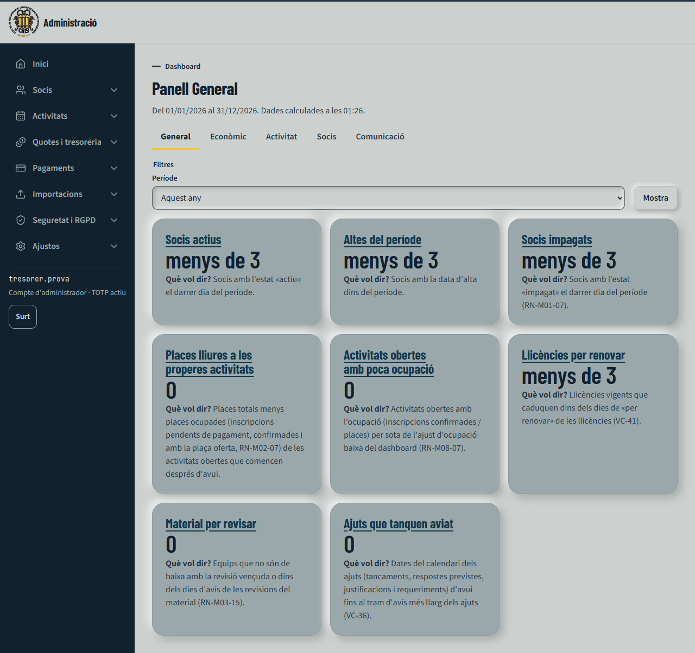

# T-DX-122 · Revisió B, C i D del 07 i el 08: dashboard, safata, fitxa i motius de contacte, i butlletí

| Data i hora (Europa/Madrid) | Commit | Proves | CI |
|---|---|---|---|
| 25/11/2026 01:30 | 1fcca690 | e2e del dashboard i del contacte | [A comprovar] |

**En tres línies:** és la revisió de les pantalles que la T-DX-140 a 145 va posar al menú. La feina és al dashboard. Els panells eren botons de text sense cap marca de l'actual i ara són pestanyes d'enllaços amb el subratllat daurat. La xifra de cada bloc és la gran de Parrilla, i els blocs fan reixa. A la safata, tota la fila obre el missatge.

## Què s'ha fet
- `static/css/tokens.css`: pestanyes d'enllaços (`a.pestanya` amb `aria-current="page"`: negreta i subratllat daurat fix, sense JavaScript). Al sistema, a la fila «Pestanyes».
- `templates/dashboard/dashboard.html`: `nav.pestanyes`, `parrilla.css` al bloc `estils`, la xifra amb `parrilla-xifra` i els blocs dins de `graella-targetes`.
- `templates/website/admin/contact_inbox.html`: `enllac-fila` a l'enllaç cap a la fitxa (§5.3, T-DX-66).
- `docs/design-system.md` i `docs/estat/DX.md` (la T-DX-122 i les T-DX-140 a 145, fetes).

## Decisions i perquè
- **Pestanyes d'enllaços, no `role="tab"`:** cada panell és una pàgina (`dashboard_panel`). El patró ARIA de pestanyes és per a panells de la mateixa pàgina. Un `nav` amb `aria-current` és el correcte, i va sense JavaScript.
- **La xifra de Parrilla:** és la peça que el sistema ja tenia per a la pantalla en construcció (§T-DX-35). Ara que la pantalla és real, es fa servir aquí (D13: la xifra principal, gran).
- **Sense canvis:** la fitxa d'un missatge, els motius i el butlletí ja seguien el sistema (un sol botó principal, Errata, targetes i confirmació d'enviament). Les dotze caselles de rols d'un motiu es queden en una columna: es llegeixen bé i dues columnes amb noms llargs es partirien.
- **Seguretat:** només xifres agregades, i el servidor amaga els grups petits («menys de N»). Cap canvi en el que es veu.

## Com se sap que funciona
- Passen les tres e2e del dashboard i del contacte.

## Comprovació §15.5
- **Captures mirades** a 1280, 1024, 390 i 320 px, en clar i en fosc: el dashboard (general i econòmic) i la safata. Al mòbil, les pestanyes es desplacen de costat.

## Evidències
- El dashboard a 1280 px. `captures/2026-11-25_0130_T-DX-122_dashboard-1280.png`

  

  *25/11/2026 01:30 (Europa/Madrid) · local, prova e2e, dades inventades · commit 1fcca690*
