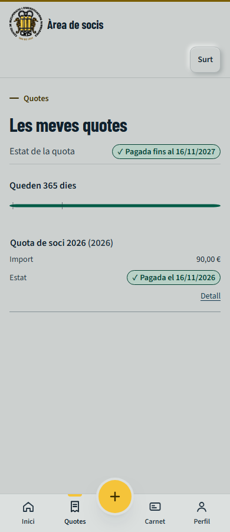

# T-DX-13 · Vigencia: els dies que queden de la quota i de la llicència

| Data i hora (Europa/Madrid) | Commit | Proves | CI |
|---|---|---|---|
| 16/11/2026 16:36 | f2bdd5c | 15 noves i 1 al navegador | [A comprovar] (PR #63) |

**En tres línies:** a «Les meves quotes», el soci veu quants dies li queden fins que li venci la quota («Queden 365 dies»), sobre una regla que es posa groga quan s'acosten els avisos i vermella si ha vençut. Al seu perfil hi veu el mateix per a la llicència, si en té la data de caducitat confirmada.

## Què s'ha fet
- Etiqueta nova `vigencia` (`apps/members/templatetags/vigencia.py`), `templates/members/_vigencia.html` i `static/css/vigencia.css`. Detall: [design-system §6.15](../design-system.md#615-vigencia-els-dies-que-queden-t-dx-13).
- A «Les meves quotes», sota l'estat de la quota, i a la taula de la llicència del perfil del soci.
- Fila a [`estat/DX.md`](../estat/DX.md). La T-DX-12 (Deposito) queda bloquejada: la pantalla de transferència és la T-M05b-06 del pilot, encara per fer.

## Decisions i perquè
- **El compte el fa el servidor** amb la data local de Barcelona, a partir de la data que ja calcula (070, P-71), mai amb el rellotge del navegador.
- **Cap valor de negoci nou:** els dies d'avís de la quota són els dels recordatoris (VC-02), que avui són a la configuració i passaran a Ajustos amb la T-M01-32. La llicència no té cap dia d'avís definit, i no se n'hi ha posat cap.
- **L'escala de 60 dies és del dibuix, no una regla:** a partir d'aquí la barra és plena. S'allarga si un dia d'avís és més llunyà.
- **Del recurs no s'hi fa:** el lliscador per avançar el temps, «Renovar» (renovar és pagar, a la pantalla de pagament) ni l'`.ics` d'avisos.
- **S'ha tret la frase «T'avisem per correu…»:** els recordatoris depenen de l'estat de la quota, i la frase podia no ser certa.

## Com se sap que funciona
- `apps/members/tests/test_vigencia.py`: dies, tram i barra per a sis dates; les marques surten de VC-02; un dia d'avís llunyà allarga l'escala; la llicència no té avisos i només es posa vermella vençuda; sense data no surt res; el text diu el mateix que la regla, sense `style=`.
- `apps/core/tests/e2e/test_vigencia.py`: un soci al corrent veu «Queden N dies» i la regla, en verd, amb la revisió a 320 px en clar i en fosc.
- Bateria sencera: 4.792 proves unitàries i 63 e2e (1 xfail que ja hi era).

## Evidències
- «Les meves quotes» a 390 px: `captures/2026-11-16_1636_T-DX-13_quotes-390.png`

  

  *16/11/2026 16:36 (Europa/Madrid) · local, prova e2e, soci inventat · commit f2bdd5c*
- A 320 px, en fosc: `captures/2026-11-16_1636_T-DX-13_quotes-320-fosc.png`

  *16/11/2026 16:36 (Europa/Madrid) · local, prova e2e · commit f2bdd5c*
- Sortida de proves · commit f2bdd5c · executada el 16/11/2026 en local (PostgreSQL 16):
  ```
  $ pytest -q
  4792 passed
  $ pytest -m e2e apps/core/tests/e2e -q
  63 passed, 1 xfailed
  ```
