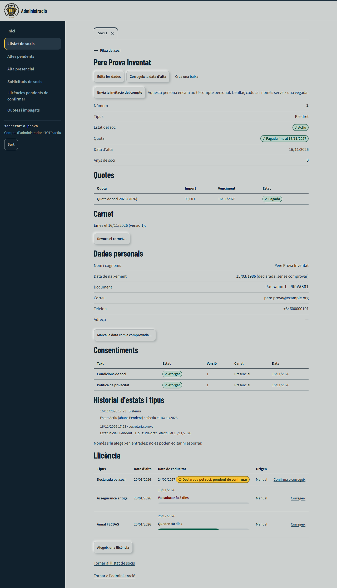

# T-DX-14 · Vigencia a la llicència de la fitxa de l'administració

| Data i hora (Europa/Madrid) | Commit | Proves | CI |
|---|---|---|---|
| 16/11/2026 17:23 | d770364 | 1 nova al navegador | [A comprovar] (PR #64) |

**En tres línies:** a la fitxa d'un soci, l'administració veu quants dies queden de cada llicència amb caducitat confirmada: en verd si és vigent i en vermell si ha caducat («Va caducar fa 3 dies»). Una llicència que el soci ha declarat i encara no s'ha confirmat no en mostra cap. De pas, s'ha arreglat que aquesta fitxa no cabés en un mòbil petit quan hi havia una llicència declarada.

## Què s'ha fet
- `templates/members/_licence_records.html`: l'etiqueta `vigencia` (T-DX-13) també surt a l'administració, no només al soci. Detall: [design-system §6.15](../design-system.md#615-vigencia-els-dies-que-queden-t-dx-13).
- `static/css/comptes.css`: a les taules apilades del mòbil, un valor llarg passa a la línia següent.
- Fila a [`estat/DX.md`](../estat/DX.md).

## Decisions i perquè
- **La confirmació en bloc no porta Vigencia:** hi surten llicències sense data de caducitat, i no hi ha res a comptar.
- **Sense dies d'avís per a la llicència:** no n'hi ha cap de definit al pla, i no se n'hi posa cap (regla «Valors i llistes de negoci»). Només vermell un cop caducada.
- **Una caducitat declarada pendent de confirmar no compta:** no és vigent fins que es confirma (RN-M01-77).

## Problemes trobats
- **Error que ja hi era:** amb una llicència declarada pel soci, la fitxa feia 441 px d'ample a 320 px, perquè l'etiqueta «Declarada pel soci, pendent de confirmar» no es partia (`white-space: nowrap`). Mesurant cada cas per separat es va veure que no era cosa de Vigencia (vigent i vençuda: 320 px; declarada: 441). Primer la prova que el reprodueix (la revisió a 320 px de la prova nova) i després l'arreglo: `flex-wrap` a les cel·les apilades i `white-space: normal` a les etiquetes d'estat dins de les taules.

## Com se sap que funciona
- `apps/core/tests/e2e/test_vigencia_admin.py`: a la fitxa, «Anual FECDAS» diu «Queden 40 dies»; l'antiga surt en vermell amb «Va caducar fa 3 dies»; la declarada no porta cap regla. Amb la revisió a 320 px en clar i en fosc, sense desplaçament lateral.
- Bateria sencera: 4.792 proves unitàries i 64 e2e (1 xfail que ja hi era).

## Evidències
- La fitxa a 1280 px: `captures/2026-11-16_1723_T-DX-14_fitxa-llicencies-1280.png`

  

  *16/11/2026 17:23 (Europa/Madrid) · local, prova e2e, soci i llicències inventats · commit d770364*
- A 320 px, sense desplaçament: `captures/2026-11-16_1723_T-DX-14_fitxa-llicencies-320.png`

  *16/11/2026 17:23 (Europa/Madrid) · local, prova e2e · commit d770364*
- Sortida de proves · commit d770364 · executada el 16/11/2026 en local (PostgreSQL 16):
  ```
  $ pytest -q
  4792 passed
  $ pytest -m e2e apps/core/tests/e2e -q
  64 passed, 1 xfailed
  ```
