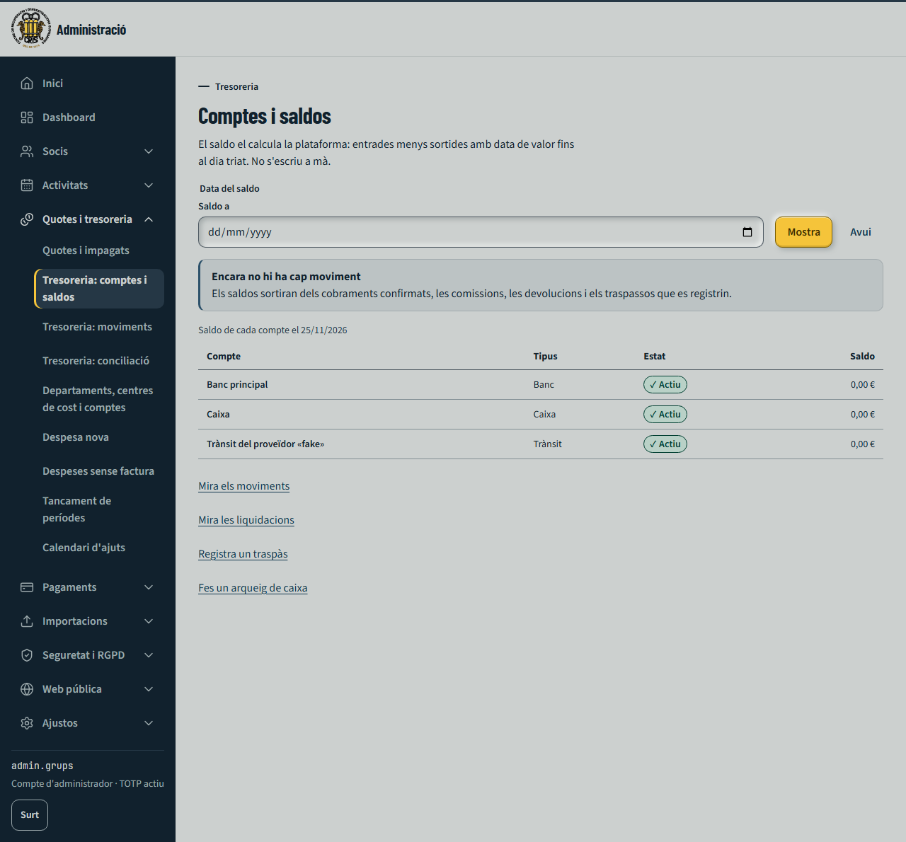

# T-DX-140 a 146 · Menú del 07 i el 08, i es retira la pantalla en construcció del dashboard

| Data i hora (Europa/Madrid) | Commit | Proves | CI |
|---|---|---|---|
| 25/11/2026 01:20 | 9d5de083 | 2 de navegació noves, 1 de pantalles en construcció ampliada, e2e de navegació, dashboard, contacte i butlletí | [A comprovar] |

**En tres línies:** el pilot va fer funcionals la safata de contacte i els motius (WP5 i WP8), el butlletí (WP6) i el dashboard (DB1), i les va deixar a `STANDALONE` fins que hi hagués menú. Ara tenen menú: el grup nou «Web pública» i «Dashboard», solt sota «Inici». La pantalla en construcció del dashboard es retira perquè la real ja hi és. La revisió B, C i D de les pantalles va a la PR següent.

## Què s'ha fet
- `apps/accounts/navigation.py`:
  - les quatre rutes, amb el mateix permís que demana la vista;
  - les entrades i les seves subpàgines;
  - el grup «Web pública»;
  - `SOLTS` (entrades soltes amb icona, per al dashboard);
  - `SWITCHES` (una entrada que depèn d'un ajust: el butlletí, amb `website.newsletter_enabled`).
- `templates/accounts/_admin_nav.html`: les entrades soltes, sota «Inici».
- Icones `globe` i `layout-dashboard` (`apps/core/icones.py` i l'sprite, generat amb el mateix paquet de Lucide 1.67.0, empremta comprovada).
- Fora `apps/previews/screens/dashboard.py` i la seva plantilla (T-DX-146).
- `STANDALONE` sense les 13 rutes.
- `docs/design-system.md` (§6.1 i §T-DX-35) i `docs/estat/DX.md`.
- Proves:
  - a `test_navigation_children.py`, el dashboard solt i marcat també en un panell, el grup «Web pública», el butlletí només amb l'ajust encès i, sense DB1, cap entrada de dashboard;
  - a `test_navegacio.py`, la llista de grups i les entrades soltes;
  - el dashboard, a la llista de pantalles en construcció que no han de tornar.

## Decisions i perquè
- **El dashboard, solt:** no és de cap grup (el mira la junta, no és una feina d'un àmbit). Un grup amb una sola entrada seria un clic de més.
- **«Motius de contacte», entrada pròpia:** WP8 no va lligat a WP5. Si només s'hi arribés des de la safata, qui té WP8 sense WP5 no hi podria arribar.
- **El butlletí, només amb l'ajust encès:** la vista retorna «no trobat» si és apagat, i el menú no ha d'enllaçar enlloc que no existeix. La condició és la mateixa que la de la vista.
- **Seguretat:** el menú no és cap control. Cada vista torna a comprovar el permís i l'ajust.

## Com se sap que funciona
- Passen 86 proves de navegació, pantalles en construcció i icones, i 28 e2e (navegació, pantalles en construcció, dashboard, contacte i butlletí).

## Comprovació §15.5
- **Captures mirades** a 1280, 1024, 390 i 320 px, en clar i en fosc: el menú agrupat, el dashboard, la safata, la fitxa i els motius de contacte, i el butlletí.

## Evidències
- El menú a 1280 px. `captures/2026-11-25_0120_T-DX-140_menu-1280.png`

  

  *25/11/2026 01:20 (Europa/Madrid) · local, prova e2e, dades inventades · commit 9d5de083*
