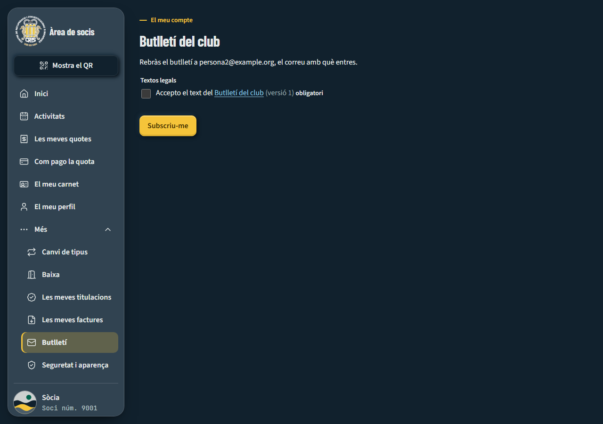

# T-DX-147 a T-DX-150 · Butlletí al menú del soci; notícies i ajuda públiques i a l'administració

| Data i hora (Europa/Madrid) | Commit | Proves | CI |
|---|---|---|---|
| 25/11/2026 03:15 | 9713b9e8 | 1 de navegació del soci nova (dues plantilles), e2e del Ramillete, la navegació del soci i el butlletí | [A comprovar] |

**En tres línies:** són peticions del pilot (carril A del 07). La pàgina del butlletí del soci (`/socis/butlleti/`) ja té entrada al menú, dins de «Més», i només surt quan el butlletí és encès. Per a les notícies i l'ajuda públiques no s'ha escrit cap menú a la plantilla: el menú de la web serà una dada de l'editor del 07. També queda triat el recurs de les notícies.

## Què s'ha fet
- **T-DX-148:**
  - `templates/members/_personal_nav.html` i `_ramillete.html` (ventall, panell i text): «Butlletí» (icona `mail`) després de «Les meves factures», amb `` (`apps/website/templatetags/website_nav.py`, com `mandate_signing_enabled`);
  - a la seva pàgina, «Més» surt obert;
  - icona `mail` a `apps/core/icones.py` i a l'sprite (el mateix paquet de Lucide 1.67.0);
  - prova a `test_personal_nav_subpages.py`: amb l'ajust apagat, cap enllaç; encès, l'entrada surt i queda marcada a la seva pàgina.
- **T-DX-147:**
  - `docs/plans/recursos-disseny-extern.md` §6.5: les files «Preguntes freqüents» (funcional, Recoveco) i «Notícies» (Vistazo quan s'encenguin les fotos; fins llavors, targetes; el detall, sense recurs).
- **T-DX-149 i T-DX-150** (quan el pilot va fusionar el lot #603):
  - `apps/accounts/navigation.py`: «Notícies» (WP2) i «Preguntes freqüents» (WP4) al grup «Web pública», amb les seves subpàgines, i fora de `STANDALONE`;
  - revisió B, C i D: «Notícia nova» i «Pregunta nova» passen a la capçalera del llistat (§5.3); les fitxes ja seguien el sistema.
- **T-DX-151, en part** (quan el pilot va fusionar la #604): «Tutorials» (WP4) al grup «Web pública», fora de `STANDALONE`, i «Tutorial nou» a la capçalera del llistat. La pàgina pública d'un tutorial i on va «Mira com es fa», en una altra tasca.
- `docs/design-system.md` (compte personal) i `docs/estat/DX.md`.

## Decisions i perquè
- **Cap menú públic a la plantilla:** l'editor del 07 té un editor de menú (decisió 034: sis enllaços i «Més»), i els elements de llista són dades, no codi. Un menú escrit ara s'hauria de desfer. «Notícies» i «Ajuda» seran entrades inicials de la llavor de l'editor de menú (apuntat pel pilot, amb la decisió 106).
- **Vistazo, quan hi hagi fotos:** la finestra de foto que segueix el cursor només té sentit amb fotos, i les fotos públiques estan apagades fins a P-41 (drets d'imatge). Fins llavors, la llista es queda amb les targetes.
- **L'entrada d'administració de les notícies i de les preguntes** es va fer quan la ruta va ser a master (lot #603 del pilot), en aquesta mateixa PR.
- **Seguretat:** el menú no és cap control. La vista del butlletí del soci retorna «no trobat» amb l'ajust apagat (`switched_on`) i només obre amb un compte personal.

## Com se sap que funciona
- Passen 701 proves d'`apps/accounts`, la navegació del soci i les icones.
- Passen les e2e de notícies i preguntes a l'administració, de la navegació, del Ramillete, de la navegació del soci i del butlletí (soci, públic i administració).

## Comprovació §15.5
- **Captures mirades** a 1280, 1024, 390 i 320 px, en clar i en fosc: el butlletí del soci (alta, pendent i subscrit) i el Ramillete.

## Evidències
- El butlletí del soci, en fosc, a 1280 px. `captures/2026-11-25_0315_T-DX-148_butlleti-soci-1280.png`

  

  *25/11/2026 03:15 (Europa/Madrid) · local, prova e2e, dades inventades · commit 9713b9e8*
