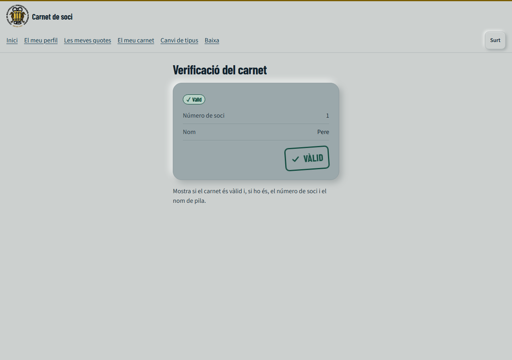

# T-DX-15 · Autentico: el segell de la verificació del carnet

| Data i hora (Europa/Madrid) | Commit | Proves | CI |
|---|---|---|---|
| 16/11/2026 18:00 | 4cf82f4, cc4e2c0 | 3 noves | [A comprovar] (PR #67) |

**En tres línies:** quan algú escaneja el QR d'un carnet, la pàgina de verificació hi posa un segell de goma: «Vàlid» en verd o «No vàlid» en vermell. La pàgina diu exactament el mateix que abans, ni més ni menys. Si s'han fet massa comprovacions seguides, no hi ha segell.

## Què s'ha fet
- `templates/members/card_verify.html` i `static/css/autentico.css`. Detall: [design-system §6.16](../design-system.md#616-autentico-el-segell-de-la-verificació-del-carnet-t-dx-15).
- Fila a [`estat/DX.md`](../estat/DX.md).

## Decisions i perquè
- **Autentico verifica, no aprova:** va a la verificació del carnet (P-91 i el mapa). Per aprovar altes i sol·licituds hi ha el panell de Deposito (T-DX-16).
- **Cap dada nova (RN-M01-26):** si és vàlid, el número i el nom de pila; si no, res. El segell és decoratiu (`aria-hidden`), perquè el títol ja ho diu.
- **Sense el codi HMAC del recurs:** el recurs el calcula al navegador amb la clau, i una clau no pot sortir del servidor. La verificació la continua fent el servidor amb el testimoni de l'enllaç (T-M01-20).

## Problemes trobats
- **Contrast en fosc:** la primera versió posava el resultat sobre paper clar (`--paper`), com el recurs. Al tema fosc, el text d'estat («No vàlid») feia servir el color clar del tema i no arribava a 4,5:1. Ho va detectar la prova d'accessibilitat (axe). Ara el resultat fa servir la superfície del tema, i el segell els colors d'estat (`--c-ok-text`, `--c-error-text`).
- El segell quedava a l'esquerra per la disposició de la targeta; ho resolen `align-self` i `justify-self`.

## Com se sap que funciona
- `apps/members/tests/test_autentico.py`: un carnet vàlid porta el segell «Vàlid» (i no «No vàlid»); un testimoni desconegut, «No vàlid»; una verificació bloquejada, cap segell.
- Les proves de verificació del carnet que ja hi havia (101) continuen passant: el text de la pàgina no canvia.
- L'e2e del carnet i la d'accessibilitat (axe, en clar i en fosc) passen després de l'arreglo. Bateria sencera: 4.810 proves unitàries i 63 e2e (1 xfail que ja hi era), més la d'accessibilitat, que ara passa.

## Evidències
- Verificació vàlida a 1280 px: `captures/2026-11-16_1800_T-DX-15_verificacio-1280.png`

  

  *16/11/2026 18:00 (Europa/Madrid) · local, prova e2e, soci inventat · commit cc4e2c0*
- A 320 px, en fosc: `captures/2026-11-16_1800_T-DX-15_verificacio-320-fosc.png`

  *16/11/2026 18:00 (Europa/Madrid) · local, prova e2e · commit cc4e2c0*
- Sortida de proves · commit cc4e2c0 · executada el 16/11/2026 en local (PostgreSQL 16):
  ```
  $ pytest -m e2e apps/core/tests/e2e/test_accessibilitat_028.py apps/core/tests/e2e/test_carnet_079.py -q
  6 passed
  ```
