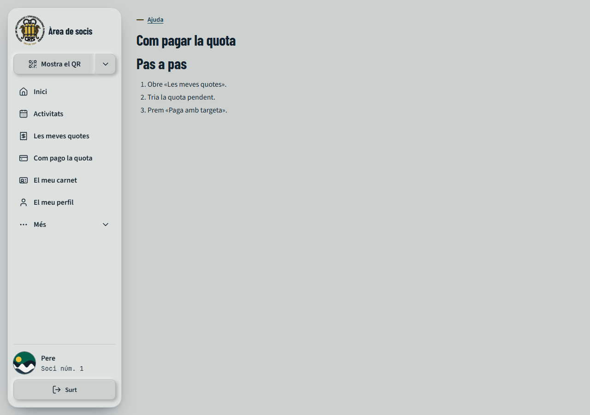

# T-DX-151 · Tutorials: la pàgina d'un tutorial i on va «Mira com es fa»

| Data i hora (Europa/Madrid) | Commit | Proves | CI |
|---|---|---|---|
| 25/11/2026 05:18 | 0b0b0faf | e2e del tutorial i de les notícies (sense canvis de codi) | [A comprovar] |

**En tres línies:** és la resta de la T-DX-151 (l'entrada «Tutorials» del menú va anar a la #605). A la pàgina d'un tutorial, el títol, «Pas a pas» i la llista quedaven enganxats, perquè el contingut va dins d'un `article`, i l'espai entre blocs del cos no compta els `article`. Ara l'`article` porta `columna-principal`, i el detall d'una notícia també. També queda fixat on va «Mira com es fa».

## Què s'ha fet
- `templates/website/tutorial.html` i `news_detail.html`: `article.columna-principal`.
- `docs/design-system.md`: secció «Tutorials i "Mira com es fa"».
- `docs/estat/DX.md`: la T-DX-151, feta.

## Decisions i perquè
- **Una solució a la pàgina, no a la regla comuna:** la regla del cos (`.cos-compte > div, section`) també toca les inscripcions i la fitxa pública d'una activitat, que porten un `article` amb Convite i Camilla. Afegir-hi `article` en podria canviar la disposició.
- **Sense recurs propi per al tutorial:** Tramite és la línia d'un pagament (tres etapes i el seu estat), no una llista d'instruccions de llargada variable. La llista `passos`, la de l'ajuda d'iPhone, ja ho resol.
- **«Mira com es fa», sota la capçalera:** l'etiqueta només surt si la pantalla té un tutorial publicat. No va a la base, perquè seria una consulta a cada pàgina i hi ha proves que compten les consultes. S'afegeix a una pantalla quan la junta n'escriu el tutorial; avui és a la de pagar una quota.

## Com se sap que funciona
- Passen les e2e del tutorial i de les notícies.

## Comprovació §15.5
- **Captures mirades** a 1280, 1024, 390 i 320 px, en clar i en fosc: el tutorial, l'enllaç «Mira com es fa» a la pantalla de pagar, i la llista i el detall de les notícies.

## Evidències
- El tutorial a 1280 px. `captures/2026-11-25_0518_T-DX-151_tutorial-1280.png`

  

  *25/11/2026 05:18 (Europa/Madrid) · local, prova e2e, dades inventades · commit 0b0b0faf*
