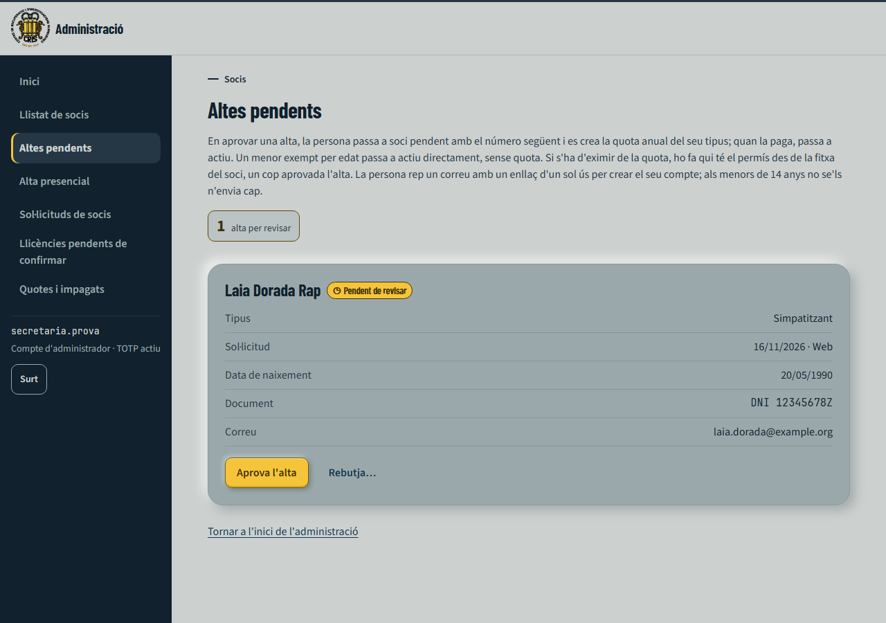

# T-DX-16 · Deposito: el panell de revisió d'altes i sol·licituds

| Data i hora (Europa/Madrid) | Commit | Proves | CI |
|---|---|---|---|
| 16/11/2026 18:21 | e91535a, 4491f5e | 2 noves | [A comprovar] (PR #69) |

**En tres línies:** a «Altes pendents», a dalt de tot es veu quantes n'hi ha per revisar, amb el número en ambre si n'hi ha cap. A cada alta, «Aprova l'alta» i «Rebutja…» són l'una al costat de l'altra, i el motiu del rebuig s'obre a sota. A «Sol·licituds», el mateix comptador per als canvis de tipus i les baixes.

## Què s'ha fet
- `static/css/deposito.css`, i els comptadors i la fila d'accions a `templates/members/join_requests.html` i `requests_list.html`. Detall: [design-system §6.17](../design-system.md#617-deposito-el-panell-de-revisió-t-dx-16).
- Fila a [`estat/DX.md`](../estat/DX.md).
- De pas, l'e2e de Duermevela espera que l'interruptor estigui enganxat abans del clic. Sota càrrega, el clic podia arribar abans que el guió.

## Decisions i perquè
- **Autentico verifica; Deposito aprova:** el panell de revisió és el lloc de «validar altes i sol·licituds» que demanava l'encàrrec (mapa dels recursos externs).
- **L'ambre, a la vora i al número, no al fons:** amb el fons daurat, el comptador semblava un botó i competia amb «Aprova l'alta» (D19, un sol botó primari).
- **Del recurs no s'hi fa:** els motius de rebuig predefinits (serien una llista de negoci, i el pla no en defineix cap) ni els comptadors de confirmades i rebutjades (demanen una consulta nova).
- **Res no canvia en el que es pot fer:** el servidor torna a comprovar el permís en aprovar o rebutjar, i el motiu continua sent obligatori.

## Problemes trobats
- A la verificació sencera, dues proves van fallar una vegada sota càrrega i van passar soles: una del hook (`test_a_timeout_kills_only_its_own_process_tree`) i la de Duermevela amb moviment reduït. La segona és meva i ara és robusta.

## Com se sap que funciona
- `apps/members/tests/test_deposito.py`: sense altes, el comptador diu 0 sense ambre; amb dues, diu 2 en ambre, i cada alta té «Aprova l'alta» i «Rebutja…» a la mateixa fila.
- Les proves d'altes i de sol·licituds que ja hi havia (136) i les e2e d'altes passen. Bateria sencera: 4.815 proves unitàries i 63 e2e (1 xfail que ja hi era), més les dues inestables, que passen soles.

## Evidències
- «Altes pendents» a 1280 px: `captures/2026-11-16_1821_T-DX-16_altes-pendents-1280.png`

  

  *16/11/2026 18:21 (Europa/Madrid) · local, prova e2e, persona inventada · commit e91535a*
- A 320 px, en fosc: `captures/2026-11-16_1821_T-DX-16_altes-pendents-320-fosc.png`

  *16/11/2026 18:21 (Europa/Madrid) · local, prova e2e · commit e91535a*
- Sortida de proves · executada el 16/11/2026 en local (PostgreSQL 16):
  ```
  $ pytest apps/members/tests/test_deposito.py apps/members/tests/test_admissions.py apps/members/tests/test_member_requests.py -q
  136 passed
  $ pytest -m e2e apps/core/tests/e2e/test_duermevela.py -q        (a 4491f5e)
  5 passed
  ```
