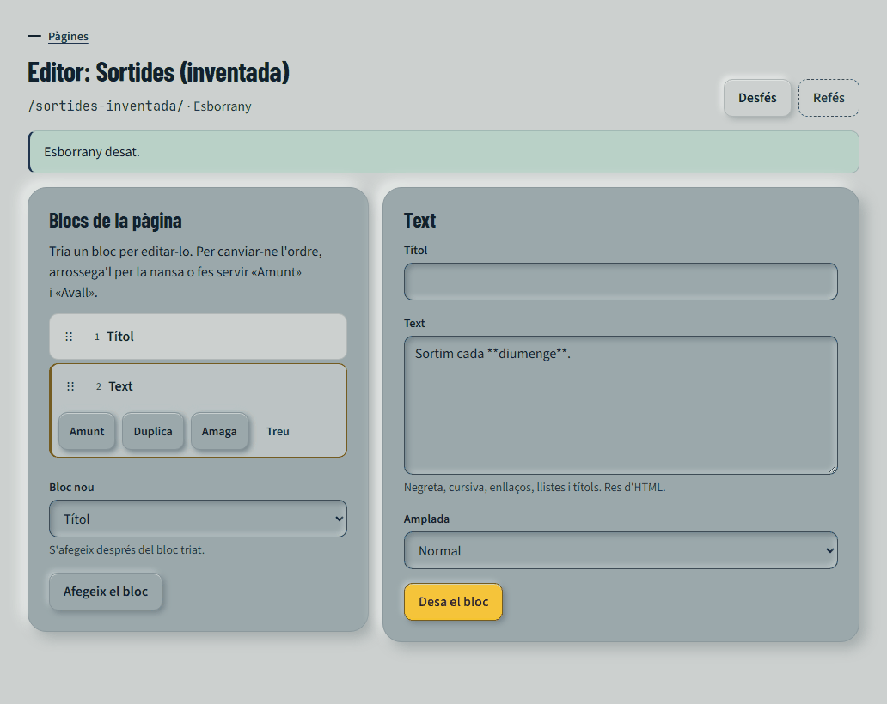
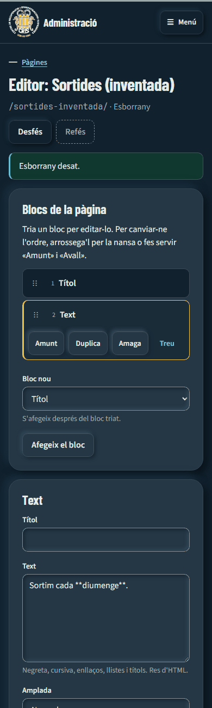

# T-DX-160 · Editor de la web en pantalla partida (part 1)

| Data i hora (Europa/Madrid) | Commit | Proves | CI |
|---|---|---|---|
| 28/11/2026 01:10 | b60ff3d9 | les de l'editor (sense canvis) | [A comprovar] |

**En tres línies:** petició del carril E del pilot. L'editor de blocs (T-M07-06a) tenia les dues targetes una sota l'altra i la llista de blocs com una llista numerada sense estil. Ara, a l'escriptori, els blocs i el formulari del bloc triat queden un al costat de l'altre, com al wireframe, i cada bloc és una fila amb la nansa per arrossegar i el bloc triat ben marcat.

## Què s'ha fet
- `static/css/editor-web.css`: `editor-partit` (dues columnes a partir de 1024 px, 5/12 i 7/12; el formulari es queda fix en baixar), `editor-blocs` (files amb número, nom i «Amagat») i `editor-nansa` (44 × 44 px, cursor d'agafar).
- `templates/website/admin/page_editor.html`: enllaça el CSS, embolica les dues targetes amb `editor-partit` i posa les classes a la llista i a la nansa. Els atributs que fan servir el JavaScript i les proves (`data-editor-blocs`, `data-nansa`, `data-index`, `aria-current`) no canvien.
- `docs/design-system.md` §6.28 i `docs/estat/DX.md`.

## Decisions i perquè
- **El bloc triat es marca amb la vora d'accent més gruixuda i el fons**, a més de `aria-current`: mai només amb el color.
- **La nansa és només per al ratolí i el dit** (`aria-hidden`): el teclat ja té «Amunt» i «Avall», que fan el mateix.
- **La columna de la dreta, provisional:** quan arribi la vista prèvia (T-M07-06b, Probador), hi anirà la vista prèvia i el formulari passarà sota els blocs.
- **L'entrada del menú, més endavant:** toca `apps/accounts/navigation.py`, i el pilot hi té PR obertes (#619 i #621, proves noves). Segons la regla del propietari, espero.

## Com se sap que funciona
- Passen les 47 proves de `apps/website/tests/test_editor_06a.py` i l'e2e de l'editor (arrossegar per la nansa, «Avall», amagar i Ctrl+Z), sense desplaçament de costat a 320 px.

## Comprovació §15.5
- **B:** cap animació nova; la nansa i els botons fan 44 px al mòbil.
- **C:** vores amb `--c-linia`; radis de tokens.
- **D:** un sol botó principal per targeta («Desa el bloc»); xifres tabulars a la numeració.
- **Tokens:** cap color ni mida fora de `tokens.css`; cap `style=`.
- **Captures mirades** a 1280, 1024, 390 i 320 px, en clar i en fosc.

## Queda
- L'entrada «Web pública › Pàgines» al menú (part 2, amb la T-DX-171).

## Evidències
- L'editor a 1280 px. `captures/2026-11-28_0110_T-DX-160_editor-1280.png`

  

  *28/11/2026 01:10 (Europa/Madrid) · local, prova e2e, dades inventades · commit b60ff3d9*

- A 390 px, en fosc. `captures/2026-11-28_0110_T-DX-160_editor-390-fosc.png`

  

  *28/11/2026 01:10 (Europa/Madrid) · local, prova e2e, dades inventades · commit b60ff3d9*
