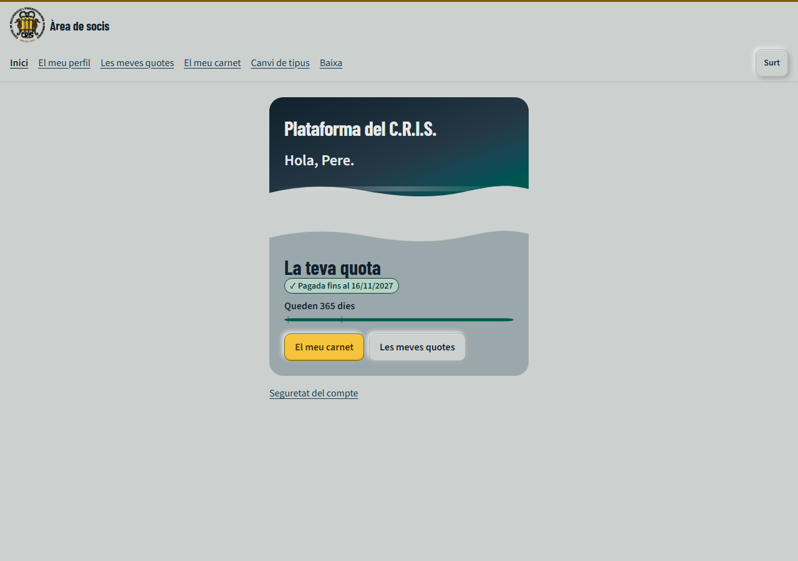

# T-DX-17 · Oleaje: la portada de l'àrea del soci

| Data i hora (Europa/Madrid) | Commit | Proves | CI |
|---|---|---|---|
| 16/11/2026 18:53 | f637972 | 6 noves | [A comprovar] (PR #71) |

**En tres línies:** en entrar, el soci veu una capçalera marina amb la salutació i una vora en ona. A sota, «La teva quota»: l'estat de la quota, els dies que queden i els botons per anar al carnet i a les quotes. Aquest bloc puja al seu lloc quan es desplaça la pàgina, sense cap animació que no s'aturi.

## Què s'ha fet
- `static/css/oleaje.css`, la capçalera a `templates/core/home.html` i el bloc a `templates/members/_home_resum.html`, amb l'etiqueta `member_home_summary` (`apps/members/templatetags/member_notices.py`). Detall: [design-system §6.18](../design-system.md#618-oleaje-la-portada-de-làrea-del-soci-t-dx-17).
- Fila a [`estat/DX.md`](../estat/DX.md) i entrada nova al mapa del hook (`.claude/hooks/e2e_map.py`).

## Decisions i perquè
- **El més important, a dalt (D13):** la quota i el carnet són el que el soci ve a mirar. L'estat surt del mateix càlcul que «Les meves quotes» (070), i els dies que queden, de Vigencia (T-DX-13).
- **Només amb CSS:** la pujada va lligada al desplaçament (`animation-timeline: view()`). Sense suport, el bloc ja és al seu lloc. No hi ha cap animació contínua, així que no cal cap ajust per desactivar-la (D20).
- **Només el compte personal:** el compte d'administrador no és la porta del soci (decisions 015 i 018), i no hi surt res del soci encara que la persona ho sigui.
- **Del recurs no s'hi fa:** l'ona que s'agita segons la velocitat i la paral·laxi. Demanarien JavaScript i una animació contínua sense cap funció escrita (D6). Tampoc la web pública, perquè la 07 encara no té pantalla.
- L'ona de la portada de la 032 només existia als tokens i als wireframes. `--m-ona` es manté perquè els wireframes el fan servir.

## Problemes trobats
- A la primera versió, entre l'ona del bloc i el contingut quedava una franja del fons de la pàgina, i a baix de la capçalera es veien les cantonades arrodonides. Ara l'ona va fora del flux, a sobre del fons de la secció, i la capçalera només té arrodonides les cantonades de dalt.
- A la bateria e2e sencera, `test_exempcio_040` (administració, no l'he tocada) va fallar una vegada sota càrrega i passa sola.

## Com se sap que funciona
- `apps/members/tests/test_oleaje.py`: un soci amb la quota pagada veu l'estat, els dies que queden i els enllaços al carnet i a les quotes. Amb la quota pendent, «Pendent» i sense compte enrere. No surt cap dada d'un altre soci. Una persona que no és sòcia no veu el bloc. El compte d'administrador tampoc.
- `apps/core/tests/e2e/test_oleaje.py`: la capçalera amb l'ona i el bloc al seu lloc un cop a la vista, amb captures a 1280, 390 i 320 px, en clar i en fosc, sense desplaçament lateral.
- Bateria sencera: 4.862 proves unitàries i 65 e2e (1 xfail que ja hi era), més la d'exempció, que passa sola.

## Evidències
- La portada a 1280 px: `captures/2026-11-16_1853_T-DX-17_portada-1280.png`

  

  *16/11/2026 18:53 (Europa/Madrid) · local, prova e2e, soci inventat · commit f637972*
- A 320 px, en fosc: `captures/2026-11-16_1853_T-DX-17_portada-320-fosc.png`

  *16/11/2026 18:53 (Europa/Madrid) · local, prova e2e · commit f637972*
- Sortida de proves · commit f637972 · executada el 16/11/2026 en local (PostgreSQL 16):
  ```
  $ pytest apps/members/tests/test_oleaje.py -q
  5 passed
  $ pytest -m e2e apps/core/tests/e2e/test_oleaje.py -q
  1 passed
  ```
