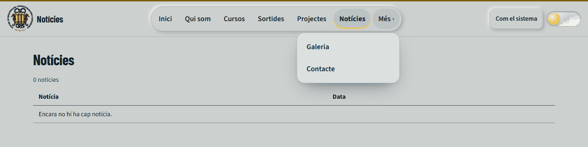
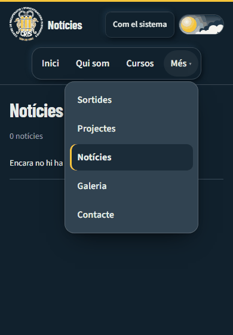

# T-DX-170 · Menú de la web pública a la capçalera (part 1)

| Data i hora (Europa/Madrid) | Commit | Proves | CI |
|---|---|---|---|
| 28/11/2026 01:33 | 2e2b0066 | 3 noves, 1 e2e nova | [A comprovar] |

**En tres línies:** petició del pilot (T-M07-21). El menú que la junta desa a «Menú, capçalera i peu» ja surt a la capçalera de les pàgines públiques per a qui no ha entrat, amb la pastilla de la decisió 034: 6 enllaços i «Més» a l'escriptori, 3 i «Més» al mòbil. Sense JavaScript. Falta el text de la capçalera i del peu desats.

## Què s'ha fet
- `templates/base.html`: `` a la capçalera, només sense sessió, dins d'un bloc `menu_public` que una pantalla pot buidar; enllaça `static/css/menu-public.css`.
- `templates/website/_menu_public.html` (el parcial del pilot): la pastilla, amb els enllaços 4 a 6 marcats `nav-escriptori` i les seves còpies dins de «Més» marcades `nav-no-escriptori`.
- `static/css/menu-public.css`: la pastilla, el desplegable de «Més» i dels submenús, i l'enllaç actual.
- `docs/design-system.md` §6.29 i `docs/estat/DX.md`.
- Proves: `apps/core/tests/test_menu_public_dx170.py` (el menú surt sense sessió, dividit per mida i amb la pàgina actual marcada; amb sessió no surt; un menú buit no pinta res) i `apps/core/tests/e2e/test_menu_public.py` (obrir «Més»; captures), al mapa del hook.

## Decisions i perquè
- **Només sense sessió:** amb sessió, el compte personal ja té Ramillete i l'administració la seva barra. Dues navegacions a la mateixa capçalera confondrien.
- **3 enllaços al mòbil en lloc d'una hamburguesa:** fan d'hamburguesa sense JavaScript i el visitant veu de seguida les tres primeres seccions. És la mateixa regla de §6.1 (`nav-escriptori` / `nav-no-escriptori`) amb un tall a 3.
- **`details` per a «Més» i els submenús:** s'obren amb clic, Intro o Espai, i sense JavaScript.
- **Capçalera i peu desats, a la part 2:** cal una etiqueta de plantilla al 07 (`apps/website`), que és del pilot; l'he demanada.

## Com se sap que funciona
- Passen les 3 proves noves, les del menú del pilot (`test_menus_07.py`, que continua trobant «Més» al parcial) i l'e2e (sense desplaçament de costat a 320 px).

## Comprovació §15.5
- **B:** cap animació; els enllaços fan 44 px d'alt; «Més» es fa servir amb el teclat.
- **C:** el desplegable a `--c-superficie-flotant` amb l'ombra flotant (C6); vores amb `--c-linia`.
- **D:** l'enllaç actual porta la ratlla daurada, el fons i la negreta, mai només el color.
- **Tokens:** cap color ni mida fora de `tokens.css`; cap `style=`.
- **Captures mirades** a 1280, 1024, 390 i 320 px, en clar i en fosc.

## Queda
- El text de la capçalera i el peu desats (part 2).

## Evidències
- El menú a 1280 px amb «Més» obert. `captures/2026-11-28_0133_T-DX-170_menu-1280.png`

  

  *28/11/2026 01:33 (Europa/Madrid) · local, prova e2e, dades inventades · commit 2e2b0066*

- A 390 px, en fosc. `captures/2026-11-28_0133_T-DX-170_menu-390-fosc.png`

  

  *28/11/2026 01:33 (Europa/Madrid) · local, prova e2e, dades inventades · commit 2e2b0066*
