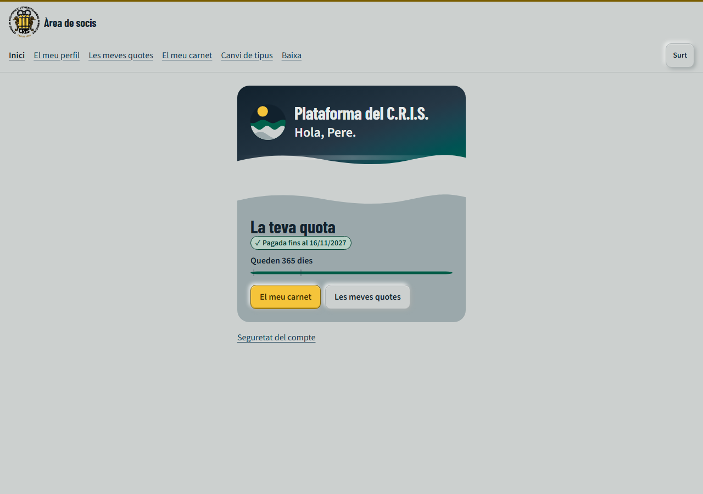

# T-DX-18 · Monograma: l'avatar per defecte del soci

| Data i hora (Europa/Madrid) | Commit | Proves | CI |
|---|---|---|---|
| 16/11/2026 19:41 | ab848ba | 9 noves | [A comprovar] (PR #76) |

**En tres línies:** el soci ja té un avatar al costat del títol, a la portada i a «El meu perfil». És un dibuix petit (blocs, ones o mosaic) amb colors de la marca, que surt sempre igual per al mateix soci. Es fa a partir d'una llavor aleatòria desada en l'alta, mai del nom.

## Què s'ha fet
- L'etiqueta `monograma` (`apps/members/templatetags/monograma.py`), que dibuixa l'SVG al servidor, i `static/css/monograma.css`, que hi posa els colors des dels tokens. Detall: [design-system §6.19](../design-system.md#619-monograma-lavatar-per-defecte-t-dx-18).
- A la portada (`templates/core/home.html`, dins de la capçalera d'Oleaje) i al perfil (`templates/members/personal_profile.html`). La comprovació «soci de la sessió, només compte personal» de la portada ara és `session_member` (`member_notices.py`), compartida amb el bloc de la quota.
- Fila a [`estat/DX.md`](../estat/DX.md) i entrada nova al mapa del hook (`.claude/hooks/e2e_map.py`).

## Decisions i perquè
- **Mai del nom (RN-M01-30, T-M01-11):** el dibuix surt de l'SHA-512 de `avatar_seed`, que és aleatòria i no canvia. Així no revela res de la persona i corregir el nom no el canvia. La llavor no surt a la pàgina.
- **Colors per classe:** l'SVG no porta cap color ni `style=`; cada forma té una classe i la paleta tria colors primitius de la marca, com la capçalera d'Oleaje i el carnet. Cap token nou.
- **Decoratiu:** `aria-hidden`, sense `title` ni text; el títol del costat ja diu on ets.
- **Del recurs no s'hi fa:** les inicials (sortirien del nom), «Otra variante», el selector de paleta i d'estil, l'animació, ni copiar o descarregar l'SVG. Els avatars de fauna marina són el mòdul 12.

## Problemes trobats
- Al perfil, l'avatar quedava a sobre del títol i no al costat: `.cos-compte > div:not(.avis)` el feia graella i guanyava per especificitat. L'embolcall és un `<header>`.
- Al tema fosc, la paleta de fons `--abisme` es perdia sobre el fons de la pàgina. Ara l'avatar porta una vora fina de `--c-linia-forta`.
- `test_a_timeout_kills_only_its_own_process_tree` (T-M00-07, no l'he tocada) va fallar una vegada amb la màquina carregada i passa sola.

## Com se sap que funciona
- `apps/members/tests/test_monograma.py`: la mateixa llavor dona el mateix SVG; 60 llavors donen 60 avatars i hi surten els tres patrons; sense color, `style=` ni text; sense llavor, res; el nom no el canvia (mateix nom i llavors diferents, avatars diferents; corregir el nom, el mateix avatar); la portada i el perfil només mostren el del soci de la sessió; el compte d'administrador no en mostra cap.
- `apps/core/tests/e2e/test_monograma.py`: l'avatar és visible a la portada i al perfil, és el mateix a totes dues, amb captures a 1280, 390 i 320 px, en clar i en fosc, sense desplaçament lateral.
- `apps/members/tests` sencer i les proves de tokens i de la T-M00-07 en verd.

## Evidències
- La portada a 1280 px: `captures/2026-11-16_1941_T-DX-18_portada-monograma-1280.png`

  

  *16/11/2026 19:41 (Europa/Madrid) · local, prova e2e, soci inventat · commit ab848ba*
- El perfil a 320 px, en fosc: `captures/2026-11-16_1941_T-DX-18_perfil-monograma-320-fosc.png`

  *16/11/2026 19:41 (Europa/Madrid) · local, prova e2e · commit ab848ba*
- Sortida de proves · commit ab848ba · executada el 16/11/2026 en local (PostgreSQL 16):
  ```
  $ pytest apps/members/tests/test_monograma.py -q
  8 passed
  $ pytest -m e2e apps/core/tests/e2e/test_monograma.py apps/core/tests/e2e/test_oleaje.py -q
  2 passed
  ```
