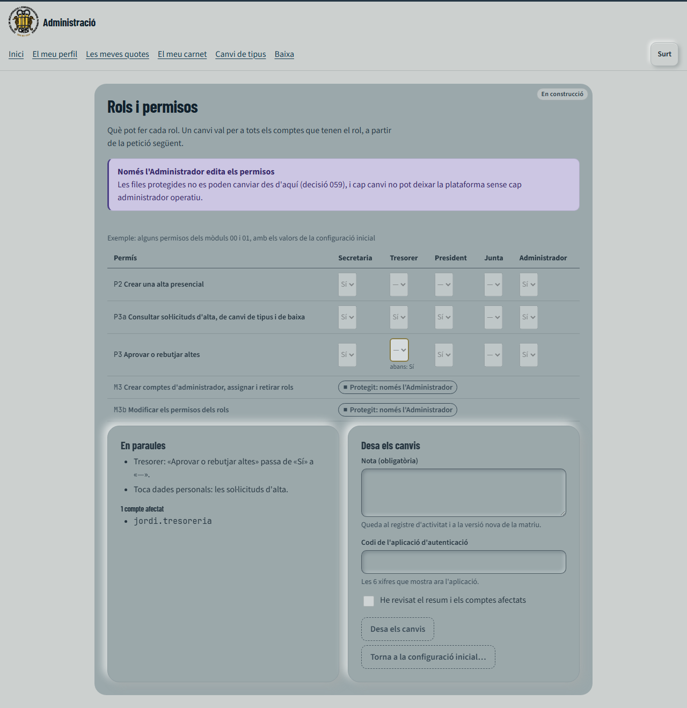

# T-DX-19 · Avisador: rols i permisos (en construcció)

| Data i hora (Europa/Madrid) | Commit | Proves | CI |
|---|---|---|---|
| 16/11/2026 19:01 | e1af0e6 | Cap de nova (les comunes la troben sola) | [A comprovar] (PR #81) |

**En tres línies:** hi ha la pantalla «Rols i permisos» en construcció, el disseny de l'editor de permisos que farà la T-RP-03. És la matriu de l'Avisador girada cap als permisos: un permís per fila i un rol per columna, amb el canvi pendent marcat i el valor d'abans en text. A sota, el resum en paraules amb els comptes afectats i el formulari de desar (nota, TOTP i casella), desactivat.

## Què s'ha fet
- `apps/previews/screens/rols_permisos.py`: títol i contingut d'exemple (cinc permisos dels mòduls 00 i 01 amb els valors de la configuració inicial; el canvi del Tresorer i el nom d'usuari afectat, inventats).
- `templates/previews/rols_permisos.html` (administració, `cos-ample`) i `static/css/avisador.css`.
- Subsecció [T-DX-19](../design-system.md#t-dx-19-avisador-rols-i-permisos) al sistema de disseny i fila a [`estat/DX.md`](../estat/DX.md).

## Decisions i perquè
- **La matriu és una `taula`:** al mòbil s'apila i cada cel·la porta el nom del rol; no calia cap peça nova.
- **Les regles de la 059 es veuen, no es fan:** files protegides sense control, avís que només l'Administrador edita i que mai no pot quedar sense administrador operatiu, nota i TOTP. Tot desactivat; el control real serà al servidor (T-RP-03).
- **Del recurs no s'hi fa** la vista prèvia per canal ni «Només l'important»: són de les preferències d'avisos, i als permisos serien un canvi més sense regla al pla.

## Problemes trobats
- A 1280 px la taula desbordava el contenidor estret de l'àrea; ara la pantalla fa servir `cos-ample`, com el registre d'activitat, i la matriu es desplaça dins del seu marc si no hi cap.
- Al mòbil, la fila protegida repetia «Protegit» (l'etiqueta de la cel·la i el text); ara l'etiqueta és buida.
- Per a l'amplada mínima de les dues targetes de sota s'ha fet servir `--carnet-amplada` (22rem), el token més proper; no n'hi ha cap de genèric.

## Com se sap que funciona
- `apps/previews/tests/test_screens.py` (parametritzada): títol i plantilla, etiqueta amb `aria-describedby`, cap `style=`, un POST torna 405 i sense accés respon 404.
- `apps/core/tests/e2e/test_previews.py -k rols_permisos`: etiqueta i títol visibles i captures a 1280, 390 i 320 px, en clar i en fosc, mirades.

## Evidències
- «Rols i permisos» a 1280 px: `captures/2026-11-16_1901_T-DX-19_rols_permisos-1280.png`

  

  *16/11/2026 19:01 (Europa/Madrid) · local, prova e2e, contingut d'exemple · commit e1af0e6*
- A 320 px, en fosc: `captures/2026-11-16_1901_T-DX-19_rols_permisos-320-fosc.png`

  *16/11/2026 19:01 (Europa/Madrid) · local, prova e2e · commit e1af0e6*
- Sortida de proves · executada el 16/11/2026 en local (PostgreSQL 16):
  ```
  $ pytest apps/previews apps/core/tests/test_under_construction.py -q
  18 passed
  $ pytest -m e2e apps/core/tests/e2e/test_previews.py -k rols_permisos -q
  1 passed, 1 deselected
  ```
