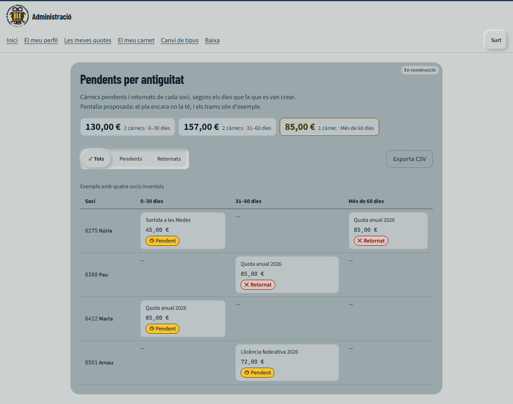

# T-DX-21 · Cartola: pendents per antiguitat (en construcció)

| Data i hora (Europa/Madrid) | Commit | Proves | CI |
|---|---|---|---|
| 16/11/2026 20:13 | ad3071a | Cap de nova (les comunes la troben sola) | [A comprovar] (PR #84) |

**En tres línies:** hi ha la pantalla «Pendents per antiguitat» en construcció: els càrrecs pendents i retornats de cada soci, repartits en trams segons els dies que fa que es van crear. És una pantalla **proposada**: el pla no la té (D1), i els trams són els del recurs, d'exemple. A dalt, el total de cada tram; a sota, una fila per soci i una fitxa per càrrec.

## Què s'ha fet
- `apps/previews/screens/pendents_antiguitat.py`: títol i contingut d'exemple (quatre socis amb número i nom de pila inventats, cinc càrrecs, tres trams).
- `templates/previews/pendents_antiguitat.html` (administració, `cos-ample`) i `static/css/cartola.css`.
- Subsecció [T-DX-21](../design-system.md#t-dx-21-cartola-pendents-per-antiguitat) al sistema de disseny i fila a [`estat/DX.md`](../estat/DX.md).

## Decisions i perquè
- **Totals amb els comptadors de Deposito (§6.17):** ja existeixen i ja diuen «en ambre si cal mirar-ho»; el tram més antic fa servir `es-pendent`.
- **La matriu és una `taula`:** al mòbil s'apila i cada cel·la porta el nom del tram; cap peça nova de taula.
- **Imports ja formatats a l'exemple** («85,00 €»): quan funcioni, el servidor els calcularà en cèntims i els formatarà.
- **Del recurs no s'hi fa** la «disputa» (el pla no té aquest estat), aïllar un soci tocant-ne el nom ni el detall que s'obre.

## Problemes trobats
- Els botons de ràdio del filtre es veien al costat de cada opció del `segmentat`; ara porten `visualment-amagat`, com al selector de tema.
- A 320 px, els imports dels totals es partien en dues línies; ara no es parteixen.

## Com se sap que funciona
- `apps/previews/tests/test_screens.py` (parametritzada): títol i plantilla, etiqueta amb `aria-describedby`, cap `style=`, un POST torna 405 i sense accés respon 404.
- `apps/core/tests/e2e/test_previews.py -k pendents_antiguitat`: etiqueta i títol visibles i captures a 1280, 390 i 320 px, en clar i en fosc, mirades.

## Evidències
- «Pendents per antiguitat» a 1280 px: `captures/2026-11-16_2013_T-DX-21_pendents_antiguitat-1280.png`

  

  *16/11/2026 20:13 (Europa/Madrid) · local, prova e2e, contingut d'exemple · commit ad3071a*
- A 320 px, en fosc: `captures/2026-11-16_2013_T-DX-21_pendents_antiguitat-320-fosc.png`

  *16/11/2026 20:13 (Europa/Madrid) · local, prova e2e · commit ad3071a*
- Sortida de proves · executada el 16/11/2026 en local (PostgreSQL 16):
  ```
  $ pytest apps/previews apps/core/tests/test_under_construction.py -q
  18 passed
  $ pytest -m e2e apps/core/tests/e2e/test_previews.py -k pendents_antiguitat -q
  1 passed, 1 deselected
  ```
