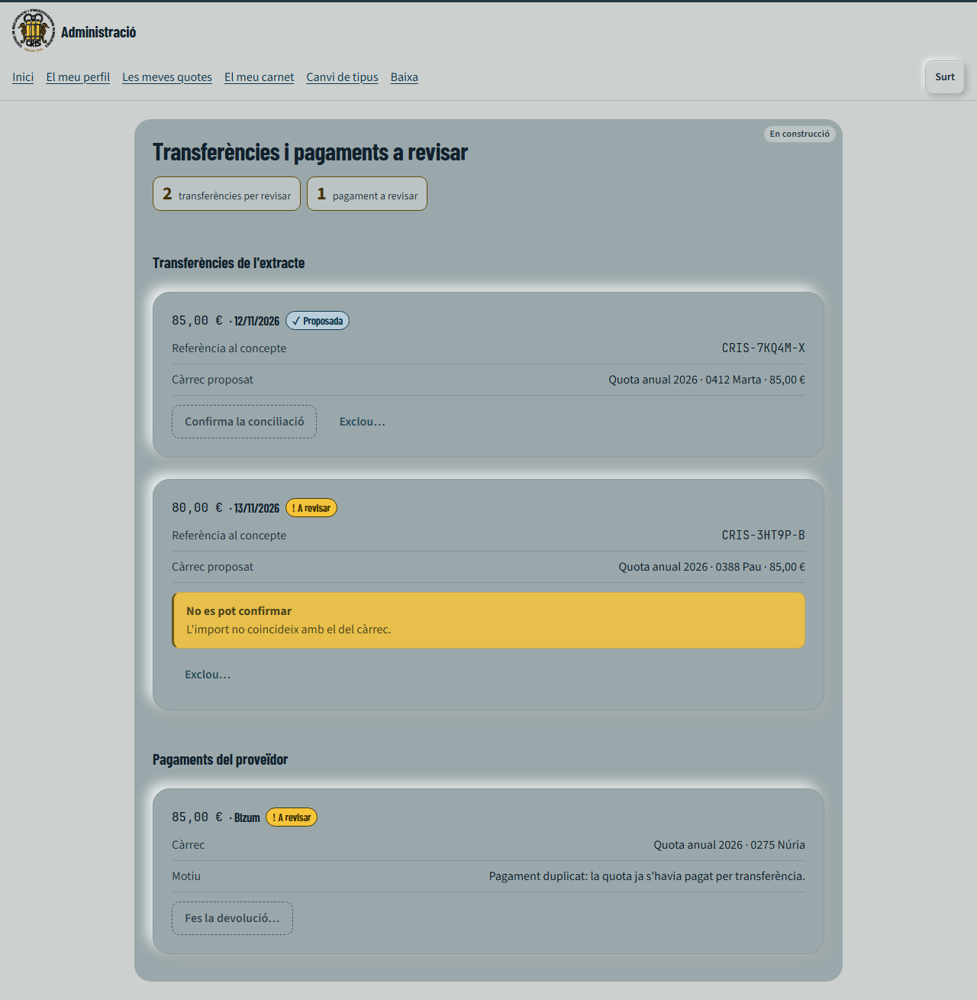

# T-DX-22 · Deposito: transferències i pagaments a revisar (en construcció)

| Data i hora (Europa/Madrid) | Commit | Proves | CI |
|---|---|---|---|
| 16/11/2026 21:44 | d729d12 | Cap de nova (les comunes la troben sola) | [A comprovar] (PR #104) |

**En tres línies:** hi ha la pantalla «Transferències i pagaments a revisar» en construcció, amb el panell de revisió de Deposito que ja fan servir les altes pendents (§6.17). Cada transferència de l'extracte surt amb el càrrec proposat i «Confirma la conciliació» o «Exclou…» amb motiu; si l'import no coincideix, no es pot confirmar. Cada pagament a revisar diu per què (aquí, un duplicat) i ofereix la devolució. Cap IBAN.

## Què s'ha fet
- `apps/previews/screens/revisar_pagaments.py`: títol i contingut d'exemple (dues transferències i un pagament; socis amb número i nom de pila inventats; referències amb el format de la T-M04-10).
- `templates/previews/revisar_pagaments.html` (administració, `cos-ample`) i `static/css/deposito-revisar.css` (només el bloc i els elements; `deposito.css` no es toca).
- Subsecció [T-DX-22](../design-system.md#t-dx-22-deposito-transferències-i-pagaments-a-revisar) al sistema de disseny i fila a [`estat/DX.md`](../estat/DX.md).

## Decisions i perquè
- **Les classes de §6.17,** no unes de noves: els comptadors en ambre i la fila d'accions ja són el patró de revisió de l'administració.
- **«Exclou…», no «Rebutja…»:** és el nom del pla per a una línia de l'extracte que no es concilia (RN-T15), amb motiu.
- **Cap IBAN ni nom de qui ordena:** de l'extracte només surten l'import, la data i la referència; el càrrec proposat diu el número i el nom de pila del soci.

## Problemes trobats
- L'avís «No es pot confirmar» repetia la frase al títol i al text; ara el text diu només el motiu.

## Com se sap que funciona
- `apps/previews/tests/test_screens.py` (parametritzada): títol i plantilla, etiqueta amb `aria-describedby`, cap `style=`, un POST torna 405 i sense accés respon 404.
- `apps/core/tests/e2e/test_previews.py -k revisar_pagaments`: etiqueta i títol visibles i captures a 1280, 390 i 320 px, en clar i en fosc, mirades.

## Evidències
- «Transferències i pagaments a revisar» a 1280 px: `captures/2026-11-16_2144_T-DX-22_revisar_pagaments-1280.png`

  

  *16/11/2026 21:44 (Europa/Madrid) · local, prova e2e, contingut d'exemple · commit d729d12*
- A 320 px, en fosc: `captures/2026-11-16_2144_T-DX-22_revisar_pagaments-320-fosc.png`

  *16/11/2026 21:44 (Europa/Madrid) · local, prova e2e · commit d729d12*
- Sortida de proves · executada el 16/11/2026 en local (PostgreSQL 16):
  ```
  $ pytest apps/previews apps/core/tests/test_under_construction.py -q
  18 passed
  $ pytest -m e2e apps/core/tests/e2e/test_previews.py -k revisar_pagaments -q
  1 passed, 1 deselected
  ```
