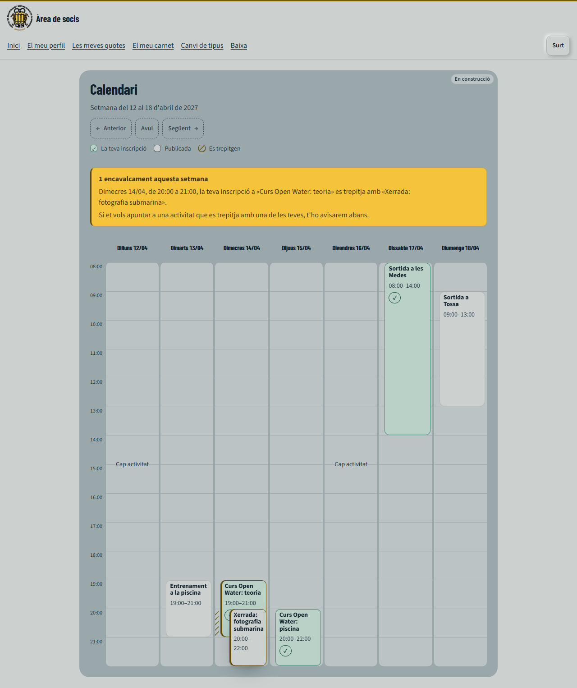

# T-DX-23 · Horario: calendari general (en construcció)

| Data i hora (Europa/Madrid) | Commit | Proves | CI |
|---|---|---|---|
| 16/11/2026 20:01 | 70e89c9 | cap de nova (les comunes la troben sola) | [A comprovar] (PR #80) |

**En tres línies:** hi ha la pantalla «Calendari» de l'àrea del soci, en construcció. Mostra una setmana d'exemple en graella a l'escriptori i com una agenda per dies al mòbil. Les inscripcions porten ✓ i les hores que es trepitgen surten ratllades i explicades en text.

## Què s'ha fet
- `apps/previews/screens/calendari.py` (títol i contingut d'exemple: abril del 2027, sortides a les Medes i a Tossa, el Curs Open Water, un entrenament i una xerrada), `templates/previews/calendari.html` i `static/css/horario.css`.
- Subsecció «T-DX-23 Horario: calendari general» al [sistema de disseny](../design-system.md).

## Decisions i perquè
- **Classes per tram, no `style=`:** l'hora d'inici (`h08`–`h21`) i la durada (`d1`–`d6`) són classes; quan funcioni, el servidor triarà la classe.
- **Graella només a partir de 1024 px i en pantalla ampla (`cos-ample`):** set columnes no hi caben en l'amplada normal de l'àrea del soci; per sota, una agenda per dies, com als calendaris habituals del mòbil.
- **L'encavalcament també en text:** el ratllat és decoratiu (`aria-hidden`); l'avís diu el dia, les hores i les dues activitats, i cada bloc que es trepitja ho diu al lector de pantalla.
- **Inscripció amb el fons d'estat correcte i ✓:** el daurat de la zona es confonia amb l'avís de l'encavalcament.
- **Solape, després:** els xocs entre calendaris del club són a l'administració i tenen la seva tasca.

## Problemes trobats
- A l'amplada normal de l'àrea (28rem) la graella era il·legible; ara la pantalla és ampla.
- Amb files de 48 px, la segona activitat del xoc tapava l'hora de la primera; ara les files són de `--e-8`.

## Com se sap que funciona
- Proves comunes de les pantalles en construcció (`apps/previews/tests/test_screens.py` i `test_under_construction.py`): 18 passades.
- `pytest -m e2e apps/core/tests/e2e/test_previews.py -k calendari`: etiqueta i títol visibles, captures a 1280, 390 i 320 px en clar i en fosc, sense desplaçament lateral. Mirades.

## Evidències
- «Calendari» a 1280 px: `captures/2026-11-16_2001_T-DX-23_calendari-1280.png`

  

  *16/11/2026 20:01 (Europa/Madrid) · local, prova e2e, contingut d'exemple · commit 70e89c9*
- A 320 px, en fosc: `captures/2026-11-16_2001_T-DX-23_calendari-320-fosc.png`

  *16/11/2026 20:01 (Europa/Madrid) · local, prova e2e · commit 70e89c9*
- Sortida de proves · executada el 16/11/2026 en local (PostgreSQL 16):
  ```
  $ pytest apps/previews apps/core/tests/test_under_construction.py -q
  18 passed
  $ pytest -m e2e apps/core/tests/e2e/test_previews.py -k calendari -q
  1 passed
  ```
