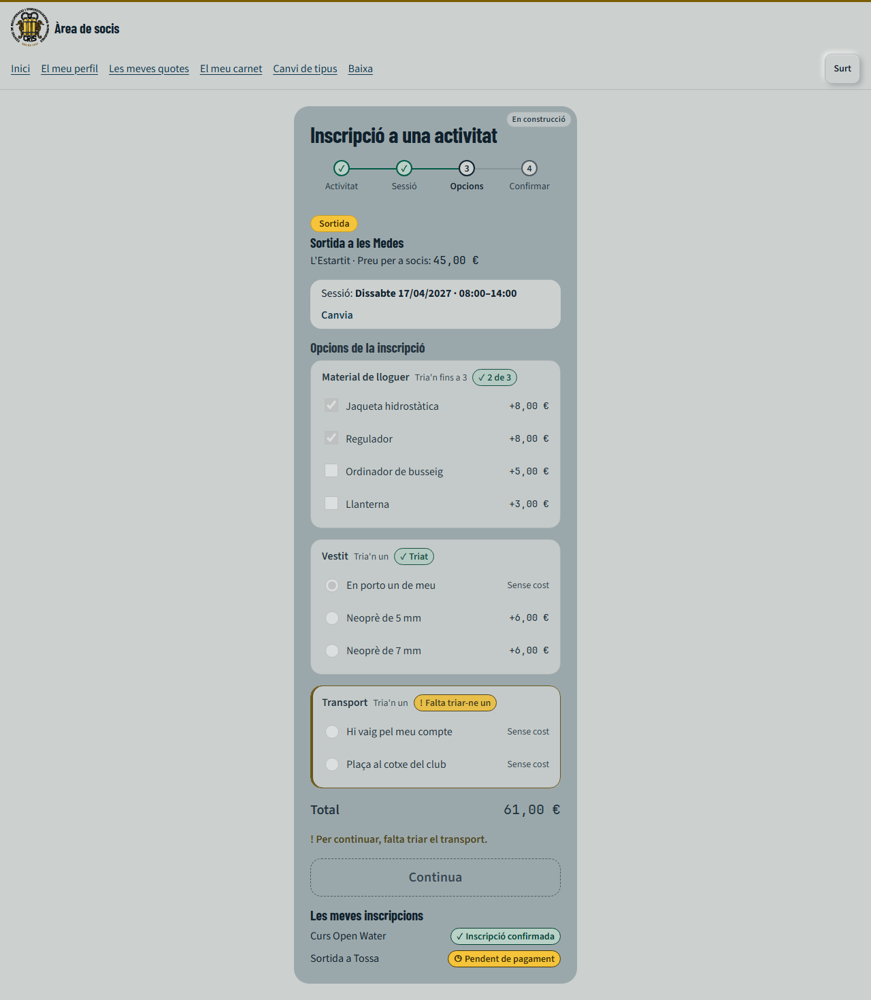

# T-DX-24 · Camilla i Comanda: inscripció a una activitat (en construcció)

| Data i hora (Europa/Madrid) | Commit | Proves | CI |
|---|---|---|---|
| 16/11/2026 20:13 | f886431 | 1 nova (cap dada de salut) | [A comprovar] (PR #83) |

**En tres línies:** hi ha la pantalla «Inscripció a una activitat» de l'àrea del soci, en construcció. Camilla posa els passos (activitat, sessió, opcions, confirmar) i Comanda, les opcions de cada activitat amb la seva regla i un botó que no s'encén fins que tot val. Del recurs Camilla, que és una clínica, no queda res de salut.

## Què s'ha fet
- `apps/previews/screens/inscripcio.py` (la Sortida a les Medes al pas 3, tres sessions, tres grups d'opcions i dues inscripcions pròpies, tot d'exemple), `templates/previews/inscripcio.html`, `static/css/camilla.css` i `static/css/comanda.css`.
- `apps/previews/tests/test_inscripcio.py`: la pantalla no mostra cap paraula de salut.
- Subsecció «T-DX-24 Camilla i Comanda: inscripció a una activitat» al [sistema de disseny](../design-system.md).

## Decisions i perquè
- **P-94, resposta A:** Camilla és el flux i Comanda les opcions, com va decidir el propietari.
- **Els passos amb la línia de Tramite (§6.13):** ja existeix i és la mateixa idea; només es passa a quatre columnes.
- **El botó que espera diu per què:** `aria-disabled` i el motiu en text («falta triar el transport»), lligat amb `aria-describedby`; el color sol no ho explicaria.
- **Les sessions completes, apagades i amb el text «Completa»:** mai només el color.
- **Sense pas de dades per al soci:** ja se sap qui és; el convidat (decisió 021) en tindrà un amb les mínimes.

## Problemes trobats
- La llegenda de cada grup quedava damunt de la vora del `fieldset`; ara va dins.

## Com se sap que funciona
- Proves comunes de les pantalles en construcció i la nova de salut: 19 passades.
- `pytest -m e2e apps/core/tests/e2e/test_previews.py -k inscripcio`: etiqueta i títol visibles, captures a 1280, 390 i 320 px en clar i en fosc, sense desplaçament lateral. Mirades.

## Evidències
- «Inscripció a una activitat» a 1280 px: `captures/2026-11-16_2013_T-DX-24_inscripcio-1280.png`

  

  *16/11/2026 20:13 (Europa/Madrid) · local, prova e2e, contingut d'exemple · commit f886431*
- A 320 px, en fosc: `captures/2026-11-16_2013_T-DX-24_inscripcio-320-fosc.png`

  *16/11/2026 20:13 (Europa/Madrid) · local, prova e2e · commit f886431*
- Sortida de proves · executada el 16/11/2026 en local (PostgreSQL 16):
  ```
  $ pytest apps/previews apps/core/tests/test_under_construction.py -q
  19 passed
  $ pytest -m e2e apps/core/tests/e2e/test_previews.py -k inscripcio -q
  1 passed
  ```
