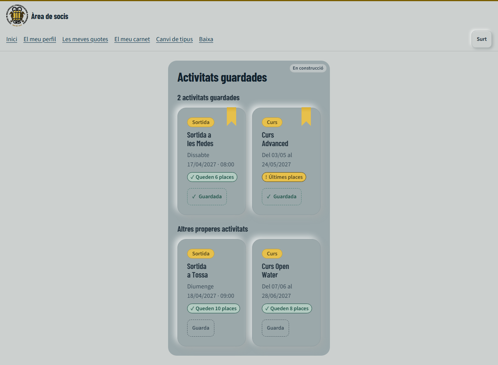

# T-DX-25 · Marcador: activitats guardades (en construcció)

| Data i hora (Europa/Madrid) | Commit | Proves | CI |
|---|---|---|---|
| 16/11/2026 20:20 | 248e34e | cap de nova (les comunes la troben sola) | [A comprovar] (PR #87) |

**En tres línies:** hi ha la pantalla «Activitats guardades» de l'àrea del soci, en construcció. Cada activitat és una targeta amb el botó «Guarda» i, a les guardades, la cinta de punt de llibre que cau del cantell. La cinta cau una sola vegada en aparèixer, només amb CSS.

## Què s'ha fet
- `apps/previews/screens/guardades.py` (dues activitats guardades i dues per guardar, d'exemple), `templates/previews/guardades.html`, `templates/previews/_marcador_targeta.html` i `static/css/marcador.css`.
- Subsecció «T-DX-25 Marcador: activitats guardades» al [sistema de disseny](../design-system.md).

## Decisions i perquè
- **La cinta sense física ni JavaScript:** el recurs simula una cadena en un llenç; aquí és una forma amb `clip-path` que cau amb la molla de `tokens.css` (B5), una sola vegada (D20).
- **Botó amb `aria-pressed`:** és un interruptor (guardada o no); el títol de l'activitat va amagat dins del botó perquè el lector de pantalla sàpiga quina es guarda.
- **El degradat de la cinta amb `--c-accent-premut`:** la primera versió enfosquia l'accent amb un color escrit a mà.

## Problemes trobats
- Cap de rellevant.

## Com se sap que funciona
- Proves comunes de les pantalles en construcció: 18 passades.
- `pytest -m e2e apps/core/tests/e2e/test_previews.py -k guardades`: etiqueta i títol visibles, captures a 1280, 390 i 320 px en clar i en fosc, sense desplaçament lateral. Mirades.

## Evidències
- «Activitats guardades» a 1280 px: `captures/2026-11-16_2020_T-DX-25_guardades-1280.png`

  

  *16/11/2026 20:20 (Europa/Madrid) · local, prova e2e, contingut d'exemple · commit 248e34e*
- A 320 px, en fosc: `captures/2026-11-16_2020_T-DX-25_guardades-320-fosc.png`

  *16/11/2026 20:20 (Europa/Madrid) · local, prova e2e · commit 248e34e*
- Sortida de proves · executada el 16/11/2026 en local (PostgreSQL 16):
  ```
  $ pytest apps/previews apps/core/tests/test_under_construction.py -q
  18 passed
  $ pytest -m e2e apps/core/tests/e2e/test_previews.py -k guardades -q
  1 passed
  ```
