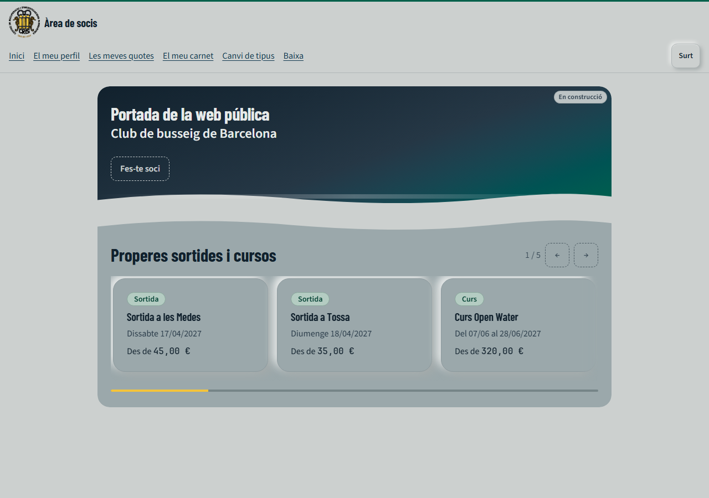

# T-DX-26 · Desfile i Oleaje: portada de la web pública (en construcció)

| Data i hora (Europa/Madrid) | Commit | Proves | CI |
|---|---|---|---|
| 16/11/2026 21:26 | 9a17659 | cap de nova (les comunes la troben sola) | [A comprovar] (PR #94) |

**En tres línies:** hi ha la pantalla «Portada de la web pública», en construcció. A dalt, la capçalera amb l'ona d'Oleaje i «Fes-te soci»; a sota, el carril de Desfile amb les properes sortides i cursos, el comptador, les fletxes i la barra de progrés. Sense avanç automàtic.

## Què s'ha fet
- `apps/previews/screens/portada_publica.py` (cinc activitats d'exemple), `templates/previews/portada_publica.html` i `static/css/desfile.css`.
- Subsecció «T-DX-26 Desfile i Oleaje: portada de la web pública» al [sistema de disseny](../design-system.md).

## Decisions i perquè
- **Oleaje reutilitzat, no copiat:** la plantilla fa servir les classes d'`oleaje.css` (§6.18), que la base ja carrega.
- **Sense avanç automàtic:** D20 i el pla dels recursos externs (§5); per això no hi ha botó Pausa.
- **El carril amb el desplaçament del navegador (`scroll-snap`):** funciona sense JavaScript i amb el teclat; el comptador i el progrés, quan funcioni, sortiran de la posició real.
- **Sense fotos:** les del club necessiten consentiment (P-41).
- **Zona pública dins de la sessió:** les pantalles en construcció demanen sessió; la portada de debò serà pública.

## Problemes trobats
- «Fes-te soci», desactivat, no es llegia sobre el degradat; ara pren el color del text de la capçalera.
- La barra de progrés no mostrava el tram fet a Chromium; ara té els seus pseudoelements.
- A 320 px, les targetes eixamplaven la graella de la pàgina i tallaven els títols; ara la columna és `minmax(0, 1fr)`.

## Com se sap que funciona
- Proves comunes de les pantalles en construcció: 18 passades.
- `pytest -m e2e apps/core/tests/e2e/test_previews.py -k portada`: etiqueta i títol visibles, captures a 1280, 390 i 320 px en clar i en fosc, sense desplaçament lateral. Mirades.

## Evidències
- «Portada de la web pública» a 1280 px: `captures/2026-11-16_2126_T-DX-26_portada_publica-1280.png`

  

  *16/11/2026 21:26 (Europa/Madrid) · local, prova e2e, contingut d'exemple · commit 9a17659*
- A 320 px, en fosc: `captures/2026-11-16_2126_T-DX-26_portada_publica-320-fosc.png`

  *16/11/2026 21:26 (Europa/Madrid) · local, prova e2e · commit 9a17659*
- Sortida de proves · executada el 16/11/2026 en local (PostgreSQL 16):
  ```
  $ pytest apps/previews apps/core/tests/test_under_construction.py -q
  18 passed
  $ pytest -m e2e apps/core/tests/e2e/test_previews.py -k portada -q
  1 passed
  ```
