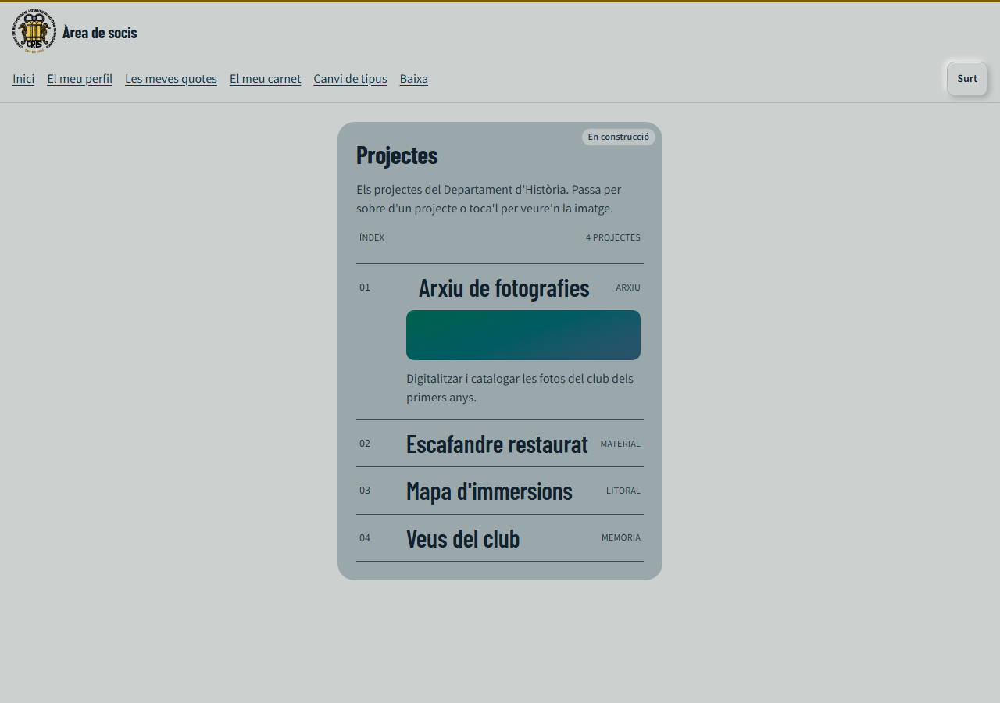

# T-DX-27 · Vistazo: projectes (en construcció)

| Data i hora (Europa/Madrid) | Commit | Proves | CI |
|---|---|---|---|
| 16/11/2026 19:58 | 9cb8795 | cap de nova (les comunes la troben sola) | [A comprovar] (PR #79) |

**En tres línies:** hi ha la pantalla «Projectes» del Departament d'Història, en construcció, a l'àrea del soci. És l'índex del recurs Vistazo: files grans amb número, nom i tipus, les altres que s'apaguen i una finestra amb la imatge en passar-hi per sobre. En lloc de fotos, degradats decoratius amb els tokens, i cap línia de JavaScript.

## Què s'ha fet
- `apps/previews/screens/projectes.py`: el títol i quatre projectes d'exemple, inventats.
- `templates/previews/projectes.html`: un `details` per projecte dins d'una llista ordenada; obert, la imatge i la nota.
- `static/css/vistazo.css`: la fila, la finestra (de tauleta amunt, en passar-hi per sobre o amb el focus) i la imatge de la fila oberta. Detall: [design-system, T-DX-27](../design-system.md#t-dx-27-vistazo-projectes).

## Decisions i perquè
- **Sense fotos:** les del recurs són de la demostració (D11) i les del club demanaran consentiment (P-41). La finestra és un degradat en OKLCH dels tokens d'estat (C7).
- **Sense JavaScript:** la finestra no segueix el cursor ni s'inclina amb la velocitat; apareix al seu lloc amb el rebot de `--m-corba-molla`. Al mòbil, com al recurs, el primer toc mostra la imatge (la fila s'obre).
- **A l'àrea del soci:** el brief del carril només preveu la base del soci i la de l'administració; la pàgina pública de projectes (07) en farà servir la mateixa peça.

## Problemes trobats
- A l'escriptori, la finestra de la fila oberta tapava la nota; ara la fila oberta mostra la imatge a sota i la finestra només surt en passar-hi per sobre.

## Com se sap que funciona
- `apps/previews/tests/test_screens.py` (títol i plantilla, etiqueta, cap `style=`, només GET, 404 sense accés, a l'índex) i la prova comuna de només lectura: 18 passades.
- `apps/core/tests/e2e/test_previews.py -k projectes`: etiqueta i títol visibles, captures a 1280, 390 i 320 px en clar i en fosc, sense desplaçament lateral. Captures mirades.

## Evidències
- «Projectes» a 1280 px: `captures/2026-11-16_1958_T-DX-27_projectes-1280.png`

  

  *16/11/2026 19:58 (Europa/Madrid) · local, prova e2e, contingut d'exemple · commit 9cb8795*
- A 320 px, en fosc: `captures/2026-11-16_1958_T-DX-27_projectes-320-fosc.png`

  *16/11/2026 19:58 (Europa/Madrid) · local, prova e2e · commit 9cb8795*
- Sortida de proves · executada el 16/11/2026 en local (PostgreSQL 16):
  ```
  $ pytest apps/previews apps/core/tests/test_under_construction.py -q
  18 passed
  $ pytest -m e2e apps/core/tests/e2e/test_previews.py -k projectes -q
  1 passed, 1 deselected
  ```
