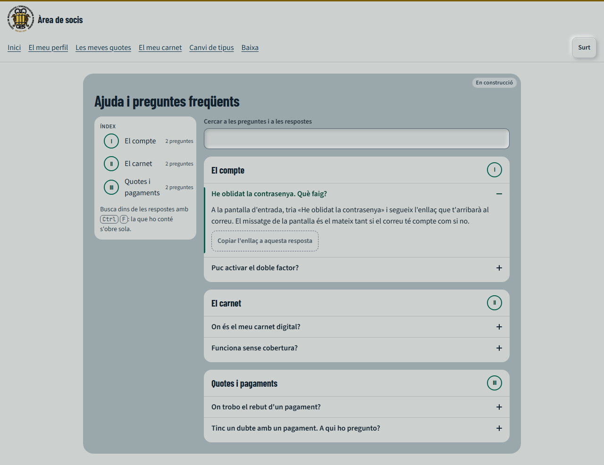

# T-DX-28 · Recoveco: ajuda i preguntes freqüents (en construcció)

| Data i hora (Europa/Madrid) | Commit | Proves | CI |
|---|---|---|---|
| 16/11/2026 20:13 | 838a16a | cap de nova (les comunes la troben sola) | [A comprovar] (PR #82) |

**En tres línies:** hi ha la pantalla «Ajuda i preguntes freqüents», en construcció, a l'àrea del soci. Del recurs Recoveco té l'índex de temes amb el número romà i el comptador, les preguntes plegades per tema (obrir-ne una tanca l'anterior) i la cerca del navegador, que obre sola la resposta que conté el text. No porta JavaScript: ho fa l'HTML.

## Què s'ha fet
- `apps/previews/screens/ajuda.py`: el títol i tres temes amb dues preguntes d'exemple cadascun.
- `templates/previews/ajuda.html`: l'índex (`nav`), la cerca pròpia desactivada i un `details name="<tema>"` per pregunta.
- `static/css/recoveco.css`: índex, temes, preguntes amb la ratlla marina i el «+» que es torna «−»; a l'escriptori, l'índex a l'esquerra i fix. Detall: [design-system, T-DX-28](../design-system.md#t-dx-28-recoveco-ajuda-i-preguntes-freqüents).

## Decisions i perquè
- **`details name` en lloc del JavaScript del recurs:** el navegador ja tanca la pregunta anterior del mateix grup i obre la que conté el text que es busca amb Ctrl+F.
- **Ctrl+F, no ⌘F:** és la drecera que es mostra (B19; al Mac, ⌘F, conflicte resolt al pla dels recursos).
- **Respostes d'exemple prudents:** cap no diu una regla del club com si fos real, i la de la contrasenya recorda que la pantalla no revela si un correu té compte.
- **Amplada `cos-ample`:** amb l'índex al costat, l'amplada estreta de l'àrea del soci no hi cabia (com «Les meves quotes»).

## Problemes trobats
- A 390 px el títol passava per sota de l'etiqueta «En construcció»; ara el títol baixa un espai.
- El paràgraf de la drecera quedava enganxat a la llista: la regla de `.cos-compte p` guanyava la de la peça.

## Com se sap que funciona
- `apps/previews/tests/test_screens.py` (títol i plantilla, etiqueta, cap `style=`, només GET, 404 sense accés, a l'índex) i la prova comuna de només lectura: 18 passades.
- `apps/core/tests/e2e/test_previews.py -k ajuda`: etiqueta i títol visibles, captures a 1280, 390 i 320 px en clar i en fosc, sense desplaçament lateral. Captures mirades.

## Evidències
- «Ajuda i preguntes freqüents» a 1280 px: `captures/2026-11-16_2013_T-DX-28_ajuda-1280.png`

  

  *16/11/2026 20:13 (Europa/Madrid) · local, prova e2e, contingut d'exemple · commit 838a16a*
- A 320 px, en fosc: `captures/2026-11-16_2013_T-DX-28_ajuda-320-fosc.png`

  *16/11/2026 20:13 (Europa/Madrid) · local, prova e2e · commit 838a16a*
- Sortida de proves · executada el 16/11/2026 en local (PostgreSQL 16):
  ```
  $ pytest apps/previews apps/core/tests/test_under_construction.py -q
  18 passed
  $ pytest -m e2e apps/core/tests/e2e/test_previews.py -k ajuda -q
  1 passed, 1 deselected
  ```
