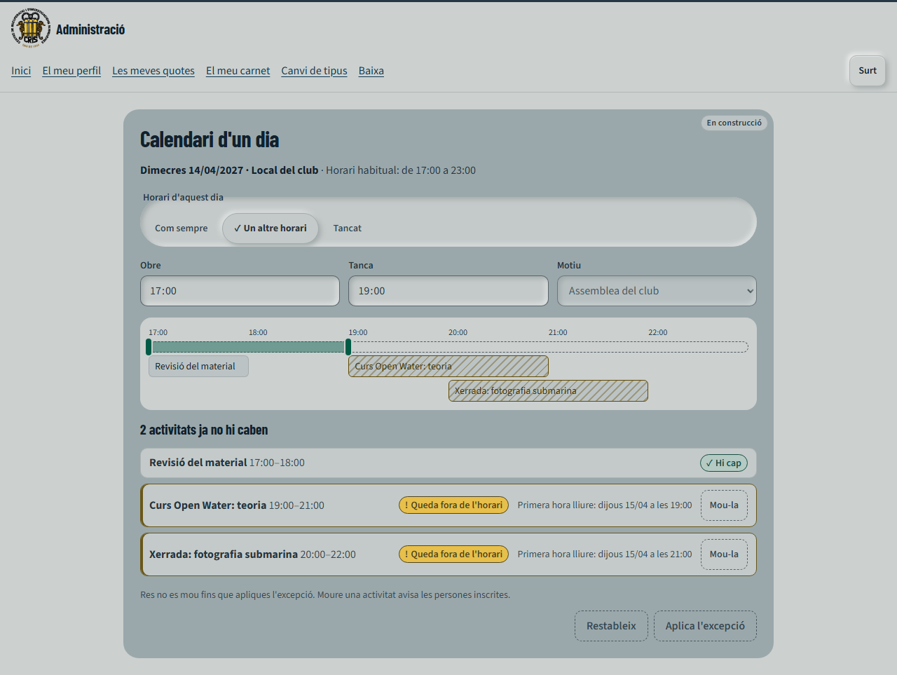

# T-DX-29 · Asueto: calendari d'un dia (en construcció)

| Data i hora (Europa/Madrid) | Commit | Proves | CI |
|---|---|---|---|
| 16/11/2026 21:31 | ca93730 | cap de nova (les comunes la troben sola) | [A comprovar] (PR #98) |

**En tres línies:** hi ha la pantalla «Calendari d'un dia» de l'administració, en construcció. Un dia d'exemple tanca abans per una assemblea: la línia del dia mostra les nanses i les activitats que en queden fora, ratllades. A sota, la mateixa informació en text, amb la primera hora lliure, «Mou-la» i «Aplica l'excepció».

## Què s'ha fet
- `apps/previews/screens/calendari_dia.py` (el dia, l'horari habitual i tres activitats d'exemple), `templates/previews/calendari_dia.html` (sobre `base_admin.html`) i `static/css/asueto.css`.
- Subsecció «T-DX-29 Asueto: calendari d'un dia» al [sistema de disseny](../design-system.md).

## Decisions i perquè
- **La línia del dia és decorativa (`aria-hidden`) i la llista ho diu tot:** les barres d'una hora no tenen lloc per al text al mòbil; la llista porta l'estat, l'hora lliure i l'acció.
- **El mateix ratllat que Horario (T-DX-23):** «fora de l'horari» i «es trepitja» són el mateix avís, amb `--c-avis`.
- **Res no es mou fins a «Aplica»:** com diu el pla dels recursos externs; ho recorda una nota, amb l'avís als inscrits.
- **Sense arrossegar les nanses:** demanaria JavaScript; les hores també s'escriuen als camps.

## Problemes trobats
- Cap de rellevant.

## Com se sap que funciona
- Proves comunes de les pantalles en construcció: 18 passades.
- `pytest -m e2e apps/core/tests/e2e/test_previews.py -k calendari_dia`: etiqueta i títol visibles, captures a 1280, 390 i 320 px en clar i en fosc, sense desplaçament lateral. Mirades.

## Evidències
- «Calendari d'un dia» a 1280 px: `captures/2026-11-16_2131_T-DX-29_calendari_dia-1280.png`

  

  *16/11/2026 21:31 (Europa/Madrid) · local, prova e2e, contingut d'exemple · commit ca93730*
- A 320 px, en fosc: `captures/2026-11-16_2131_T-DX-29_calendari_dia-320-fosc.png`

  *16/11/2026 21:31 (Europa/Madrid) · local, prova e2e · commit ca93730*
- Sortida de proves · executada el 16/11/2026 en local (PostgreSQL 16):
  ```
  $ pytest apps/previews apps/core/tests/test_under_construction.py -q
  18 passed
  $ pytest -m e2e apps/core/tests/e2e/test_previews.py -k calendari_dia -q
  1 passed
  ```
