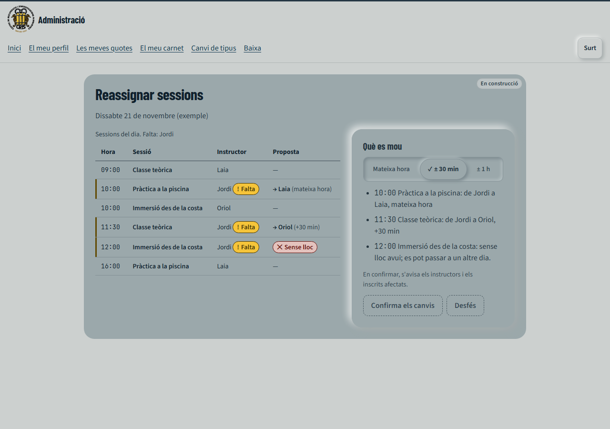

# T-DX-30 · Reasigna: reassignar sessions (en construcció)

| Data i hora (Europa/Madrid) | Commit | Proves | CI |
|---|---|---|---|
| 16/11/2026 21:20 | 146b4de | Cap de nova (les comunes la troben sola) | [A comprovar] (PR #88) |

**En tres línies:** hi ha la pantalla «Reassignar sessions» en construcció: l'agenda d'un dia amb les sessions de l'instructor que falta marcades i, per a cada una, la proposta («→ qui» o «sense lloc»). Al costat, el marge d'hora, la llista del que es mou en frases i «Confirma els canvis», desactivats. El mòdul 02 és aparcat (D6): només és el disseny.

## Què s'ha fet
- `apps/previews/screens/reassignar.py`: títol i contingut d'exemple (un dia, tres instructors amb nom de pila inventat, sis sessions).
- `templates/previews/reassignar.html` (administració, `cos-ample`) i `static/css/reasigna.css`.
- Subsecció [T-DX-30](../design-system.md#t-dx-30-reasigna-reassignar-sessions) al sistema de disseny i fila a [`estat/DX.md`](../estat/DX.md).

## Decisions i perquè
- **L'agenda és una `taula`** en lloc de les columnes per persona del recurs: al mòbil s'apila i les sessions afectades es reconeixen per la vora ambre i «! Falta» en text.
- **Sense el vol de les cites:** seria moviment sense funció (D6 de la taula D) i, a més, la proposta la calcularà el servidor.
- **El marge d'hora amb el `segmentat`**, el component que ja existeix per triar una opció.

## Problemes trobats
- La targeta «Què es mou» perdia el farciment perquè és un `fieldset` dins d'un `formulari`; ara el porta la pantalla.
- Al mòbil, la proposta i el marge se separaven als dos extrems de la fila; ara van junts.

## Com se sap que funciona
- `apps/previews/tests/test_screens.py` (parametritzada): títol i plantilla, etiqueta amb `aria-describedby`, cap `style=`, un POST torna 405 i sense accés respon 404.
- `apps/core/tests/e2e/test_previews.py -k reassignar`: etiqueta i títol visibles i captures a 1280, 390 i 320 px, en clar i en fosc, mirades.

## Evidències
- «Reassignar sessions» a 1280 px: `captures/2026-11-16_2120_T-DX-30_reassignar-1280.png`

  

  *16/11/2026 21:20 (Europa/Madrid) · local, prova e2e, contingut d'exemple · commit 146b4de*
- A 320 px, en fosc: `captures/2026-11-16_2120_T-DX-30_reassignar-320-fosc.png`

  *16/11/2026 21:20 (Europa/Madrid) · local, prova e2e · commit 146b4de*
- Sortida de proves · executada el 16/11/2026 en local (PostgreSQL 16):
  ```
  $ pytest apps/previews apps/core/tests/test_under_construction.py -q
  18 passed
  $ pytest -m e2e apps/core/tests/e2e/test_previews.py -k reassignar -q
  1 passed, 1 deselected
  ```
