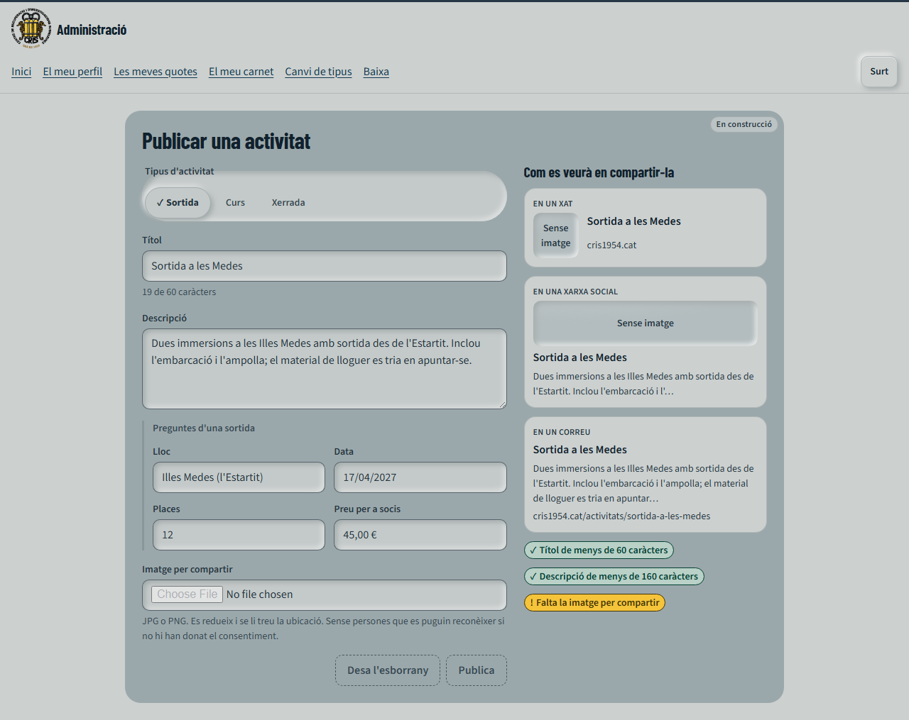

# T-DX-31 · Averia i Pregon: publicar una activitat (en construcció)

| Data i hora (Europa/Madrid) | Commit | Proves | CI |
|---|---|---|---|
| 16/11/2026 21:37 | c96c3e4 | cap de nova (les comunes la troben sola) | [A comprovar] (PR #101) |

**En tres línies:** hi ha la pantalla «Publicar una activitat» de l'administració, en construcció. A l'esquerra, el formulari amb les preguntes del tipus triat i la imatge (Averia); a la dreta, com es veurà en un xat, una xarxa social i un correu, amb les comprovacions (Pregon). La Sortida a les Medes d'exemple encara no té imatge, i ho diu.

## Què s'ha fet
- `apps/previews/screens/publicar_activitat.py`, `templates/previews/publicar_activitat.html` (sobre `base_admin.html`), `static/css/averia-publicar.css` i `static/css/pregon-publicar.css`.
- Subsecció «T-DX-31 Averia i Pregon: publicar una activitat» al [sistema de disseny](../design-system.md).

## Decisions i perquè
- **De cada recurs, només el que serveix per publicar:** d'Averia, les preguntes segons el tipus i la imatge; els equips, les franges i el folio són de les avaries del material (T-DX-32).
- **Les preguntes del tipus agrupades amb una vora, no amb una caixa (D15).**
- **La imatge, a les targetes, amb `caixa-imatge`:** encara no n'hi ha cap, i la comprovació ho avisa.
- **EXIF i etiquetes `meta` al servidor:** el pla dels recursos externs ho demana encara que el navegador redueixi la foto.

## Problemes trobats
- El botó natiu del camp de fitxer surt en anglès al Chromium de les proves («Choose File»); és el text del navegador, no de la plataforma.

## Com se sap que funciona
- Proves comunes de les pantalles en construcció: 18 passades.
- `pytest -m e2e apps/core/tests/e2e/test_previews.py -k publicar`: etiqueta i títol visibles, captures a 1280, 390 i 320 px en clar i en fosc, sense desplaçament lateral. Mirades.

## Evidències
- «Publicar una activitat» a 1280 px: `captures/2026-11-16_2137_T-DX-31_publicar_activitat-1280.png`

  

  *16/11/2026 21:37 (Europa/Madrid) · local, prova e2e, contingut d'exemple · commit c96c3e4*
- A 320 px, en fosc: `captures/2026-11-16_2137_T-DX-31_publicar_activitat-320-fosc.png`

  *16/11/2026 21:37 (Europa/Madrid) · local, prova e2e · commit c96c3e4*
- Sortida de proves · executada el 16/11/2026 en local (PostgreSQL 16):
  ```
  $ pytest apps/previews apps/core/tests/test_under_construction.py -q
  18 passed
  $ pytest -m e2e apps/core/tests/e2e/test_previews.py -k publicar -q
  1 passed
  ```
